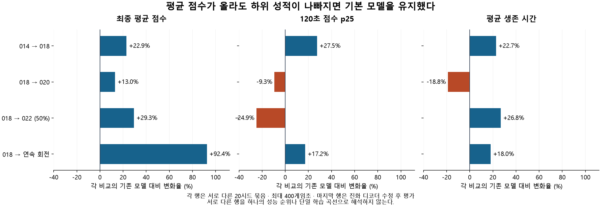

# 조준을 분리해 학습하고, 실제 게임 점수로 후보를 걸러낸 과정

`gpt_training*/` 전체 작업 회고 · 기록 기준일 2026-11-01 · 시간 표기는 한국 표준시(KST)

이 문서는 `gpt_training/`의 22개와 `gpt_training_rotation_continuous/`의 5개, **총 27개 실험 기록**을 연결한다. 당시에 남긴 연구 노트, 실행 manifest, 평가 JSONL, 원시 에피소드, 후보 선택 기록, 소스 사본을 대조했다. 이번 보고서 작성에서는 새 학습이나 게임 평가를 실행하지 않았다.

**먼저 확인할 내용**

- 처음의 모방학습 실험은 별도 계보다. 사용자의 순수 강화학습 요청 이후 무작위 초기화로 다시 시작했고, 혼합 정책 가중치를 이어받지 않았다. 현재 두 최종 모델은 순수 PPO 계보다.
- 가장 큰 전환은 CNN 추가 하나가 아니라 **조준 신경망을 장면·이동 신경망에서 분리하고, 학습 대상을 번갈아 동결한 것**이었다. 다만 여러 변경이 함께 이루어졌으므로 하나의 기법만의 인과 효과를 증명한 실험은 아니다.
- 이산 행동 기본 모델은 **018**이다. 후속 020·022는 평균 점수가 올라가도 초반 하위 성적이 나빠져 교체하지 않았다. 연속 회전 후보는 수정 후 새 20시드에서 평균 점수 **1,508 → 2,902점**을 기록했다.
- 연속 회전 연구에는 진화 명령 누락 버그와 프로세스 제한 위반이 있었다. 수정 전 수치를 최종 성과로 쓰지 않고 별도의 새 시드로 재평가했다. 이 결함이 학습 과정에 미친 한계도 아래에 남겼다.

## 읽는 순서

1. [전체 흐름과 현재 모델](#overview): 계보와 결론을 먼저 본다.
2. [실험별 판단 과정](#history): 문제·변경·관측·다음 결정을 시간순으로 본다.
3. [설계·보상·평가의 변경](#settings): 어떤 숫자와 코드가 달라졌는지 본다.
4. [실제 작업과 검증·오류 처리](#execution): 실행·보존·재평가 과정을 확인한다.
5. [상세 설정 원장](#ledger): 실험별 접힌 항목을 열어 실제 설정과 평가 지점을 확인한다.

정밀 수치와 전체 설정은 [evidence.json](evidence.json)에 있다. 실험명 앞의 **D**는 `gpt_training/`, **R**은 `gpt_training_rotation_continuous/`를 뜻하는 이 보고서의 구분 표기다. 원래 폴더명은 바꾸지 않았다. 표의 **판정**은 당시 문서·선택 기록에 근거하며, 새로 추가한 평가는 ‘회고 판단’으로 표시한다.

<a id="overview"></a>
## 1. 전체 흐름과 현재 모델

### 순서대로 이어 학습한 하나의 모델이 아니다

```text
초기 혼합 계보 D001 → 모방 체크포인트에서 D002 / D003 분기 → 보존

순수 PPO 계보 A: 무작위 초기화 → D004 → D005 → 낮은 실전 성능 확인

순수 PPO 계보 B: 새 무작위 초기화 → D006
  D006 best ├─ D007 / D008: 실전 회귀, 다음 부모로 사용하지 않음
            └─ D009 best → D010 final → D011 final
                 → D012 best → D013 best → D014 best
                      ├─ D015: 회귀, 미채택
                      ├─ D016 마지막 가중치 → D018: 행동 주기만 보정 → 이산 기본 모델
                      └─ D017: 회귀, 미채택
  D018 → D019 마지막 후보 ├─ D020: 새 시드 안정성 기준 실패
                         └─ D021: 회귀, 미채택
  D018 + D020 → D022 가중치 평균: 새 시드 초반 p25 실패, 기본 모델 유지

연속 회전 계보: D018에서 필요한 가중치 이전 → R001
  R001 ├─ R002: 전체 동시 적응 후 중단
       └─ R003 ├─ R004: 연장했으나 부모보다 낮아 미채택
               └─ R005 중간 체크포인트 선택 → 진화 디코더 수정 → 새 20시드 재평가
```

`best.zip`은 그 실행 안의 개발 평가 규칙으로 고른 파일이다. 다음 실험이 `final.zip`이나 특정 `evaluated_*.zip`에서 시작한 경우도 있다. **실험 번호·최신 파일·최대 학습량이 최종 선택을 의미하지 않는다.** 계보의 부모 경로와 해시는 상세 원장에서 확인할 수 있다.

### 보존된 두 최종 경로

| 용도 | 현재 파일 | 정책·결정 주기 | 학습량을 읽는 방법 |
|---|---|---|---|
| 이산 행동 기본 재생 | [pure_ppo_model.zip](../gpt_training/pure_ppo_model.zip) | D018, 이동·회전·발사·성장 이산, 2프레임/결정 | 체크포인트 누적 1,474,560스텝. D018 포장 과정의 PPO 업데이트는 0 |
| 연속 회전 실험 재생 | [selected_model.zip](../gpt_training_rotation_continuous/selected_model.zip) | R005 중간 후보, 회전 연속·나머지 이산, 2프레임/결정 | 새 행동 계보 1,200,000스텝. 분기 전체 연구 비용은 2,000,000스텝 |

두 파일의 SHA256은 각각 `657c380f…38cf08e`, `205b19d9…63a8bea`다. 전체 해시는 [이산 모델 카드](../gpt_training/pure_ppo_model.json), [연속 회전 모델 카드](../gpt_training_rotation_continuous/selected_model.json), `evidence.json`에 있다. 연속 후보를 선택하면서 기존 이산 기본 파일을 교체하지 않았다. 서로 다른 행동 공간이므로 재생 진입점도 다르다.

### 평균 증가와 채택은 다르다



각 행의 두 모델은 같은 시드로 비교했지만 **행마다 시드 묶음은 다르다.** 행 사이의 절대 점수를 연결해 하나의 성능 상승 곡선으로 읽으면 안 된다. 그림의 p25는 점수의 25백분위 경계로, 하위 25% 점수의 평균이 아니다.

| 당시 최종 비교 | 시드·행동 주기 | 최종 평균 점수 | 120초 점수 p25 | 평균 생존 | 당시 결정 |
|---|---|---:|---:|---:|---|
| [D014](#d014) → D018 | 새 20개, 4 → 2프레임 | 1,167 → 1,434.5 | 618.75 → 788.75 | 160.69 → 197.18초 | 당시 목표 네 개 통과, D018 공개 |
| [D018](#d018) → D020 | 새 20개, 양쪽 2프레임 | 1,561.25 → 1,764.75 | 736.25 → 667.50 | 240.23 → 195.09초 | 초반 p25·생존 실패, 교체 안 함 |
| [D018](#d018) → D022 50% | 또 다른 새 20개, 양쪽 2프레임 | 1,591.25 → 2,057.75 | 865 → 650 | 185.72 → 235.43초 | 초반 p25 실패, 교체 안 함 |
| [D018](#d018) → 연속 회전 수정 후 | 새 20개, 양쪽 2프레임 | 1,508 → 2,902 | 778.75 → 912.50 | 222.67 → 262.84초 | 수정 후 점 추정 기준 네 개 통과, 별도 후보 보존 |

이 표는 원시 에피소드에서 평균·p25를 다시 계산했다. 근거: [D018 평가](../gpt_training/phase2_heldout_400_seconds.json), [D020 평가](../gpt_training/phase3_heldout_400_seconds.json), [D022 평가](../gpt_training/phase3_blend_heldout_400_seconds.json), 연속 회전 [기준선](../gpt_training_rotation_continuous/corrected_heldout_baseline.json)·[후보](../gpt_training_rotation_continuous/corrected_heldout_candidate.json).

표본의 한계도 함께 읽어야 한다. D018 비교는 최종 점수 10승 10패였으며, 이번 원자료 재계산에서 최종 점수 평균 차이의 95% 구간은 약 -122~+682점으로 0을 포함한다. **당시 점 추정 승격 조건을 통과했다는 사실과 통계적으로 확정된 일반화 개선은 다르다.** 연속 회전의 최종 점수는 14승 6패이며 이번 재계산 구간은 약 +592~+2,277점이다. 생존 차이 구간은 약 -33.60~+112.00초로 0을 포함한다. 평가 게임 시드에 대한 구간이며, 독립 재학습 여러 번의 알고리즘 성능 구간은 아니다.

<a id="history"></a>
## 2. 어떤 문제를 보고 다음 실험을 선택했는가

아래 평균 점수는 명시한 평가의 **실제 게임 점수**다. 연습 환경의 누적 보상과 혼합하지 않았다. D001~005는 3시드, D006~017의 기본 개발 평가는 6시드·200초다. 후반의 4·8·16·20·40시드는 표마다 표시한다. 소수 시드 반복 평가는 후보 선택에 썼으며 최종 독립 평가와 구분한다.

### 2.1 처음에는 모방학습을 사용했고, 요청에 따라 폐기하지 않고 분리 보존했다

초기 계보는 **164차원 전술 관찰·자동 성장 규칙·교사 라벨**을 포함했다. 이 성적을 현재 5139차원·정책 성장 선택의 순수 PPO와 같은 순위표에 넣지 않는다. 이후 순수 PPO 경로는 기존 혼합 가중치를 사용하지 않았다. [당시 전체 기록](../gpt_training/EXPERIMENTS.md)

| 실험 | 당시 질문과 변경 | 실제 관측 | 판정·다음 행동 |
|---|---|---|---|
| [D001](#d001) `imitation_combat` | 큰 행동 공간의 탐색을 교사로 시작하면 유효한 정책이 생기는가? 시연 16,384개·모방 25 epoch, 단순 combat PPO | 같은 3시드·200초에서 모방 직후 3,070점 → PPO 후 2,640점. 추가 PPO 34,048스텝 | PPO 보정이 개선하지 못함. D002는 악화된 final 대신 모방 체크포인트로 돌아감 |
| [D002](#d002) `full_ppo` | 연습·실전 차이를 줄이면 되는가? D001 모방 정책에서 기본 게임 PPO 66,304스텝 | 3,070 → 3,028.33점, 생존 200 → 181.43초 | 시작 모방 정책 유지. 추가 학습을 성공으로 보지 않음 |
| [D003](#d003) `dagger_full` | 정책이 방문한 상태를 교사 라벨로 보강하면 되는가? 교사/정책 50% 혼합 rollout 24,576개, 모방 30 epoch, PPO 16,640스텝 | 개발 3시드에서 모방 후 3,251.67 → PPO 후 3,966.67점. 새 3시드·600초에서는 D001 5,380점 > D003 5,068.33점 | 개발 후보는 D003, 새 시드 일반화 개선은 지지되지 않음. 혼합 계보로 보존 |

‘순수 강화학습’이라는 사용자 조건이 들어온 뒤에는 성적이 더 높았던 혼합 정책을 편의상 이어 쓰지 않았다. 요구 조건을 바꾸는 전환이므로 새 초기화와 데이터 경로 분리가 필요했다.

### 2.2 순수 PPO를 실행하는 것과 게임을 잘하는 것은 달랐다

| 실험 | 당시 질문과 변경 | 실제 관측 | 판정·다음 행동 |
|---|---|---|---|
| [D004](#d004) `pure_ppo_harvest` | 모방 없이 원본 5139관찰·성장 선택까지 PPO가 배우게 함. 무작위 초기화, 적·벽 없는 harvest | 실제 132,608스텝. 기본 게임 개발 점수 무학습 36.67 → final 3.33점 | 순수 PPO 경로는 작동하지만 게임 성능 부족 |
| [D005](#d005) `pure_ppo_full` | 실제 적·벽을 경험하면 되는가? D004 final에서 기본 게임 263,424스텝 | 개발 점수 final 3.33점. 새 3시드·400초에서 선택 후보 36.67점, 최신 final 0점 | 최신 모델 미채택. 안정적 조준·장기 생존 실패를 기록 |

이 단계는 `MultiDiscrete([9,9,2,6,5])`와 원본 관찰을 사용하는 순수 PPO를 검증한 단계다. 교사 데이터가 없다는 사실 자체가 높은 성능의 증거는 아니다. [D004·D005 결과와 부정 결과](../gpt_training/EXPERIMENTS.md)

### 2.3 CNN과 보상을 추가했지만, 쉬운 연습 성적은 실전에 그대로 옮겨지지 않았다

D006은 이전 순수 PPO MLP도 이어받지 않고 **새 무작위 초기화**로 시작했다. 개체 공유 인코더·지형 CNN·포신 기준 좌표를 넣었으며, 입력 정보량은 5139개로 유지했다. [D006~014 당시 가설·중간 기록](../gpt_training/RESEARCH.md)

| 실험 | 당시 문제·핵심 변경 | 기본 게임 개발 점수 | 판정·다음 행동 |
|---|---|---:|---|
| [D006](#d006) `spatial_aim` | 가까운 명중을 자주 경험하도록 1,920×1,440 연습 월드·천체 18개·score_v2, 개체/CNN 인코더 | 최고 168.33점(135,168스텝), final 155점 | best를 다음 부모로 선택. 연습 최근 점수 상승만으로 성공 선언 안 함 |
| [D007](#d007) `spatial_duel` | 이동하지만 발사하지 않는 적 2기·천체 30개·벽 없음 | 부모 168.33 → final 106.67점 | 연습에서는 처치가 생겼지만 기본 게임은 후퇴. 다음은 D006 best로 복귀 |
| [D008](#d008) `full_score_v3` | 기본 게임 직접 학습, 명중·실제 정렬 발사 보상, 피격·사망·탄환 위험 비용 강화 | 168.33 → final 135점 | 202,752스텝에서 중단. 보상 추가만으로 실전 개선 실패 |
| [D009](#d009) `focused_arena` | 발사하는 적 3기·좁은 arena, 최근접 가시 개체, 0출력 초기화의 작은 조준 잔차망 | 최고 188.33점, final 138.33점 | 생존이 짧아 적절한 쉬운 단계로 기능하지 않음. 조준 기술을 전투 전체와 분리하기로 함 |

이때의 중요한 근거는 **연습에서는 점수와 처치가 늘어도 기본 게임 개발 점수는 내려갔다는 불일치**다. 쉬운 환경을 더 오래 돌리는 방향을 계속 밀지 않고, 전이되지 않는 요소를 나누어 진단했다.

### 2.4 조준 입력과 이동 학습을 분리하면서 실전 점수가 올라가기 시작했다

| 실험 | 당시 문제·핵심 변경 | 실제 관측 | 판정·다음 행동 |
|---|---|---|---|
| [D010](#d010) `stationary_range` | 이동·피격·조준을 동시에 배우기 어려움. 몸체·CNN·성장 동결, 한 발 파괴 7HP 정지 표적, 조준 잔차망·critic만 PPO | final은 사격장 1,491.67점이나 기본 게임 134.17점. 개발 최고는 출발 부모 188.33점 | 사격은 학습됐지만 실전 전이는 실패. 다음은 실전 best가 아닌 **사격 기술이 생긴 final** 사용 |
| [D011](#d011) `unified_moving_range` | 적/천체 입력 위치 통일, 가시 개체 선택, 표적 속도 [-3,3] 이동 연습 | 기본 게임 final 71.67점. sampled 재생도 실전 목표에 미달 | 202,752스텝에서 중단. 장면 latent·속도·체력 등 불필요한 입력의 분포 차이를 의심 |
| [D012](#d012) `independent_static` | 조준을 장면 latent에서 독립. 출력층·해당 optimizer 이력 초기화, 무장/기하 입력만 사용, 정지 연습 재학습 | 초기 3.33 → 최고 623.33점(872,448스텝), final 595점 | 이 계열에서 실전 전이가 뚜렷해짐. 최고 후보를 다음 부모로 선택 |
| [D013](#d013) `independent_moving` | 조준 경로에서 개체 체력을 통일하고 체력 강화 입력 제외, 이동 표적 PPO | 같은 가중치의 입력 정리 직후 623.33 → 761.67점. 이후 학습 final 820점 | 입력 변경 효과와 학습 효과를 분리 기록. 생존은 136.01 → 114.58초로 감소 |
| [D014](#d014) `full_body_control` | 익힌 조준 동결, 기본 게임에서 CNN·이동·성장 PPO. 학습률 0.0001·entropy 0.008 | 개발 200초 820 → 1,459.17점. 개발 400초 비교 후 후보 고정 | 새 10시드·400초에서 이전 순수 PPO 11.5 → 1,389점. 선택 모델 공개 |

**D012의 변화는 단순히 층 하나를 더 붙인 것이 아니다.** 연습/실전에서 달라지는 장면 정보가 조준 출력을 흔들지 않도록 입력 책임을 나누고, 기존 이동·성장을 보존한 채 조준만 PPO로 다시 학습했다. 이것이 당시 코드·진단에 기초한 설계 판단이다. 해당 변화와 entropy 변경 등이 동시에 있어 ‘입력 분리 하나만의 효과’라고 확정하지 않는다.

D014의 [독립 10시드 결과](../gpt_training/heldout_400_seconds.json)는 점수 10/10, 생존 9/10 상승이었다. 그러나 8/10은 400초 전에 사망했고, 한 학습 계보의 10개 게임 시드다. 이 성적을 무제한 생존이나 다른 초기화에서도 반복되는 성과로 넓혀 해석하지 않는다.

### 2.5 더 학습했더니 초반 평균만 좋아져, 보상 비중과 행동 주기를 다시 봤다

이 시기부터 ‘최종 평균 점수’ 외에 **120초 평균과 p25**를 별도 목표로 삼았다. 오래 생존해서 점수만 누적된 경우와 빠르게 점수를 얻는 경우를 구분하려는 변경이다. [당시 기록](../gpt_training/RESEARCH_PHASE2.md)

| 실험·진단 | 바꾼 내용 | 당시 근거와 결과 | 판정 |
|---|---|---|---|
| [D015](#d015) `full_early_stability` | D014에서 조준 고정 유지, entropy 0.008 → 0.004, 추가 기본 게임 학습 | 첫 구간 120초 평균 1,237.5 → 1,302.5점이지만 p25 1,090 → 910, 생존 156.93 → 96.58초. 최종 초반 성적도 악화 | 요청 524,288 중 실제 264,192스텝 후 중단, D014 유지 |
| [D015](#d015) 보상 항 분해 | 누적 보상을 항목별로 확인 | 완료 109에피소드 시점, 실제 점수 보상 평균 18.55에 비해 부분 피해+정렬 발사 항 합이 31.23 | 보조 항이 공격적인 부분 피해를 유리하게 만들 가능성을 **다음 가설**로 삼음. 원인으로 확정하지 않음 |
| [D016](#d016) `full_score_focus` | D014에서 score_v6로 보조 양의 보상 축소·피격/사망 비용 확대 | 원래 개발 6시드에서 악화. 이미 관측한 다른 10시드에서는 마지막 후보의 120초 평균·p25가 개선 | 135,168스텝 후 중단했지만 마지막 가중치를 진단 후보로 보존 |
| [D017](#d017) `full_aim_refinement` | D014 몸체·CNN·성장 고정, 기본 게임에서 조준·발사만 미세 조정 | 실제 131,072스텝, 원래 6시드 200초 점수 1,258.33점으로 D014보다 낮음 | 미채택 |
| 행동 주기 진단 | 학습 없이 같은 가중치의 frame_skip 4/2/1/3 비교. 비교 게임 시간은 200초로 동일 | D014의 2프레임은 추가 개발 10시드에서 120초 평균 1,009.5 → 1,294점. 1프레임이 항상 더 좋지는 않음 | 개발 16시드의 여러 가중치·주기 조합을 종합 비교 |
| [D018](#d018) `reaction_calibration` | **D016 마지막 가중치 + 2프레임 결정 주기** 저장. PPO 업데이트 0 | 개발 16시드에서 네 지표 개선, 후보 고정 후 새 20시드에서 당시 목표 통과 | 이산 기본 모델로 공개. 신경망 학습 성과와 재생 주기 효과를 혼동하지 않음 |

중단된 D016을 다시 검토한 것은 실패 기록을 지운 것이 아니다. 한 개발 묶음의 회귀와 다른 묶음의 개선을 모두 남기고, 더 넓은 개발 평가로 후보를 정한 것이다. 실제 최종 판단은 이후 새 시드에서 확인했다. [선택 기록](../gpt_training/phase2_candidate_selection.json), [개발 조합 결과](../gpt_training/phase2_development_comparison.json)

### 2.6 정상 게임에서도 추가 학습이 항상 좋은 것은 아니었다

| 실험 | 당시 질문·변경 | 실제 관측 | 판정 |
|---|---|---|---|
| [D019](#d019) `deployment_cadence` | D018이 4프레임 학습·2프레임 재생이므로, 학습도 2프레임으로 맞추기. 조준 고정, 에피소드 400초, lr 0.00003 | 초기 두 구간 악화 후 세 번째 회복. 실제 202,752스텝. 개발 20시드에서 생존은 증가했지만 초반 p25 하락 | 마지막 후보 보존, 곧바로 기본 모델 교체 안 함 |
| [D020](#d020) `time_discount` | D019에서 gamma를 0.995 → sqrt(0.995)로 조정. score_v7 | 개발 20시드 네 조건 통과. 새 20시드에서는 최종 평균 +13.0%이나 생존 -18.8%, 초반 p25 하락 | 사전 네 조건 중 두 개 실패. D018 유지 |
| [D021](#d021) `cadence_aim_refinement` | D019 몸체·CNN·성장 고정, score_v5로 조준·발사만 2프레임에서 재학습 | 마지막 로컬 4시드 200초 점수 1,176.25점으로 시작 1,963.75보다 낮음 | 미채택. 보조 5시드도 약했고 나머지 15시드 진단은 진행하지 않음 |
| [D022](#d022) `checkpoint_blend` | D018과 D020의 가중치 25/50/75% 평균. 추가 PPO 0, 일치 텐서는 보존, Adam 모멘트 제거 | 개발 8시드에서 50% 선택 → 개발 40시드 네 조건 통과 → 또 다른 새 20시드 최종 평균 +29.3%지만 초반 p25 -24.9% | 실험 후보로 보존하고 D018 기본 유지 |

D020은 gamma 외에도 부모·추가 학습·seed·worker 수가 달라졌다. **gamma 하나의 효과를 분리한 대조 실험이 아니다.** D022도 새 학습 알고리즘의 성공이라기보다 두 PPO 체크포인트를 사후 평균한 후보 검증이다. 최종 시드를 보고 다른 비율을 다시 고르지 않았다. 실패한 첫 최종 시드는 두 번째 단계에서 개발용으로 명시적으로 전환하고, 새 최종 시드를 예약했다. [전체 기록](../gpt_training/RESEARCH_PHASE3.md), [최종 결정](../gpt_training/phase3_final_decision.json)

### 2.7 연속 회전은 200만 스텝을 5개 구간으로 나누고, 조준·몸체를 번갈아 적응시켰다

R001은 D018의 개체/CNN·이동·성장·가치 함수·조준 숨은층을 재사용하되 회전 출력을 연속 분포로 새로 학습했다. 새 무작위 모델 전체를 200만 스텝 학습한 실험과 다르다. 아래 개발 수치는 **진화 디코더 오류 수정 전**의 의사결정 이력이다. 수정 후 성능과 섞지 않는다. [당시 기록](../gpt_training_rotation_continuous/RESEARCH.md)

| 실험 | 추가 스텝·핵심 설정 | 관측과 다음 판단 |
|---|---|---|
| [R001](#r001) `aim_adaptation` | 300,000. 적·벽 없는 aim, score_v5, lr 0.0003, entropy 0.003, 몸체 동결 | 회전·발사 적응. 이후 기본 게임에서 전체 정책을 풀어 보기로 함 |
| [R002](#r002) `full_adaptation` | 계획 700,000 중 200,000. full, score_v7, lr 0.0001, entropy 0.002, 전체 학습 | 원래 소수 시드의 좋아 보이는 결과가 넓은 개발 묶음에서 불안정. 조준과 몸체를 동시에 바꾸는 방향 중단 |
| [R003](#r003) `body_stability` | R001로 복귀 후 500,000. full, lr 0.00003, 조준 동결 | 개발 8시드·200초에서 계보 800,000스텝 후보는 120초 평균 1,927.5점, p25 1,667.5점, 생존 195.6초. 부모 후보로 선택 |
| [R004](#r004) `body_continuation` | R003 계보 800,000에서 추가 500,000. 같은 설정, seed 변경 | 연장 후보들이 부모의 넓은 개발 성적을 넘지 못함. 다음 실험은 R004 final 대신 R003로 복귀 |
| [R005](#r005) `aim_precision` | R003에서 추가 500,000. lr 0.00002, entropy 0.001, 몸체 동결·조준 학습 | 계보 1,200,000의 중간 후보 선택. 계보 1,300,000의 마지막 파일을 자동 채택하지 않음 |

greedy와 sampled의 우열도 고정되지 않았다. R003의 계보 400,000에서는 sampled가 나았지만 800,000에서는 greedy가 더 좋았다. sampled는 게임 seed마다 Torch seed를 고정했다. 넓은 개발 비교를 통해 가중치와 재생 방식을 함께 정한 뒤 최종 시드를 열었다. ‘확률 실행이 항상 좋다’ 같은 일반 규칙으로 만들지 않았다.

### 2.8 실제 화면에서 발견한 진화 오류로 최종 평가를 다시 했다

| 순서 | 실제 행동·근거 | 결과와 처리 |
|---|---|---|
| 1 | 200만 스텝 완료 후 선택 후보를 실제 렌더러로 재생 | 진화 요청이 있는데도 rookie가 유지되는 것을 발견 |
| 2 | 새 디코더 → PlayerControl → 공용 성장 선택의 타입 검사 추적 | `numpy.int64` 진화 인덱스가 Python `int` 검사에서 무시됨 |
| 3 | 새 디코더의 범주 값을 `map(int, choices)`로 변환 | 공용 게임 코어를 수정하지 않고 원인 해결 |
| 4 | 레벨 10 보상 상태에서 실제 환경 step 통합 검사 추가 | twin으로 실제 진화함을 확인. 테스트 fixture의 점수 부여는 학습 데이터가 아님 |
| 5 | 최초 모델·평가·그림·선택 기록을 [initial_decoder_results](../gpt_training_rotation_continuous/initial_decoder_results/README.md)에 보존 | 최초에 보고했던 약 109% 개선을 수정 후 성과 근거에서 제외 |
| 6 | 동일 가중치를 수정 후 개발 8시드로 확인, 후보·모드·새 20시드 고정 | 개발에서 실제 twin/sniper/flank 진화 확인. 수정 후 추가 연구 PPO 학습 0 |
| 7 | 이전 최종 시드와 다른 61001~62910의 20시드에서 양쪽 평가 | 점수 1,508 → 2,902, 120초 평균 1,049.25 → 1,530, 400초 생존 2/20 → 5/20 |
| 8 | 수정 후 화면을 seed 505·61001로 캡처하고 평가와 대조 | 61001은 2,855점·9처치·252.8833초로 정확히 일치, flank 진화. 505는 twin·4,110점 후 사망 |

**남는 한계:** 200만 연구 스텝은 진화가 정상 적용되지 않던 구현에서 학습했다. 수정 후 독립 평가는 유효한 현재 동작의 성과지만, 정상 진화를 포함해 처음부터 끝까지 200만 스텝 학습한 연구라고 말할 수 없다. 수정 후 통합 검증용 64 PPO스텝 모델은 최종 모델에 합치지 않았다. [오류 수정 프로토콜](../gpt_training_rotation_continuous/decoder_correction_protocol.json), [수정 후 후보 고정](../gpt_training_rotation_continuous/corrected_candidate_selection.json), [통합 검사](../gpt_training_rotation_continuous/checks/evolution_application.json)

실제 재생 근거: [seed 505의 프레임 기록](../gpt_training_rotation_continuous/visual_corrected_seed505/frames.json), [seed 61001의 프레임 기록](../gpt_training_rotation_continuous/visual_corrected_seed61001/frames.json), [200초의 실제 게임 화면](../gpt_training_rotation_continuous/visual_corrected_seed61001/step_006000.png). 두 캡처 모두 최종적으로 사망했으며 성공 장면만 골라 제시한 영상이 아니다.

<a id="settings"></a>
## 3. 무엇을 어디에서 바꾸었는가

### 관찰과 신경망

| 시기 | 외부 관찰·행동 | 신경망 내부 변경 |
|---|---|---|
| D001~003 | 164차원 전술 관찰, 이동9·회전9·발사2, 자동 성장 | 교사 모방을 포함하는 초기 혼합 시스템 |
| D004~005 | 원본 5139차원, `[9,9,2,6,5]`, 성장도 정책 선택 | 기존 MLP 순수 PPO |
| D006~008 | 원본 관찰 그대로 | 개체 공유 인코더·attention/최댓값 집계·지형 CNN, 포신 기준 기하 표현 |
| D009~011 | 동일 | 조준 잔차망 추가, 가까운 가시 개체 입력 통일, 몸체 동결 진단 |
| D012~022 | 동일 | 조준/발사를 장면 인코더에서 독립, 체력 관련 불필요한 입력 제외, 필요에 따라 조준 또는 몸체 동결 |
| R001~005 | 원본 5139차원, 5칸 Box 전달 형식 | 이동9 Categorical + 회전 tanh Gaussian + 발사 Bernoulli + 강화6/진화5 Categorical의 결합 확률 |

현재 개체/CNN 인코더는 플레이어 133개, 적 `9×31`, 천체 `30×10`, 탄환 `64×8`, 지형 `3×29×45`로 원본 벡터를 나누고 256차원 특징으로 합친다. 지형은 원본 `[1224:5139]` 구간이다. 조준에는 관찰로 계산한 기하 표현을 사용하며 정답 행동을 생성하지 않는다. 연속 회전의 -1~1은 최대 회전 속도의 비율이고 **이동 세기는 여전히 이산**이다. Box의 범주 칸을 Gaussian에서 뽑아 반올림하는 구현도 아니다.

근거 코드: [networks.py](../gpt_training/networks.py), [연속 정책](../gpt_training_rotation_continuous/policy.py), [새 디코더](../actions/rotation_continuous_action_decoder.py). 당시 버전과 현재 소스가 같은지까지 확인하려면 각 실험의 `source_code.zip`을 사용해야 한다. 원장의 소스 해시는 현재 수집 시점 기준이고, `evidence.json/source_archive_files`는 당시 보존 사본별 파일 해시다.

### 보상은 실험 목표에 따라 별도 프로필로 보존했다

보상은 `실제 점수 증가 × 계수 + 부분 피해 보상 + 발사 보조 + potential 변화 − 피격/사망/발사/위험 비용`으로 구성된다. 훈련 보상 수치가 커졌다고 실전 점수가 좋아졌다고 판단하지 않았다. 프로필이 다르면 누적 보상의 절대값을 직접 비교하지 않는다.

| 프로필·도입 | 이전 대비 핵심 설정 | 목적 |
|---|---|---|
| score_v2 · D006 | 실제 점수 0.02, 천체 피해 0.03, 적 피해 0.015, 피격 체력비 0.5, 사망 2, 발사 비용 0.001, potential 0.8, gamma 0.995 | 명중·조준/접근 진전을 자주 받도록 함 |
| score_v3 · D008 | 적 피해 0.05, 피격 2, 사망 3, 정렬된 **실제** 발사 보너스 최대 0.15, 관찰 탄환 위험 비용 최대 0.02 | 실제 교전·위험을 더 반영 |
| score_v4 · D009 | v3 + 가까운 가시 개체 중심 potential/발사 품질 | 쉬운 먼 표적보다 현재 교전을 학습 |
| score_v5 · D010 | potential 0.8 → 0.2 | 한 발 파괴 뒤 potential 감소가 실제 파괴 보상을 상쇄하는 문제 완화 |
| score_v6 · D016 | 천체/적 피해 0.01/0.01, 발사 보너스 0.02, potential 0.1, 피격 3, 사망 6, 탄환 위험 0.03 | 부분 피해보다 실제 점수·생존의 상대 비중 확대 |
| score_v7 · D020 | v6 유지, gamma = sqrt(0.995) ≈ 0.997496867 | 2프레임 결정 두 번의 할인이 이전 4프레임 한 번과 맞도록 조정 |

피격 비용은 원시 HP 자체가 아니라 체력 비율을 사용하고, 천체 부분 피해 이벤트도 점수와 최대 HP가 반영된 값이다. 계수를 비교할 때 단위를 함께 봐야 한다. potential 보상은 `gamma × 다음 potential − 이전 potential`이며 사망 상태 potential은 0이다. 이론적 shaping 형식이 유한 학습·추가 보조 항을 포함한 전체 시스템의 최적성을 보장하지는 않는다. [현재 보상 구현](../gpt_training/score_reward.py), [프로필 도입 당시 설명](../gpt_training/RESEARCH.md)

### PPO와 실행 주기

| 구간 | rollout / batch / epochs | 학습률·entropy | 행동 주기·gamma |
|---|---|---|---|
| D001~003 | 256 / 256 / 4 | 0.0001 / 0.005 | 4프레임, 0.995 |
| D004~005 | 256 / 256 / 4 | 0.0003 / 0.02 | 4프레임, 0.995 |
| D006~017 | 512 / 512 / 4 | 0.0001~0.0003 / 0~0.01, 실험별 다름 | 학습 4프레임, 0.995 |
| [D018](#d018) | 추가 업데이트 없음 | D016 가중치 그대로 | 재생만 2프레임 |
| D019~021 | 512 / 512 / 4 | 0.00003 / 0.002 또는 0.001 | 2프레임, D020만 sqrt(0.995) |
| R001~005 | 500 / 250 / 4 | 0.0003 → 0.0001 → 0.00003 → 0.00002 | 2프레임, R001 0.995 / R002부터 sqrt(0.995) |

정확한 실험별 seed·worker·에피소드 제한·동결 플래그·모든 PPO 인자는 아래 원장에 있다. `step`은 보통 **환경 하나의 행동 전이**다. 벡터 환경에서는 여러 환경의 전이를 합산한다. `n_steps × 환경 수`가 rollout 전이 수이며, 한 게임에서 연속으로 그만큼의 프레임을 진행했다는 뜻이 아니다. 게임 시간은 `행동 step × frame_skip / 60`으로 맞췄다. R 학습의 4환경 × 500은 rollout당 2,000전이이며 예산을 정확히 나누었다.

### 연습 환경을 바꾼 내용과 평가의 경계

환경 설정 인스턴스·연습 wrapper 안에서 적 수, 벽, 천체 거리·체력·이동, 플레이어 이동 적용 여부를 달리했다. 예를 들어 range는 이동 요청을 무시하고 7HP 천체를 가까운 무작위 각도로 배치했으며 moving_range는 범위를 벗어난 표적을 점수 없이 재배치했다. 이것은 연습 조건 변경이며 관찰에 정답 행동을 넣는 방식은 아니다. 일부 동적 배치는 `GameConfig` diff만으로 표현되지 않으므로 코드와 노트를 함께 확인해야 한다.

각 실험의 기본 게임 평가는 적 발사·기본 탄속·기본 지형·피해·점수 규칙을 유지했다는 기록이 있다. 하지만 버그·관찰/행동 방식·주기·평가 시드·관측 길이가 다르면 서로 다른 연구 구간의 숫자는 그대로 합칠 수 없다. 특히 초기 혼합 시스템, 연속 회전의 진화 오류 수정 전/후는 명시적으로 나누었다.

<a id="execution"></a>
## 4. 실제로 어떤 순서로 작업하고 검증했는가

### 반복한 작업 단위

1. **기준 모델과 범위를 보존했다.** 부모 체크포인트·기본 모델·공유 파일의 해시를 기록하고, 허용된 실험 폴더에 코드를 추가했다.
2. **다음 가설과 실행 설정을 남겼다.** `RESEARCH*.md`, `experiment.json`, 후반에는 `protocol.json`에 목적·부모·seed·환경·보상·동결·예산·평가 조건을 저장했다.
3. **작은 실제 검사를 통과시켰다.** 관찰/행동 계약, PPO 업데이트, 저장/로드, 동결 대상 텐서, 보상 합, frame_skip·gamma 버퍼를 점검했다. 이후 발견된 진화 버그는 기존 검사 범위가 부족했음을 드러냈다.
4. **학습과 기본 게임 평가를 분리했다.** 에피소드 보상 항은 `episodes.jsonl`, 주기별 게임 성적은 `evaluations.jsonl`·TensorBoard에 기록했다. 평가 직전 정확한 ZIP과 SHA256 보존 방식도 추가했다.
5. **중간 결과에 따라 멈추거나 부모를 되돌렸다.** stop.request는 평가/저장 경계에서 처리되므로 요청량과 실제량이 다를 수 있다. 사용한 실제 전이 수는 원장에서 계산했다.
6. **개발 시드 범위를 넓히고 후보를 고정했다.** 소수 시드의 좋고 나쁨을 더 넓은 묶음에서 확인했다. 이미 본 최종 시드를 재사용할 때는 개발용으로 재분류하고 새 최종 묶음을 사용했다.
7. **최종 비교 후 승격 여부를 결정했다.** 평균뿐 아니라 초반 p25·생존의 사전 조건을 적용했다. 이후 실제 화면으로 생존·선체·행동·점수를 확인하고, 재현 파일·소스 사본을 남겼다.

이것은 보존 자료를 연결한 실제 작업의 요약이며, 누락된 터미널 명령 전체를 복원한 감사 로그는 아니다. 초기 기록은 후반보다 상세도가 낮다. 당시 없는 결정을 사전에 정했던 것처럼 새로 만들지 않았다.

### 코드 작업 위치와 역할

| 위치 | 기록에서 확인되는 작업 |
|---|---|
| [gpt_training/environment.py](../gpt_training/environment.py) | 훈련 단계·주기·성장 선택·연습 표적 조건을 기존 TankEnv와 연결 |
| [gpt_training/networks.py](../gpt_training/networks.py) | 개체/CNN 특징 추출, 조준 경로, 성장 마스크, 조준/몸체 동결 |
| [gpt_training/score_reward.py](../gpt_training/score_reward.py) | score_v2~v7·potential·실제 발사 품질·탄환 위험 보상 |
| [gpt_training/improve.py](../gpt_training/improve.py) | 순수 PPO 실험 실행·평가·체크포인트·명시적 seed 재설정·중단 처리 |
| [D022 생성 코드](../gpt_training/experiments/022_checkpoint_blend/create_candidates.py) | 가중치 비율별 평균·일치 텐서 보존·optimizer 이력 정리 |
| [rotation/policy.py](../gpt_training_rotation_continuous/policy.py) | 혼합 분포, tanh Jacobian 보정, 이산 부모 가중치 이전 |
| [actions 새 디코더](../actions/rotation_continuous_action_decoder.py) | 연속 회전·범주 행동 검증과 Python int 변환 |
| [rotation/train.py](../gpt_training_rotation_continuous/train.py) | 구간 예산·동결·평가·소스 스냅샷 |
| [rotation/process_slot.ps1](../gpt_training_rotation_continuous/process_slot.ps1) | Windows 프로세스 예약·named mutex·종료 코드 처리 |
| [rotation/check.py](../gpt_training_rotation_continuous/check.py), [final_validation.py](../gpt_training_rotation_continuous/final_validation.py) | 확률/게임 동작·진화·저장복원·소스·실제 재생·TensorBoard 대조 |

이 표는 파일별 변경 책임을 설명한다. 현재 파일을 열어 과거 모든 실험이 동일 코드로 실행됐다고 보면 안 된다. 당시에 생성한 ZIP의 파일별 해시는 `evidence.json/source_archive_files`에 보존했다. 개별 줄의 작성 시점까지 확정하는 Git 커밋 이력은 이 보고서에서 검증하지 않았다.

### 확인된 실패·오류와 처리

| 문제 | 원인·관측 | 실제 처리·남은 제약 |
|---|---|---|
| 보조 학습이 실전 점수에 전이되지 않음 | D007~011에서 연습 성적과 기본 게임 성적 불일치 | 실패 체크포인트 보존, 입력/역할 분리와 부모 복귀로 다음 실험 설계 |
| 후보 선택 JSON 일부 필드가 비었음 | 초기 개선기의 PowerShell 배열 처리 문제 | 불완전 원본도 보존하고 테스트 전 해시·실제 명령 체크포인트와 대조. [불완전 원본](../gpt_training/candidate_selection_incomplete.json) |
| 이어 학습 seed 복원 | SB3 load가 부모 seed를 복원 | 실험 seed를 명시적으로 다시 적용. 이전 해당 실험들의 부모/요청 seed는 같았다는 기록. [수정 설명](../gpt_training/RESEARCH_PHASE2.md) |
| 보조 PS 스크립트 최초 파싱 실패 | R004의 param 위치 오류, Python 시작 전 실패 | 수정 후 실행, 최초 source ZIP의 스크립트 오류도 숨기지 않고 최종 스냅샷과 구분 |
| PNG 경고가 실행 실패로 처리됨 | libpng iCCP 경고를 PowerShell이 오류 취급 | 실제 네이티브 종료 코드로 판단하도록 변경. 완료 이미지·기록과 최초 실패 코드 보존 |
| [R004](#r004) 실행기는 실패, 학습은 완료 | Start-Process 핸들 미확보로 ExitCode null | manifest·final ZIP·빈 stderr로 완료 확인, 실행기 원래 코드 1 보존. [복구 기록](../gpt_training_rotation_continuous/004_completion_recovery.json) |
| 진화 명령 누락 | 범주값 numpy.int64가 공용 int 검사에서 거절 | 새 디코더 수정·실제 진화 검사·초기 결과 격리·새 시드 재평가. 최초 200만 학습은 정상 진화 조건이 아니었다는 한계 유지 |
| 8프로세스 제한 위반 ① | 학습 6 + 보조 평가 2 + 수동 평가 2 = Python 10개 관측 | 경쟁 평가 중단, named mutex·예약 검사 도입. [사고 기록](../gpt_training_rotation_continuous/process_limit_incident.json) |
| 8프로세스 제한 위반 ② | graphify가 기본 24 process worker 설정으로 실행, 모델 평가도 병행 | 이후 GRAPHIFY_MAX_WORKERS=1 순차 추출, 도구 자식 포함 모니터 추가. 당시 전체 최대치는 측정되지 않음. [사고 기록](../gpt_training_rotation_continuous/graphify_process_limit_incident.json) |

이전 `gpt_training`의 phase3 범위 검사에는 최대 8개가 기록되어 있다. 이는 **해당 모니터 기간의 기록**이며 모든 초기 실행·외부 도구까지 8개였다는 보증으로 확대하지 않는다. 특히 초기 manifest의 worker 7개와 process_limit 8 표기만으로 Windows launcher까지 포함한 실제 최대치를 확인할 수는 없다. 연속 회전 연구 전체가 제한을 지켰다는 주장은 잘못이다. 확장 모니터 이후 관측 최대 7개라는 후속 기록과도 구분한다.

### 확인 가능한 학습 비용

| 구간 | 실제 추가 PPO 전이 수 | 산정 |
|---|---:|---|
| D001~003 혼합 이력 | 116,992 | 34,048 + 66,304 + 16,640 |
| D004~005 순수 PPO 초기 | 396,032 | 132,608 + 263,424 |
| D006~014 구조화·조준 분리 | 2,193,408 | 실행별 final − initial 합산 |
| D015~018 | 530,432 | D015~017 합산, D018 0 |
| D019~022 | 464,896 | D019~021 합산, D022 0 |
| R001~005 | 2,000,000 | 300,000 + 200,000 + 500,000 + 500,000 + 500,000 |
| **manifest로 확인한 전체 연구 합계** | **5,701,760** | 혼합 이력 포함, 분기 비용 합계 |
| 그중 순수 PPO 연구 | **5,584,768** | 위 합계에서 혼합 이력 제외 |

이 합계는 단일 모델의 누적 학습량이 아니다. 모방 라벨 16,384 + 24,576개·모방 epoch, 평가 전이, 검증용 업데이트, 중단/재시작의 기록 밖 비용은 포함하지 않는다. 연속 회전 self-check의 별도 PPO 업데이트는 수정 전·후 각 64로 총 128이며 연구 예산과 최종 모델에 합치지 않았다. 다른 시기의 self-check까지 모두 합친 전체 계산비용은 기록만으로 완전히 확정하지 않았다. 벽시계 시간 합계는 병렬 평가·실행기 포함 범위가 달라 전체 실시간 비용으로 제시하지 않는다.

### 현재 검증을 믿을 범위

- 보존된 최종 검사에는 이산 연구의 공유 소스·맵 47개, 연속 회전의 보호 파일 40개 해시 대조가 있다. 대상 목록이 달라 47과 40을 동일한 검사 집합으로 읽지 않는다.
- 실제 PPO 업데이트, 행동 log probability와 저장/로드, 보상 합, gamma 버퍼, 동결 대상 가중치, 게임 회전/진화, 렌더 재생·평가 일치, TensorBoard 수치 읽기 기록이 있다.
- 이번 보고서에서는 그 검사를 다시 학습으로 실행하지 않았다. manifest 27개·원시 에피소드 통계·현재 모델 두 개 해시·출처 파일 해시를 새로 대조했다. 과거 검사 기록과 이번 재검산을 구분한다.
- 평가 20시드는 20번의 독립 PPO 재학습이 아니다. 같은 체크포인트의 다른 게임 시작 조건이다. 다중 학습 seed 반복·모든 맵·장기 생존·다른 기기/버전 재현은 입증되지 않았다.

근거: [phase3 범위 검사](../gpt_training/phase3_scope_check.json), [연속 최종 검사](../gpt_training_rotation_continuous/checks/final_validation.json), [학습 완료 기록](../gpt_training_rotation_continuous/completion.json)

## 5. 이 보고서는 어떤 전문가 방식을 참고해 구성했는가

공식 지침과 연구 원문의 **증거 공개 원칙**을 차용했다. 특정 회사의 템플릿을 복제하거나, 이 실험이 NeurIPS 기준을 충족했다고 인증하는 문서는 아니다. ‘문제 → 변경 → 결과 → 판정’이라는 정확한 배치는 아래 원칙을 이 프로젝트에 적용한 편집 선택이다.

| 참고한 일차 자료 | 원문에서 참고한 원칙 | 이 보고서에서 보이는 형태 |
|---|---|---|
| [NeurIPS Paper Checklist](https://nips.cc/public/guides/PaperChecklist) | 주장 범위·한계·학습/평가 설정·재현 근거·오차 의미·실패 실험 비용 공개 | 근거 경로, 전체 설정 원장, 실패 실험과 실제 전이 수 보존 |
| [Henderson et al., Deep Reinforcement Learning That Matters](https://arxiv.org/html/1709.06560v3) | RL 성과는 seed·구현·환경·보상 스케일·하이퍼파라미터에 민감 | 입력/행동/보상/주기 변경 경계, 연습과 실전 분리, 여러 변경의 단독 인과 주장 배제 |
| [Agarwal et al., Deep RL at the Edge of the Statistical Precipice](https://arxiv.org/html/2108.13264v1) | 점수 하나보다 분포·불확실성·효과 크기, 비교 가능한 평가 절차 | 평균·p25·시드별 승패·구간을 함께 표시. 평가 에피소드와 독립 재학습을 구분 |
| [Mitchell et al., Model Cards for Model Reporting](https://arxiv.org/html/1810.03993v2) | 의도된 사용·평가 조건·조건별 성능과 실패·주의 사항 | 현재 모델 두 경로와 재생 조건, 실제 사망 사례, 400초 범위·진화 버그 한계 |
| [Cawley & Talbot, On Over-fitting in Model Selection and Subsequent Selection Bias in Performance Evaluation](https://jmlr.org/papers/v11/cawley10a.html) | 유한 표본으로 후보를 고르는 과정에도 선택 편향이 생김 | 개발용 시드·최종 시드 분리, 후보 고정 기록, 이미 본 테스트를 개발용으로 전환한 이력 |

보고서 제작 순서도 이 원칙에 맞췄다. 먼저 폴더·실험을 빠짐없이 목록화하고, 당시에 쓴 설명과 실제 manifest를 연결했다. 다음 원시 에피소드에서 핵심 수치를 재계산하고 서로 다른 프로토콜을 분리했다. 그 뒤 결정 단위로 본문을 구성하고, 독자가 원자료로 바로 이동할 수 있게 링크와 접힌 상세 원장을 붙였다. 마지막에 비교 그림·합계·출처 링크·최종 파일을 검증했다. 보기 좋은 요약을 먼저 만든 뒤 맞는 수치만 고르는 순서를 피하기 위한 제작 방식이다.

단일 과제·한 학습 계보인 이 자료에 다중 과제 benchmark용 IQM이나 층화 bootstrap을 형식적으로 추가하지 않았다. 이번 구간 재계산은 시드 쌍을 함께 재표집한 10,000회 percentile bootstrap이며 PCG64 seed 4100을 지표마다 새로 적용했다. 기존 보고서의 난수 진행 순서와 달라 구간 끝값이 조금 다르다. 원래 구간을 덮어쓰지 않았고 해석은 동일하다. 누락된 대조 실험·사전 등록·학습 반복을 사후 보고서 작성으로 보충했다고 주장하지 않는다.

## 6. 직접 확인하는 가장 짧은 경로

**설정이 궁금하면** 아래 원장에서 실험을 열고 manifest 링크를 누른다. **왜 그다음 실험으로 갔는지 궁금하면** 2장의 해당 표와 당시 RESEARCH 문서를 본다. **성능을 확인하려면** 1장의 같은 행 안에서 두 모델을 비교하고 원시 에피소드 링크로 내려간다. **실제로 움직이는지 확인하려면** 다음처럼 서로 다른 진입점을 사용한다.

```powershell
# 프로젝트 루트에서 실행. 학습을 시작하는 명령이 아니다.
$env:PYTHONPATH = "$PWD/src"
$env:PYTHONDONTWRITEBYTECODE = '1'
$python = 'src/space_z/rl/gpt_training/.venv/Scripts/python.exe'

# 기존 이산 기본 모델 D018
& $python -B -m space_z.rl.gpt_training.play --seed 61001 --max-seconds 400 --no-stochastic --zoom 0.35

# 연속 회전 최종 모델
& $python -B -m space_z.rl.gpt_training_rotation_continuous.play --seed 61001 --max-seconds 400 --no-stochastic --zoom 0.35
```

TensorBoard는 같은 가상환경의 `tensorboard.exe --logdir src/space_z/rl/gpt_training` 또는 `--logdir src/space_z/rl/gpt_training_rotation_continuous`로 열면 된다. 기존 실험 기록은 여러 하위 경로로 나뉘어 있으므로 루트부터 지정했다. 이미 학습·평가가 실행 중이라면 병렬 실행 수까지 함께 확인해야 한다.

**파일 구성:** 이 본문 `REPORT.md`, 비교 그림 `comparison.png`, 검산 가능한 자료 `evidence.json`만 남긴다. `evidence.json`에는 27개 manifest, 부모 설정 차이, 학습·평가 환경 차이, 평가 행/에피소드, 최종 비교 재계산, 출처별 SHA256, 소스 ZIP 안의 파일별 해시를 담았다. 원본 실험 폴더의 코드를 변경하거나 최종 모델을 교체하지 않았다.

<a id="ledger"></a>
## 7. 상세 설정 원장

다음 항목은 해석을 새로 쓰기보다 보존된 실행 자료를 펼쳐 둔 것이다. 값이 기록되지 않은 경우 기본값을 추정해 채우지 않는다. 부모의 manifest와 비교한 차이는 부모 실행 전체 설정과의 차이이며, 선택한 중간 체크포인트의 모든 런타임 속성까지 같다는 보장은 아니다. 특히 0출력 head 초기화·동결·주기 보정처럼 manifest 밖 코드 처리가 있는 변경은 2·3장의 설명과 소스 사본을 함께 본다.

본문 표의 실험 ID를 누르면 해당 상세 항목으로 이동한다. 공통 실행 파서의 사용하지 않은 인자도 원장에는 그대로 남겼다. 예를 들어 D004의 `imitation_epochs=20`, `teacher_rollin_probability=1.0` 표기만으로 모방학습이 실행됐다고 보면 안 된다. 실제 경로는 `training_method=pure_ppo`, `demo_steps=0`이며 시연 요청을 거절하고 혼합 부모를 거부하는 분기가 있다. [실행 분기](../gpt_training/train.py)

<!-- GENERATED_EXPERIMENT_LEDGER -->

<a id="d001"></a>
<details markdown="1"><summary>D001 · 001_imitation_combat · 추가 PPO 34,048스텝 · completed</summary>

원본 [manifest](../gpt_training/experiments/001_imitation_combat/experiment.json) · [실행 내부 평가 JSONL](../gpt_training/experiments/001_imitation_combat/evaluations.jsonl)

- 시작: 2026-10-31 20:56:39 KST.
- 종료/공개: 2026-10-31 20:59:58 KST.
- 요청 추가 스텝: 32768. 실제 추가 PPO: **34,048**.
- 실행 시작 timesteps: 0. 실행 마지막: 34048. 로컬 best: 기록 없음.

동일 항목의 전체 보존 자료: `evidence.json/experiments`에서 `gpt_training/001_imitation_combat` 검색.

**실행 인자**

| 설정 키 | 기록된 값 |
|---|---|
| `name` | `"001_imitation_combat"` |
| `stage` | `"combat"` |
| `steps` | `32768` |
| `demo_steps` | `16384` |
| `imitation_epochs` | `25` |
| `num_envs` | `7` |
| `seed` | `2026` |
| `eval_seeds` | `[101, 202, 303]` |
| `eval_steps` | `3000` |
| `episode_steps` | `1500` |
| `resume` | `null` |

**PPO 설정**

| 설정 키 | 기록된 값 |
|---|---|
| `n_steps` | `256` |
| `batch_size` | `256` |
| `n_epochs` | `4` |
| `learning_rate` | `0.0001` |
| `gamma` | `0.995` |
| `gae_lambda` | `0.95` |
| `ent_coef` | `0.005` |
| `target_kl` | `0.02` |

**훈련 연결 설정**

| 설정 키 | 기록된 값 |
|---|---|
| `stage` | `"combat"` |
| `max_steps` | `1500` |
| `frame_skip` | `4` |

**정책·선택·추가 처리 기록**

| 설정 키 | 기록된 값 |
|---|---|
| `observations` | `"164 current-state tactical features, no privileged future state"` |
| `actions` | `"MultiDiscrete([9 movement, 9 rotation strengths, 2 fire])"` |
| `growth_controller` | `"fixed observation-based stat/evolution rule; identical for every policy"` |

**평가 GameConfig 대비 훈련 GameConfig 차이**

| 키 | 평가 | 훈련 |
|---|---|---|
| `num_enemies` | `9` | `3` |
| `num_shapes` | `30` | `40` |
| `terrain.enabled` | `true` | `false` |

wrapper의 동적 표적 배치·이동 제한은 이 표에 전부 포함되지 않는다.

**실행 내부 개발 평가 — 최종 독립 평가와 구분**

| label | timesteps | 에피소드 수 | 평균 게임 점수 | 평균 생존(초) |
|---|---:|---:|---:|---:|
| before | 0 | 3 | 8.33 | 82.27 |
| teacher | 0 | 3 | 2,313.33 | 135.29 |
| imitation | 0 | 3 | 3,070.00 | 200.00 |
| final | 34,048 | 3 | 2,640.00 | 193.17 |

seed는 실행 인자와 원시 행에 있다. teacher/imitation 행은 초기 혼합 이력이다.

</details>

<a id="d002"></a>
<details markdown="1"><summary>D002 · 002_full_ppo · 추가 PPO 66,304스텝 · completed</summary>

원본 [manifest](../gpt_training/experiments/002_full_ppo/experiment.json) · [실행 내부 평가 JSONL](../gpt_training/experiments/002_full_ppo/evaluations.jsonl)

- 시작: 2026-10-31 21:00:37 KST.
- 종료/공개: 2026-10-31 21:04:40 KST.
- 요청 추가 스텝: 65536. 실제 추가 PPO: **66,304**.
- 실행 시작 timesteps: 0. 실행 마지막: 66304. 로컬 best: 기록 없음.

동일 항목의 전체 보존 자료: `evidence.json/experiments`에서 `gpt_training/002_full_ppo` 검색.

**실행 인자**

| 설정 키 | 기록된 값 |
|---|---|
| `name` | `"002_full_ppo"` |
| `stage` | `"full"` |
| `steps` | `65536` |
| `demo_steps` | `0` |
| `imitation_epochs` | `20` |
| `num_envs` | `7` |
| `seed` | `2026` |
| `eval_seeds` | `[101, 202, 303]` |
| `eval_steps` | `3000` |
| `episode_steps` | `3000` |
| `resume` | `"src\\space_z\\rl\\gpt_training\\experiments\\001_imitation_combat\\checkpoints\\imitation.zip"` |

**PPO 설정**

| 설정 키 | 기록된 값 |
|---|---|
| `n_steps` | `256` |
| `batch_size` | `256` |
| `n_epochs` | `4` |
| `learning_rate` | `0.0001` |
| `gamma` | `0.995` |
| `gae_lambda` | `0.95` |
| `ent_coef` | `0.005` |
| `target_kl` | `0.02` |

**훈련 연결 설정**

| 설정 키 | 기록된 값 |
|---|---|
| `stage` | `"full"` |
| `max_steps` | `3000` |
| `frame_skip` | `4` |

**정책·선택·추가 처리 기록**

| 설정 키 | 기록된 값 |
|---|---|
| `observations` | `"164 current-state tactical features, no privileged future state"` |
| `actions` | `"MultiDiscrete([9 movement, 9 rotation strengths, 2 fire])"` |
| `growth_controller` | `"fixed observation-based stat/evolution rule; identical for every policy"` |

저장된 훈련·평가 GameConfig는 동일하다. 보상·주기·wrapper까지 같다는 뜻은 아니다.

**부모 실행 `gpt_training/001_imitation_combat` 대비 저장 설정 차이**

| 키 | 부모 기록 | 이번 기록 |
|---|---|---|
| `arguments.demo_steps` | `16384` | `0` |
| `arguments.episode_steps` | `1500` | `3000` |
| `arguments.imitation_epochs` | `25` | `20` |
| `arguments.name` | `"001_imitation_combat"` | `"002_full_ppo"` |
| `arguments.resume` | `null` | `"src\\space_z\\rl\\gpt_training\\experiments\\001_imitation_combat\\checkpoints\\imitation.zip"` |
| `arguments.stage` | `"combat"` | `"full"` |
| `arguments.steps` | `32768` | `65536` |
| `environment.max_steps` | `1500` | `3000` |
| `environment.stage` | `"combat"` | `"full"` |
| `training_game.num_enemies` | `3` | `9` |
| `training_game.num_shapes` | `40` | `30` |
| `training_game.terrain.enabled` | `false` | `true` |

‘기록 없음’을 기본값으로 추정하지 않았다. 부모 실행 설정과 선택 체크포인트의 속성은 다를 수 있다.

**실행 내부 개발 평가 — 최종 독립 평가와 구분**

| label | timesteps | 에피소드 수 | 평균 게임 점수 | 평균 생존(초) |
|---|---:|---:|---:|---:|
| before | 0 | 3 | 3,070.00 | 200.00 |
| teacher | 0 | 3 | 2,313.33 | 135.29 |
| final | 66,304 | 3 | 3,028.33 | 181.43 |

seed는 실행 인자와 원시 행에 있다. teacher/imitation 행은 초기 혼합 이력이다.

</details>

<a id="d003"></a>
<details markdown="1"><summary>D003 · 003_dagger_full · 추가 PPO 16,640스텝 · completed</summary>

원본 [manifest](../gpt_training/experiments/003_dagger_full/experiment.json) · [실행 내부 평가 JSONL](../gpt_training/experiments/003_dagger_full/evaluations.jsonl)

- 시작: 2026-10-31 21:05:52 KST.
- 종료/공개: 2026-10-31 21:09:33 KST.
- 요청 추가 스텝: 16384. 실제 추가 PPO: **16,640**.
- 실행 시작 timesteps: 0. 실행 마지막: 16640. 로컬 best: 기록 없음.

동일 항목의 전체 보존 자료: `evidence.json/experiments`에서 `gpt_training/003_dagger_full` 검색.

**실행 인자**

| 설정 키 | 기록된 값 |
|---|---|
| `name` | `"003_dagger_full"` |
| `stage` | `"full"` |
| `steps` | `16384` |
| `demo_steps` | `24576` |
| `imitation_epochs` | `30` |
| `teacher_rollin_probability` | `0.5` |
| `num_envs` | `5` |
| `seed` | `2026` |
| `eval_seeds` | `[101, 202, 303]` |
| `eval_steps` | `3000` |
| `episode_steps` | `3000` |
| `resume` | `"src\\space_z\\rl\\gpt_training\\experiments\\001_imitation_combat\\checkpoints\\imitation.zip"` |

**PPO 설정**

| 설정 키 | 기록된 값 |
|---|---|
| `n_steps` | `256` |
| `batch_size` | `256` |
| `n_epochs` | `4` |
| `learning_rate` | `0.0001` |
| `gamma` | `0.995` |
| `gae_lambda` | `0.95` |
| `ent_coef` | `0.005` |
| `target_kl` | `0.02` |

**훈련 연결 설정**

| 설정 키 | 기록된 값 |
|---|---|
| `stage` | `"full"` |
| `max_steps` | `3000` |
| `frame_skip` | `4` |

**정책·선택·추가 처리 기록**

| 설정 키 | 기록된 값 |
|---|---|
| `observations` | `"164 current-state tactical features, no privileged future state"` |
| `actions` | `"MultiDiscrete([9 movement, 9 rotation strengths, 2 fire])"` |
| `growth_controller` | `"fixed observation-based stat/evolution rule; identical for every policy"` |

저장된 훈련·평가 GameConfig는 동일하다. 보상·주기·wrapper까지 같다는 뜻은 아니다.

**부모 실행 `gpt_training/001_imitation_combat` 대비 저장 설정 차이**

| 키 | 부모 기록 | 이번 기록 |
|---|---|---|
| `arguments.demo_steps` | `16384` | `24576` |
| `arguments.episode_steps` | `1500` | `3000` |
| `arguments.imitation_epochs` | `25` | `30` |
| `arguments.name` | `"001_imitation_combat"` | `"003_dagger_full"` |
| `arguments.num_envs` | `7` | `5` |
| `arguments.resume` | `null` | `"src\\space_z\\rl\\gpt_training\\experiments\\001_imitation_combat\\checkpoints\\imitation.zip"` |
| `arguments.stage` | `"combat"` | `"full"` |
| `arguments.steps` | `32768` | `16384` |
| `arguments.teacher_rollin_probability` | `기록 없음` | `0.5` |
| `environment.max_steps` | `1500` | `3000` |
| `environment.stage` | `"combat"` | `"full"` |
| `training_game.num_enemies` | `3` | `9` |
| `training_game.num_shapes` | `40` | `30` |
| `training_game.terrain.enabled` | `false` | `true` |

‘기록 없음’을 기본값으로 추정하지 않았다. 부모 실행 설정과 선택 체크포인트의 속성은 다를 수 있다.

**실행 내부 개발 평가 — 최종 독립 평가와 구분**

| label | timesteps | 에피소드 수 | 평균 게임 점수 | 평균 생존(초) |
|---|---:|---:|---:|---:|
| before | 0 | 3 | 3,070.00 | 200.00 |
| teacher | 0 | 3 | 2,313.33 | 135.29 |
| imitation | 0 | 3 | 3,251.67 | 200.00 |
| final | 16,640 | 3 | 3,966.67 | 200.00 |

seed는 실행 인자와 원시 행에 있다. teacher/imitation 행은 초기 혼합 이력이다.

</details>

<a id="d004"></a>
<details markdown="1"><summary>D004 · 004_pure_ppo_harvest · 추가 PPO 132,608스텝 · completed</summary>

원본 [manifest](../gpt_training/experiments/004_pure_ppo_harvest/experiment.json) · [실행 내부 평가 JSONL](../gpt_training/experiments/004_pure_ppo_harvest/evaluations.jsonl)

- 시작: 2026-10-31 23:01:17 KST.
- 종료/공개: 2026-10-31 23:04:08 KST.
- 요청 추가 스텝: 131072. 실제 추가 PPO: **132,608**.
- 실행 시작 timesteps: 0. 실행 마지막: 132608. 로컬 best: 기록 없음.

동일 항목의 전체 보존 자료: `evidence.json/experiments`에서 `gpt_training/004_pure_ppo_harvest` 검색.

**실행 인자**

| 설정 키 | 기록된 값 |
|---|---|
| `name` | `"004_pure_ppo_harvest"` |
| `training_method` | `"pure_ppo"` |
| `stage` | `"harvest"` |
| `steps` | `131072` |
| `demo_steps` | `0` |
| `imitation_epochs` | `20` |
| `teacher_rollin_probability` | `1.0` |
| `num_envs` | `7` |
| `seed` | `2031` |
| `eval_seeds` | `[101, 202, 303]` |
| `eval_steps` | `3000` |
| `episode_steps` | `1500` |
| `resume` | `null` |

**PPO 설정**

| 설정 키 | 기록된 값 |
|---|---|
| `n_steps` | `256` |
| `batch_size` | `256` |
| `n_epochs` | `4` |
| `learning_rate` | `0.0003` |
| `gamma` | `0.995` |
| `gae_lambda` | `0.95` |
| `ent_coef` | `0.02` |
| `target_kl` | `0.02` |

**훈련 연결 설정**

| 설정 키 | 기록된 값 |
|---|---|
| `stage` | `"harvest"` |
| `max_steps` | `1500` |
| `frame_skip` | `4` |
| `pure_rl` | `true` |

**정책·선택·추가 처리 기록**

| 설정 키 | 기록된 값 |
|---|---|
| `observations` | `"unmodified VectorObservation, 5139 features"` |
| `actions` | `"MultiDiscrete([9, 9, 2, 6, 5])"` |
| `growth_controller` | `"PPO stat/evolution action branches"` |
| `training_method` | `"pure_ppo"` |

**평가 GameConfig 대비 훈련 GameConfig 차이**

| 키 | 평가 | 훈련 |
|---|---|---|
| `num_enemies` | `9` | `0` |
| `num_shapes` | `30` | `45` |
| `terrain.enabled` | `true` | `false` |

wrapper의 동적 표적 배치·이동 제한은 이 표에 전부 포함되지 않는다.

**실행 내부 개발 평가 — 최종 독립 평가와 구분**

| label | timesteps | 에피소드 수 | 평균 게임 점수 | 평균 생존(초) |
|---|---:|---:|---:|---:|
| before | 0 | 3 | 36.67 | 55.58 |
| final | 132,608 | 3 | 3.33 | 60.85 |

seed는 실행 인자와 원시 행에 있다. teacher/imitation 행은 초기 혼합 이력이다.

</details>

<a id="d005"></a>
<details markdown="1"><summary>D005 · 005_pure_ppo_full · 추가 PPO 263,424스텝 · completed</summary>

원본 [manifest](../gpt_training/experiments/005_pure_ppo_full/experiment.json) · [실행 내부 평가 JSONL](../gpt_training/experiments/005_pure_ppo_full/evaluations.jsonl)

- 시작: 2026-10-31 23:05:10 KST.
- 종료/공개: 2026-10-31 23:12:48 KST.
- 요청 추가 스텝: 262144. 실제 추가 PPO: **263,424**.
- 실행 시작 timesteps: 132608. 실행 마지막: 396032. 로컬 best: 기록 없음.

동일 항목의 전체 보존 자료: `evidence.json/experiments`에서 `gpt_training/005_pure_ppo_full` 검색.

**실행 인자**

| 설정 키 | 기록된 값 |
|---|---|
| `name` | `"005_pure_ppo_full"` |
| `training_method` | `"pure_ppo"` |
| `stage` | `"full"` |
| `steps` | `262144` |
| `demo_steps` | `0` |
| `imitation_epochs` | `20` |
| `teacher_rollin_probability` | `1.0` |
| `num_envs` | `7` |
| `seed` | `2031` |
| `eval_seeds` | `[101, 202, 303]` |
| `eval_steps` | `3000` |
| `episode_steps` | `3000` |
| `resume` | `"src\\space_z\\rl\\gpt_training\\experiments\\004_pure_ppo_harvest\\checkpoints\\final.zip"` |

**PPO 설정**

| 설정 키 | 기록된 값 |
|---|---|
| `n_steps` | `256` |
| `batch_size` | `256` |
| `n_epochs` | `4` |
| `learning_rate` | `0.0003` |
| `gamma` | `0.995` |
| `gae_lambda` | `0.95` |
| `ent_coef` | `0.02` |
| `target_kl` | `0.02` |

**훈련 연결 설정**

| 설정 키 | 기록된 값 |
|---|---|
| `stage` | `"full"` |
| `max_steps` | `3000` |
| `frame_skip` | `4` |
| `pure_rl` | `true` |

**정책·선택·추가 처리 기록**

| 설정 키 | 기록된 값 |
|---|---|
| `observations` | `"unmodified VectorObservation, 5139 features"` |
| `actions` | `"MultiDiscrete([9, 9, 2, 6, 5])"` |
| `growth_controller` | `"PPO stat/evolution action branches"` |
| `training_method` | `"pure_ppo"` |

저장된 훈련·평가 GameConfig는 동일하다. 보상·주기·wrapper까지 같다는 뜻은 아니다.

**부모 실행 `gpt_training/004_pure_ppo_harvest` 대비 저장 설정 차이**

| 키 | 부모 기록 | 이번 기록 |
|---|---|---|
| `arguments.episode_steps` | `1500` | `3000` |
| `arguments.name` | `"004_pure_ppo_harvest"` | `"005_pure_ppo_full"` |
| `arguments.resume` | `null` | `"src\\space_z\\rl\\gpt_training\\experiments\\004_pure_ppo_harvest\\checkpoints\\final.zip"` |
| `arguments.stage` | `"harvest"` | `"full"` |
| `arguments.steps` | `131072` | `262144` |
| `environment.max_steps` | `1500` | `3000` |
| `environment.stage` | `"harvest"` | `"full"` |
| `training_game.num_enemies` | `0` | `9` |
| `training_game.num_shapes` | `45` | `30` |
| `training_game.terrain.enabled` | `false` | `true` |

‘기록 없음’을 기본값으로 추정하지 않았다. 부모 실행 설정과 선택 체크포인트의 속성은 다를 수 있다.

**실행 내부 개발 평가 — 최종 독립 평가와 구분**

| label | timesteps | 에피소드 수 | 평균 게임 점수 | 평균 생존(초) |
|---|---:|---:|---:|---:|
| before | 132,608 | 3 | 3.33 | 60.85 |
| final | 396,032 | 3 | 3.33 | 43.62 |

seed는 실행 인자와 원시 행에 있다. teacher/imitation 행은 초기 혼합 이력이다.

</details>

<a id="d006"></a>
<details markdown="1"><summary>D006 · 006_spatial_aim · 추가 PPO 264,192스텝 · completed</summary>

원본 [manifest](../gpt_training/experiments/006_spatial_aim/experiment.json) · [실행 내부 평가 JSONL](../gpt_training/experiments/006_spatial_aim/evaluations.jsonl)

- 시작: 2026-10-31 23:58:37 KST.
- 종료/공개: 2026-11-01 00:07:39 KST.
- 요청 추가 스텝: 262144. 실제 추가 PPO: **264,192**.
- 실행 시작 timesteps: 0. 실행 마지막: 264192. 로컬 best: 135168.

동일 항목의 전체 보존 자료: `evidence.json/experiments`에서 `gpt_training/006_spatial_aim` 검색.

**실행 인자**

| 설정 키 | 기록된 값 |
|---|---|
| `name` | `"006_spatial_aim"` |
| `hypothesis` | `"Structured entity encoders and terrain CNN plus dense hit rewards and potential progress on a small empty map can learn aiming from random PPO initialization."` |
| `stage` | `"aim"` |
| `steps` | `262144` |
| `eval_interval` | `65536` |
| `num_envs` | `6` |
| `episode_steps` | `1200` |
| `eval_steps` | `3000` |
| `eval_seeds` | `[101, 202, 303, 404, 505, 606]` |
| `seed` | `2042` |
| `learning_rate` | `0.0003` |
| `entropy` | `0.01` |
| `resume` | `null` |

**PPO 설정**

| 설정 키 | 기록된 값 |
|---|---|
| `n_steps` | `512` |
| `batch_size` | `512` |
| `n_epochs` | `4` |
| `learning_rate` | `0.0003` |
| `gamma` | `0.995` |
| `gae_lambda` | `0.95` |
| `ent_coef` | `0.01` |
| `target_kl` | `0.025` |

**훈련 연결 설정**

| 설정 키 | 기록된 값 |
|---|---|
| `stage` | `"aim"` |
| `max_steps` | `1200` |
| `frame_skip` | `4` |
| `pure_rl` | `true` |
| `reward_profile` | `"score_v2"` |

**보상 계수**

| 설정 키 | 기록된 값 |
|---|---|
| `score_scale` | `0.02` |
| `shape_damage_scale` | `0.03` |
| `enemy_damage_scale` | `0.015` |
| `damage_fraction_penalty` | `0.5` |
| `death_penalty` | `2.0` |
| `shot_penalty` | `0.001` |
| `potential_scale` | `0.8` |
| `gamma` | `0.995` |

**정책·선택·추가 처리 기록**

| 설정 키 | 기록된 값 |
|---|---|
| `training_method` | `"pure_ppo"` |
| `demonstration_steps` | `0` |
| `policy` | `"GrowthMaskedPolicy + SpatialFeaturesExtractor; original 5139 inputs; all weights PPO-trained"` |
| `selection_rule` | `"mean game score, then mean survival, then time-limit completion fraction"` |

**평가 GameConfig 대비 훈련 GameConfig 차이**

| 키 | 평가 | 훈련 |
|---|---|---|
| `num_enemies` | `9` | `0` |
| `num_shapes` | `30` | `18` |
| `shape_respawn_dist_from_player` | `900.0` | `250` |
| `shape_spawn_candidates` | `12` | `3` |
| `terrain.enabled` | `true` | `false` |
| `world_area_scale` | `1.8` | `1.0` |
| `world_scale` | `5` | `2` |

wrapper의 동적 표적 배치·이동 제한은 이 표에 전부 포함되지 않는다.

**실행 내부 개발 평가 — 최종 독립 평가와 구분**

| label | timesteps | 에피소드 수 | 평균 게임 점수 | 평균 생존(초) |
|---|---:|---:|---:|---:|
| before | 0 | 6 | 3.33 | 33.59 |
| progress | 67,584 | 6 | 120.83 | 58.01 |
| progress | 135,168 | 6 | 168.33 | 63.75 |
| progress | 202,752 | 6 | 137.50 | 22.49 |
| progress | 264,192 | 6 | 155.00 | 33.51 |

seed는 실행 인자와 원시 행에 있다. teacher/imitation 행은 초기 혼합 이력이다.

</details>

<a id="d007"></a>
<details markdown="1"><summary>D007 · 007_spatial_duel · 추가 PPO 264,192스텝 · completed</summary>

원본 [manifest](../gpt_training/experiments/007_spatial_duel/experiment.json) · [실행 내부 평가 JSONL](../gpt_training/experiments/007_spatial_duel/evaluations.jsonl)

- 시작: 2026-11-01 00:10:12 KST.
- 종료/공개: 2026-11-01 00:20:39 KST.
- 요청 추가 스텝: 262144. 실제 추가 PPO: **264,192**.
- 실행 시작 timesteps: 135168. 실행 마지막: 399360. 로컬 best: 135168.

동일 항목의 전체 보존 자료: `evidence.json/experiments`에서 `gpt_training/007_spatial_duel` 검색.

**실행 인자**

| 설정 키 | 기록된 값 |
|---|---|
| `name` | `"007_spatial_duel"` |
| `hypothesis` | `"Practice against two moving non-firing enemies to learn enemy hits, pursuit and progression; measure transfer on unchanged default full game."` |
| `stage` | `"duel"` |
| `steps` | `262144` |
| `eval_interval` | `65536` |
| `num_envs` | `6` |
| `episode_steps` | `1500` |
| `eval_steps` | `3000` |
| `eval_seeds` | `[101, 202, 303, 404, 505, 606]` |
| `seed` | `2042` |
| `learning_rate` | `0.0003` |
| `entropy` | `0.01` |
| `resume` | `"src\\space_z\\rl\\gpt_training\\experiments\\006_spatial_aim\\checkpoints\\best.zip"` |

**PPO 설정**

| 설정 키 | 기록된 값 |
|---|---|
| `n_steps` | `512` |
| `batch_size` | `512` |
| `n_epochs` | `4` |
| `learning_rate` | `0.0003` |
| `gamma` | `0.995` |
| `gae_lambda` | `0.95` |
| `ent_coef` | `0.01` |
| `target_kl` | `0.025` |

**훈련 연결 설정**

| 설정 키 | 기록된 값 |
|---|---|
| `stage` | `"duel"` |
| `max_steps` | `1500` |
| `frame_skip` | `4` |
| `pure_rl` | `true` |
| `reward_profile` | `"score_v2"` |

**보상 계수**

| 설정 키 | 기록된 값 |
|---|---|
| `score_scale` | `0.02` |
| `shape_damage_scale` | `0.03` |
| `enemy_damage_scale` | `0.015` |
| `damage_fraction_penalty` | `0.5` |
| `death_penalty` | `2.0` |
| `shot_penalty` | `0.001` |
| `potential_scale` | `0.8` |
| `gamma` | `0.995` |

**정책·선택·추가 처리 기록**

| 설정 키 | 기록된 값 |
|---|---|
| `training_method` | `"pure_ppo"` |
| `demonstration_steps` | `0` |
| `policy` | `"GrowthMaskedPolicy + SpatialFeaturesExtractor; original 5139 inputs; all weights PPO-trained"` |
| `selection_rule` | `"mean game score, then mean survival, then time-limit completion fraction"` |

**평가 GameConfig 대비 훈련 GameConfig 차이**

| 키 | 평가 | 훈련 |
|---|---|---|
| `enemy_ai.fire_angle_tol_deg` | `15.0` | `-1` |
| `num_enemies` | `9` | `2` |
| `shape_respawn_dist_from_player` | `900.0` | `300` |
| `terrain.enabled` | `true` | `false` |
| `world_area_scale` | `1.8` | `1.0` |
| `world_scale` | `5` | `3` |

wrapper의 동적 표적 배치·이동 제한은 이 표에 전부 포함되지 않는다.

**부모 실행 `gpt_training/006_spatial_aim` 대비 저장 설정 차이**

| 키 | 부모 기록 | 이번 기록 |
|---|---|---|
| `arguments.episode_steps` | `1200` | `1500` |
| `arguments.hypothesis` | `"Structured entity encoders and terrain CNN plus dense hit rewards and potential progress on a small empty map can learn aiming from random PPO initialization."` | `"Practice against two moving non-firing enemies to learn enemy hits, pursuit and progression; measure transfer on unchanged default full game."` |
| `arguments.name` | `"006_spatial_aim"` | `"007_spatial_duel"` |
| `arguments.resume` | `null` | `"src\\space_z\\rl\\gpt_training\\experiments\\006_spatial_aim\\checkpoints\\best.zip"` |
| `arguments.stage` | `"aim"` | `"duel"` |
| `training_environment.max_steps` | `1200` | `1500` |
| `training_environment.stage` | `"aim"` | `"duel"` |
| `training_game.enemy_ai.fire_angle_tol_deg` | `15.0` | `-1` |
| `training_game.num_enemies` | `0` | `2` |
| `training_game.num_shapes` | `18` | `30` |
| `training_game.shape_respawn_dist_from_player` | `250` | `300` |
| `training_game.shape_spawn_candidates` | `3` | `12` |
| `training_game.world_scale` | `2` | `3` |

‘기록 없음’을 기본값으로 추정하지 않았다. 부모 실행 설정과 선택 체크포인트의 속성은 다를 수 있다.

**실행 내부 개발 평가 — 최종 독립 평가와 구분**

| label | timesteps | 에피소드 수 | 평균 게임 점수 | 평균 생존(초) |
|---|---:|---:|---:|---:|
| before | 135,168 | 6 | 168.33 | 63.75 |
| progress | 202,752 | 6 | 132.50 | 35.77 |
| progress | 270,336 | 6 | 133.33 | 29.08 |
| progress | 337,920 | 6 | 109.17 | 61.39 |
| progress | 399,360 | 6 | 106.67 | 45.66 |

seed는 실행 인자와 원시 행에 있다. teacher/imitation 행은 초기 혼합 이력이다.

</details>

<a id="d008"></a>
<details markdown="1"><summary>D008 · 008_full_score_v3 · 추가 PPO 202,752스텝 · stopped</summary>

원본 [manifest](../gpt_training/experiments/008_full_score_v3/experiment.json) · [실행 내부 평가 JSONL](../gpt_training/experiments/008_full_score_v3/evaluations.jsonl)

- 시작: 2026-11-01 00:22:21 KST.
- 종료/공개: 2026-11-01 00:33:00 KST.
- 요청 추가 스텝: 524288. 실제 추가 PPO: **202,752**.
- 실행 시작 timesteps: 135168. 실행 마지막: 337920. 로컬 best: 135168.

동일 항목의 전체 보존 자료: `evidence.json/experiments`에서 `gpt_training/008_full_score_v3` 검색.

**실행 인자**

| 설정 키 | 기록된 값 |
|---|---|
| `name` | `"008_full_score_v3"` |
| `hypothesis` | `"Train directly on unchanged full game; reinforce aligned in-range shots immediately and increase enemy-hit rewards, damage/death costs and projectile-risk costs to improve actual score and survival."` |
| `stage` | `"full"` |
| `steps` | `524288` |
| `eval_interval` | `65536` |
| `num_envs` | `6` |
| `episode_steps` | `3000` |
| `eval_steps` | `3000` |
| `eval_seeds` | `[101, 202, 303, 404, 505, 606]` |
| `seed` | `2042` |
| `learning_rate` | `0.0003` |
| `entropy` | `0.01` |
| `reward_profile` | `"score_v3"` |
| `resume` | `"src\\space_z\\rl\\gpt_training\\experiments\\006_spatial_aim\\checkpoints\\best.zip"` |

**PPO 설정**

| 설정 키 | 기록된 값 |
|---|---|
| `n_steps` | `512` |
| `batch_size` | `512` |
| `n_epochs` | `4` |
| `learning_rate` | `0.0003` |
| `gamma` | `0.995` |
| `gae_lambda` | `0.95` |
| `ent_coef` | `0.01` |
| `target_kl` | `0.025` |

**훈련 연결 설정**

| 설정 키 | 기록된 값 |
|---|---|
| `stage` | `"full"` |
| `max_steps` | `3000` |
| `frame_skip` | `4` |
| `pure_rl` | `true` |
| `reward_profile` | `"score_v3"` |

**보상 계수**

| 설정 키 | 기록된 값 |
|---|---|
| `score_scale` | `0.02` |
| `shape_damage_scale` | `0.03` |
| `enemy_damage_scale` | `0.05` |
| `damage_fraction_penalty` | `2.0` |
| `death_penalty` | `3.0` |
| `shot_penalty` | `0.001` |
| `potential_scale` | `0.8` |
| `gamma` | `0.995` |
| `aimed_shot_bonus` | `0.15` |
| `projectile_threat_penalty` | `0.02` |

**정책·선택·추가 처리 기록**

| 설정 키 | 기록된 값 |
|---|---|
| `training_method` | `"pure_ppo"` |
| `demonstration_steps` | `0` |
| `policy` | `"GrowthMaskedPolicy + SpatialFeaturesExtractor; original 5139 inputs; all weights PPO-trained"` |
| `selection_rule` | `"mean game score, then mean survival, then time-limit completion fraction"` |

저장된 훈련·평가 GameConfig는 동일하다. 보상·주기·wrapper까지 같다는 뜻은 아니다.

**부모 실행 `gpt_training/006_spatial_aim` 대비 저장 설정 차이**

| 키 | 부모 기록 | 이번 기록 |
|---|---|---|
| `arguments.episode_steps` | `1200` | `3000` |
| `arguments.hypothesis` | `"Structured entity encoders and terrain CNN plus dense hit rewards and potential progress on a small empty map can learn aiming from random PPO initialization."` | `"Train directly on unchanged full game; reinforce aligned in-range shots immediately and increase enemy-hit rewards, damage/death costs and projectile-risk costs to improve actual score and survival."` |
| `arguments.name` | `"006_spatial_aim"` | `"008_full_score_v3"` |
| `arguments.resume` | `null` | `"src\\space_z\\rl\\gpt_training\\experiments\\006_spatial_aim\\checkpoints\\best.zip"` |
| `arguments.reward_profile` | `기록 없음` | `"score_v3"` |
| `arguments.stage` | `"aim"` | `"full"` |
| `arguments.steps` | `262144` | `524288` |
| `reward.aimed_shot_bonus` | `기록 없음` | `0.15` |
| `reward.damage_fraction_penalty` | `0.5` | `2.0` |
| `reward.death_penalty` | `2.0` | `3.0` |
| `reward.enemy_damage_scale` | `0.015` | `0.05` |
| `reward.projectile_threat_penalty` | `기록 없음` | `0.02` |
| `training_environment.max_steps` | `1200` | `3000` |
| `training_environment.reward_profile` | `"score_v2"` | `"score_v3"` |
| `training_environment.stage` | `"aim"` | `"full"` |
| `training_game.num_enemies` | `0` | `9` |
| `training_game.num_shapes` | `18` | `30` |
| `training_game.shape_respawn_dist_from_player` | `250` | `900.0` |
| `training_game.shape_spawn_candidates` | `3` | `12` |
| `training_game.terrain.enabled` | `false` | `true` |
| `training_game.world_area_scale` | `1.0` | `1.8` |
| `training_game.world_scale` | `2` | `5` |

‘기록 없음’을 기본값으로 추정하지 않았다. 부모 실행 설정과 선택 체크포인트의 속성은 다를 수 있다.

**실행 내부 개발 평가 — 최종 독립 평가와 구분**

| label | timesteps | 에피소드 수 | 평균 게임 점수 | 평균 생존(초) |
|---|---:|---:|---:|---:|
| before | 135,168 | 6 | 168.33 | 63.75 |
| progress | 202,752 | 6 | 108.33 | 28.34 |
| progress | 270,336 | 6 | 148.33 | 47.96 |
| progress | 337,920 | 6 | 135.00 | 33.87 |

seed는 실행 인자와 원시 행에 있다. teacher/imitation 행은 초기 혼합 이력이다.

</details>

<a id="d009"></a>
<details markdown="1"><summary>D009 · 009_focused_arena · 추가 PPO 264,192스텝 · completed</summary>

원본 [manifest](../gpt_training/experiments/009_focused_arena/experiment.json) · [실행 내부 평가 JSONL](../gpt_training/experiments/009_focused_arena/evaluations.jsonl)

- 시작: 2026-11-01 00:42:18 KST.
- 종료/공개: 2026-11-01 00:56:01 KST.
- 요청 추가 스텝: 262144. 실제 추가 PPO: **264,192**.
- 실행 시작 timesteps: 135168. 실행 마지막: 399360. 로컬 best: 202752.

동일 항목의 전체 보존 자료: `evidence.json/experiments`에서 `gpt_training/009_focused_arena` 검색.

**실행 인자**

| 설정 키 | 기록된 값 |
|---|---|
| `name` | `"009_focused_arena"` |
| `hypothesis` | `"Learn precise turning and firing with a zero-initialized PPO aim residual and nearest-visible-entity shaping while practicing against three firing enemies; preserve all 5139 inputs and evaluate unchanged full game."` |
| `stage` | `"arena"` |
| `steps` | `262144` |
| `eval_interval` | `65536` |
| `num_envs` | `6` |
| `episode_steps` | `1800` |
| `eval_steps` | `3000` |
| `eval_seeds` | `[101, 202, 303, 404, 505, 606]` |
| `seed` | `2042` |
| `learning_rate` | `0.0002` |
| `entropy` | `0.005` |
| `reward_profile` | `"score_v4"` |
| `aim_residual` | `true` |
| `resume` | `"src\\space_z\\rl\\gpt_training\\experiments\\006_spatial_aim\\checkpoints\\best.zip"` |

**PPO 설정**

| 설정 키 | 기록된 값 |
|---|---|
| `n_steps` | `512` |
| `batch_size` | `512` |
| `n_epochs` | `4` |
| `learning_rate` | `0.0002` |
| `gamma` | `0.995` |
| `gae_lambda` | `0.95` |
| `ent_coef` | `0.005` |
| `target_kl` | `0.025` |

**훈련 연결 설정**

| 설정 키 | 기록된 값 |
|---|---|
| `stage` | `"arena"` |
| `max_steps` | `1800` |
| `frame_skip` | `4` |
| `pure_rl` | `true` |
| `reward_profile` | `"score_v4"` |

**보상 계수**

| 설정 키 | 기록된 값 |
|---|---|
| `score_scale` | `0.02` |
| `shape_damage_scale` | `0.03` |
| `enemy_damage_scale` | `0.05` |
| `damage_fraction_penalty` | `2.0` |
| `death_penalty` | `3.0` |
| `shot_penalty` | `0.001` |
| `potential_scale` | `0.8` |
| `gamma` | `0.995` |
| `aimed_shot_bonus` | `0.15` |
| `projectile_threat_penalty` | `0.02` |
| `focus_nearest` | `true` |

**정책·선택·추가 처리 기록**

| 설정 키 | 기록된 값 |
|---|---|
| `training_method` | `"pure_ppo"` |
| `demonstration_steps` | `0` |
| `policy` | `"GrowthMaskedPolicy + SpatialFeaturesExtractor; original 5139 inputs; all weights PPO-trained"` |
| `selection_rule` | `"mean game score, then mean survival, then time-limit completion fraction"` |

**평가 GameConfig 대비 훈련 GameConfig 차이**

| 키 | 평가 | 훈련 |
|---|---|---|
| `enemy_ai.hearing_range` | `850.0` | `3000` |
| `enemy_ai.sight_range` | `750.0` | `1500` |
| `num_enemies` | `9` | `3` |
| `num_shapes` | `30` | `18` |
| `shape_respawn_dist_from_player` | `900.0` | `300` |
| `terrain.enabled` | `true` | `false` |
| `world_area_scale` | `1.8` | `1.0` |
| `world_scale` | `5` | `3` |

wrapper의 동적 표적 배치·이동 제한은 이 표에 전부 포함되지 않는다.

**부모 실행 `gpt_training/006_spatial_aim` 대비 저장 설정 차이**

| 키 | 부모 기록 | 이번 기록 |
|---|---|---|
| `arguments.aim_residual` | `기록 없음` | `true` |
| `arguments.entropy` | `0.01` | `0.005` |
| `arguments.episode_steps` | `1200` | `1800` |
| `arguments.hypothesis` | `"Structured entity encoders and terrain CNN plus dense hit rewards and potential progress on a small empty map can learn aiming from random PPO initialization."` | `"Learn precise turning and firing with a zero-initialized PPO aim residual and nearest-visible-entity shaping while practicing against three firing enemies; preserve all 5139 inputs and evaluate unchanged full game."` |
| `arguments.learning_rate` | `0.0003` | `0.0002` |
| `arguments.name` | `"006_spatial_aim"` | `"009_focused_arena"` |
| `arguments.resume` | `null` | `"src\\space_z\\rl\\gpt_training\\experiments\\006_spatial_aim\\checkpoints\\best.zip"` |
| `arguments.reward_profile` | `기록 없음` | `"score_v4"` |
| `arguments.stage` | `"aim"` | `"arena"` |
| `ppo.ent_coef` | `0.01` | `0.005` |
| `ppo.learning_rate` | `0.0003` | `0.0002` |
| `reward.aimed_shot_bonus` | `기록 없음` | `0.15` |
| `reward.damage_fraction_penalty` | `0.5` | `2.0` |
| `reward.death_penalty` | `2.0` | `3.0` |
| `reward.enemy_damage_scale` | `0.015` | `0.05` |
| `reward.focus_nearest` | `기록 없음` | `true` |
| `reward.projectile_threat_penalty` | `기록 없음` | `0.02` |
| `training_environment.max_steps` | `1200` | `1800` |
| `training_environment.reward_profile` | `"score_v2"` | `"score_v4"` |
| `training_environment.stage` | `"aim"` | `"arena"` |
| `training_game.enemy_ai.hearing_range` | `850.0` | `3000` |
| `training_game.enemy_ai.sight_range` | `750.0` | `1500` |
| `training_game.num_enemies` | `0` | `3` |
| `training_game.shape_respawn_dist_from_player` | `250` | `300` |
| `training_game.shape_spawn_candidates` | `3` | `12` |
| `training_game.world_scale` | `2` | `3` |

‘기록 없음’을 기본값으로 추정하지 않았다. 부모 실행 설정과 선택 체크포인트의 속성은 다를 수 있다.

**실행 내부 개발 평가 — 최종 독립 평가와 구분**

| label | timesteps | 에피소드 수 | 평균 게임 점수 | 평균 생존(초) |
|---|---:|---:|---:|---:|
| before | 135,168 | 6 | 168.33 | 63.75 |
| progress | 202,752 | 6 | 188.33 | 44.22 |
| progress | 270,336 | 6 | 125.00 | 43.59 |
| progress | 337,920 | 6 | 140.83 | 60.36 |
| progress | 399,360 | 6 | 138.33 | 39.99 |

seed는 실행 인자와 원시 행에 있다. teacher/imitation 행은 초기 혼합 이력이다.

</details>

<a id="d010"></a>
<details markdown="1"><summary>D010 · 010_stationary_range · 추가 PPO 264,192스텝 · completed</summary>

원본 [manifest](../gpt_training/experiments/010_stationary_range/experiment.json) · [실행 내부 평가 JSONL](../gpt_training/experiments/010_stationary_range/evaluations.jsonl)

- 시작: 2026-11-01 00:59:15 KST.
- 종료/공개: 2026-11-01 01:07:08 KST.
- 요청 추가 스텝: 262144. 실제 추가 PPO: **264,192**.
- 실행 시작 timesteps: 202752. 실행 마지막: 466944. 로컬 best: 202752.

동일 항목의 전체 보존 자료: `evidence.json/experiments`에서 `gpt_training/010_stationary_range` 검색.

**실행 인자**

| 설정 키 | 기록된 값 |
|---|---|
| `name` | `"010_stationary_range"` |
| `hypothesis` | `"Isolate precise aiming: keep the existing actor and encoder frozen, train only PPO aim residual plus critic against randomized stationary one-shot targets, then verify transfer on unchanged full game."` |
| `stage` | `"range"` |
| `steps` | `262144` |
| `eval_interval` | `65536` |
| `num_envs` | `6` |
| `episode_steps` | `900` |
| `eval_steps` | `3000` |
| `eval_seeds` | `[101, 202, 303, 404, 505, 606]` |
| `seed` | `2042` |
| `learning_rate` | `0.0003` |
| `entropy` | `0.005` |
| `reward_profile` | `"score_v5"` |
| `aim_residual` | `true` |
| `freeze_base_actor` | `true` |
| `resume` | `"src\\space_z\\rl\\gpt_training\\experiments\\009_focused_arena\\checkpoints\\best.zip"` |

**PPO 설정**

| 설정 키 | 기록된 값 |
|---|---|
| `n_steps` | `512` |
| `batch_size` | `512` |
| `n_epochs` | `4` |
| `learning_rate` | `0.0003` |
| `gamma` | `0.995` |
| `gae_lambda` | `0.95` |
| `ent_coef` | `0.005` |
| `target_kl` | `0.025` |

**훈련 연결 설정**

| 설정 키 | 기록된 값 |
|---|---|
| `stage` | `"range"` |
| `max_steps` | `900` |
| `frame_skip` | `4` |
| `pure_rl` | `true` |
| `reward_profile` | `"score_v5"` |

**보상 계수**

| 설정 키 | 기록된 값 |
|---|---|
| `score_scale` | `0.02` |
| `shape_damage_scale` | `0.03` |
| `enemy_damage_scale` | `0.05` |
| `damage_fraction_penalty` | `2.0` |
| `death_penalty` | `3.0` |
| `shot_penalty` | `0.001` |
| `potential_scale` | `0.2` |
| `gamma` | `0.995` |
| `aimed_shot_bonus` | `0.15` |
| `projectile_threat_penalty` | `0.02` |
| `focus_nearest` | `true` |

**정책·선택·추가 처리 기록**

| 설정 키 | 기록된 값 |
|---|---|
| `training_method` | `"pure_ppo"` |
| `demonstration_steps` | `0` |
| `policy` | `"GrowthMaskedPolicy + SpatialFeaturesExtractor; original 5139 inputs; all weights PPO-trained"` |
| `selection_rule` | `"mean game score, then mean survival, then time-limit completion fraction"` |

**평가 GameConfig 대비 훈련 GameConfig 차이**

| 키 | 평가 | 훈련 |
|---|---|---|
| `num_enemies` | `9` | `0` |
| `num_shapes` | `30` | `1` |
| `shape_drift` | `0.25` | `0` |
| `shape_respawn_dist_from_player` | `900.0` | `220` |
| `shape_spawn_candidates` | `12` | `1` |
| `terrain.enabled` | `true` | `false` |
| `world_area_scale` | `1.8` | `1.0` |
| `world_scale` | `5` | `2` |

wrapper의 동적 표적 배치·이동 제한은 이 표에 전부 포함되지 않는다.

**부모 실행 `gpt_training/009_focused_arena` 대비 저장 설정 차이**

| 키 | 부모 기록 | 이번 기록 |
|---|---|---|
| `arguments.episode_steps` | `1800` | `900` |
| `arguments.freeze_base_actor` | `기록 없음` | `true` |
| `arguments.hypothesis` | `"Learn precise turning and firing with a zero-initialized PPO aim residual and nearest-visible-entity shaping while practicing against three firing enemies; preserve all 5139 inputs and evaluate unchanged full game."` | `"Isolate precise aiming: keep the existing actor and encoder frozen, train only PPO aim residual plus critic against randomized stationary one-shot targets, then verify transfer on unchanged full game."` |
| `arguments.learning_rate` | `0.0002` | `0.0003` |
| `arguments.name` | `"009_focused_arena"` | `"010_stationary_range"` |
| `arguments.resume` | `"src\\space_z\\rl\\gpt_training\\experiments\\006_spatial_aim\\checkpoints\\best.zip"` | `"src\\space_z\\rl\\gpt_training\\experiments\\009_focused_arena\\checkpoints\\best.zip"` |
| `arguments.reward_profile` | `"score_v4"` | `"score_v5"` |
| `arguments.stage` | `"arena"` | `"range"` |
| `ppo.learning_rate` | `0.0002` | `0.0003` |
| `reward.potential_scale` | `0.8` | `0.2` |
| `training_environment.max_steps` | `1800` | `900` |
| `training_environment.reward_profile` | `"score_v4"` | `"score_v5"` |
| `training_environment.stage` | `"arena"` | `"range"` |
| `training_game.enemy_ai.hearing_range` | `3000` | `850.0` |
| `training_game.enemy_ai.sight_range` | `1500` | `750.0` |
| `training_game.num_enemies` | `3` | `0` |
| `training_game.num_shapes` | `18` | `1` |
| `training_game.shape_drift` | `0.25` | `0` |
| `training_game.shape_respawn_dist_from_player` | `300` | `220` |
| `training_game.shape_spawn_candidates` | `12` | `1` |
| `training_game.world_scale` | `3` | `2` |

‘기록 없음’을 기본값으로 추정하지 않았다. 부모 실행 설정과 선택 체크포인트의 속성은 다를 수 있다.

**실행 내부 개발 평가 — 최종 독립 평가와 구분**

| label | timesteps | 에피소드 수 | 평균 게임 점수 | 평균 생존(초) |
|---|---:|---:|---:|---:|
| before | 202,752 | 6 | 188.33 | 44.22 |
| progress | 270,336 | 6 | 111.67 | 27.95 |
| progress | 337,920 | 6 | 135.00 | 49.46 |
| progress | 405,504 | 6 | 133.33 | 59.41 |
| progress | 466,944 | 6 | 134.17 | 57.98 |

seed는 실행 인자와 원시 행에 있다. teacher/imitation 행은 초기 혼합 이력이다.

</details>

<a id="d011"></a>
<details markdown="1"><summary>D011 · 011_unified_moving_range · 추가 PPO 202,752스텝 · stopped</summary>

원본 [manifest](../gpt_training/experiments/011_unified_moving_range/experiment.json) · [실행 내부 평가 JSONL](../gpt_training/experiments/011_unified_moving_range/evaluations.jsonl)

- 시작: 2026-11-01 01:14:32 KST.
- 종료/공개: 2026-11-01 01:20:33 KST.
- 요청 추가 스텝: 262144. 실제 추가 PPO: **202,752**.
- 실행 시작 timesteps: 466944. 실행 마지막: 669696. 로컬 best: 602112.

동일 항목의 전체 보존 자료: `evidence.json/experiments`에서 `gpt_training/011_unified_moving_range` 검색.

**실행 인자**

| 설정 키 | 기록된 값 |
|---|---|
| `name` | `"011_unified_moving_range"` |
| `hypothesis` | `"Share one observed-visible entity aiming input across enemy and shape types, retain learned static-range controller, and use PPO moving-target practice to learn leading without demonstrations or expert actions."` |
| `stage` | `"moving_range"` |
| `steps` | `262144` |
| `eval_interval` | `65536` |
| `num_envs` | `6` |
| `episode_steps` | `900` |
| `eval_steps` | `3000` |
| `eval_seeds` | `[101, 202, 303, 404, 505, 606]` |
| `seed` | `2042` |
| `learning_rate` | `0.0003` |
| `entropy` | `0.005` |
| `reward_profile` | `"score_v5"` |
| `aim_residual` | `true` |
| `freeze_base_actor` | `true` |
| `unified_aim_input` | `true` |
| `resume` | `"src\\space_z\\rl\\gpt_training\\experiments\\010_stationary_range\\checkpoints\\final.zip"` |

**PPO 설정**

| 설정 키 | 기록된 값 |
|---|---|
| `n_steps` | `512` |
| `batch_size` | `512` |
| `n_epochs` | `4` |
| `learning_rate` | `0.0003` |
| `gamma` | `0.995` |
| `gae_lambda` | `0.95` |
| `ent_coef` | `0.005` |
| `target_kl` | `0.025` |

**훈련 연결 설정**

| 설정 키 | 기록된 값 |
|---|---|
| `stage` | `"moving_range"` |
| `max_steps` | `900` |
| `frame_skip` | `4` |
| `pure_rl` | `true` |
| `reward_profile` | `"score_v5"` |

**보상 계수**

| 설정 키 | 기록된 값 |
|---|---|
| `score_scale` | `0.02` |
| `shape_damage_scale` | `0.03` |
| `enemy_damage_scale` | `0.05` |
| `damage_fraction_penalty` | `2.0` |
| `death_penalty` | `3.0` |
| `shot_penalty` | `0.001` |
| `potential_scale` | `0.2` |
| `gamma` | `0.995` |
| `aimed_shot_bonus` | `0.15` |
| `projectile_threat_penalty` | `0.02` |
| `focus_nearest` | `true` |

**정책·선택·추가 처리 기록**

| 설정 키 | 기록된 값 |
|---|---|
| `training_method` | `"pure_ppo"` |
| `demonstration_steps` | `0` |
| `policy` | `"GrowthMaskedPolicy + SpatialFeaturesExtractor; original 5139 inputs; all weights PPO-trained"` |
| `selection_rule` | `"mean game score, then mean survival, then time-limit completion fraction"` |

**평가 GameConfig 대비 훈련 GameConfig 차이**

| 키 | 평가 | 훈련 |
|---|---|---|
| `num_enemies` | `9` | `0` |
| `num_shapes` | `30` | `1` |
| `shape_drift` | `0.25` | `0` |
| `shape_respawn_dist_from_player` | `900.0` | `220` |
| `shape_spawn_candidates` | `12` | `1` |
| `terrain.enabled` | `true` | `false` |
| `world_area_scale` | `1.8` | `1.0` |
| `world_scale` | `5` | `2` |

wrapper의 동적 표적 배치·이동 제한은 이 표에 전부 포함되지 않는다.

**부모 실행 `gpt_training/010_stationary_range` 대비 저장 설정 차이**

| 키 | 부모 기록 | 이번 기록 |
|---|---|---|
| `arguments.hypothesis` | `"Isolate precise aiming: keep the existing actor and encoder frozen, train only PPO aim residual plus critic against randomized stationary one-shot targets, then verify transfer on unchanged full game."` | `"Share one observed-visible entity aiming input across enemy and shape types, retain learned static-range controller, and use PPO moving-target practice to learn leading without demonstrations or expert actions."` |
| `arguments.name` | `"010_stationary_range"` | `"011_unified_moving_range"` |
| `arguments.resume` | `"src\\space_z\\rl\\gpt_training\\experiments\\009_focused_arena\\checkpoints\\best.zip"` | `"src\\space_z\\rl\\gpt_training\\experiments\\010_stationary_range\\checkpoints\\final.zip"` |
| `arguments.stage` | `"range"` | `"moving_range"` |
| `arguments.unified_aim_input` | `기록 없음` | `true` |
| `training_environment.stage` | `"range"` | `"moving_range"` |

‘기록 없음’을 기본값으로 추정하지 않았다. 부모 실행 설정과 선택 체크포인트의 속성은 다를 수 있다.

**실행 내부 개발 평가 — 최종 독립 평가와 구분**

| label | timesteps | 에피소드 수 | 평균 게임 점수 | 평균 생존(초) |
|---|---:|---:|---:|---:|
| before | 466,944 | 6 | 128.33 | 42.11 |
| progress | 534,528 | 6 | 127.50 | 28.02 |
| progress | 602,112 | 6 | 132.50 | 59.05 |
| progress | 669,696 | 6 | 71.67 | 61.69 |

seed는 실행 인자와 원시 행에 있다. teacher/imitation 행은 초기 혼합 이력이다.

</details>

<a id="d012"></a>
<details markdown="1"><summary>D012 · 012_independent_static · 추가 PPO 264,192스텝 · completed</summary>

원본 [manifest](../gpt_training/experiments/012_independent_static/experiment.json) · [실행 내부 평가 JSONL](../gpt_training/experiments/012_independent_static/evaluations.jsonl)

- 시작: 2026-11-01 01:38:45 KST.
- 종료/공개: 2026-11-01 01:51:51 KST.
- 요청 추가 스텝: 262144. 실제 추가 PPO: **264,192**.
- 실행 시작 timesteps: 669696. 실행 마지막: 933888. 로컬 best: 872448.

동일 항목의 전체 보존 자료: `evidence.json/experiments`에서 `gpt_training/012_independent_static` 검색.

**실행 인자**

| 설정 키 | 기록된 값 |
|---|---|
| `name` | `"012_independent_static"` |
| `hypothesis` | `"Remove scene/velocity nuisance inputs from aiming, reset its output head, and learn a shared geometric aiming controller with PPO only while preserving the existing CNN movement/growth policy."` |
| `stage` | `"range"` |
| `steps` | `262144` |
| `eval_interval` | `65536` |
| `num_envs` | `6` |
| `episode_steps` | `900` |
| `eval_steps` | `3000` |
| `eval_seeds` | `[101, 202, 303, 404, 505, 606]` |
| `seed` | `2042` |
| `learning_rate` | `0.0003` |
| `entropy` | `0.0` |
| `reward_profile` | `"score_v5"` |
| `aim_residual` | `true` |
| `freeze_base_actor` | `true` |
| `unified_aim_input` | `false` |
| `independent_aim` | `true` |
| `freeze_aim` | `false` |
| `resume` | `"src\\space_z\\rl\\gpt_training\\experiments\\011_unified_moving_range\\checkpoints\\final.zip"` |

**PPO 설정**

| 설정 키 | 기록된 값 |
|---|---|
| `n_steps` | `512` |
| `batch_size` | `512` |
| `n_epochs` | `4` |
| `learning_rate` | `0.0003` |
| `gamma` | `0.995` |
| `gae_lambda` | `0.95` |
| `ent_coef` | `0.0` |
| `target_kl` | `0.025` |

**훈련 연결 설정**

| 설정 키 | 기록된 값 |
|---|---|
| `stage` | `"range"` |
| `max_steps` | `900` |
| `frame_skip` | `4` |
| `pure_rl` | `true` |
| `reward_profile` | `"score_v5"` |

**보상 계수**

| 설정 키 | 기록된 값 |
|---|---|
| `score_scale` | `0.02` |
| `shape_damage_scale` | `0.03` |
| `enemy_damage_scale` | `0.05` |
| `damage_fraction_penalty` | `2.0` |
| `death_penalty` | `3.0` |
| `shot_penalty` | `0.001` |
| `potential_scale` | `0.2` |
| `gamma` | `0.995` |
| `aimed_shot_bonus` | `0.15` |
| `projectile_threat_penalty` | `0.02` |
| `focus_nearest` | `true` |

**정책·선택·추가 처리 기록**

| 설정 키 | 기록된 값 |
|---|---|
| `training_method` | `"pure_ppo"` |
| `demonstration_steps` | `0` |
| `policy` | `"GrowthMaskedPolicy + SpatialFeaturesExtractor; original 5139 inputs; all weights PPO-trained"` |
| `selection_rule` | `"mean game score, then mean survival, then time-limit completion fraction"` |

**평가 GameConfig 대비 훈련 GameConfig 차이**

| 키 | 평가 | 훈련 |
|---|---|---|
| `num_enemies` | `9` | `0` |
| `num_shapes` | `30` | `1` |
| `shape_drift` | `0.25` | `0` |
| `shape_respawn_dist_from_player` | `900.0` | `220` |
| `shape_spawn_candidates` | `12` | `1` |
| `terrain.enabled` | `true` | `false` |
| `world_area_scale` | `1.8` | `1.0` |
| `world_scale` | `5` | `2` |

wrapper의 동적 표적 배치·이동 제한은 이 표에 전부 포함되지 않는다.

**부모 실행 `gpt_training/011_unified_moving_range` 대비 저장 설정 차이**

| 키 | 부모 기록 | 이번 기록 |
|---|---|---|
| `arguments.entropy` | `0.005` | `0.0` |
| `arguments.freeze_aim` | `기록 없음` | `false` |
| `arguments.hypothesis` | `"Share one observed-visible entity aiming input across enemy and shape types, retain learned static-range controller, and use PPO moving-target practice to learn leading without demonstrations or expert actions."` | `"Remove scene/velocity nuisance inputs from aiming, reset its output head, and learn a shared geometric aiming controller with PPO only while preserving the existing CNN movement/growth policy."` |
| `arguments.independent_aim` | `기록 없음` | `true` |
| `arguments.name` | `"011_unified_moving_range"` | `"012_independent_static"` |
| `arguments.resume` | `"src\\space_z\\rl\\gpt_training\\experiments\\010_stationary_range\\checkpoints\\final.zip"` | `"src\\space_z\\rl\\gpt_training\\experiments\\011_unified_moving_range\\checkpoints\\final.zip"` |
| `arguments.stage` | `"moving_range"` | `"range"` |
| `arguments.unified_aim_input` | `true` | `false` |
| `ppo.ent_coef` | `0.005` | `0.0` |
| `training_environment.stage` | `"moving_range"` | `"range"` |

‘기록 없음’을 기본값으로 추정하지 않았다. 부모 실행 설정과 선택 체크포인트의 속성은 다를 수 있다.

**실행 내부 개발 평가 — 최종 독립 평가와 구분**

| label | timesteps | 에피소드 수 | 평균 게임 점수 | 평균 생존(초) |
|---|---:|---:|---:|---:|
| before | 669,696 | 6 | 3.33 | 69.28 |
| progress | 737,280 | 6 | 45.83 | 62.07 |
| progress | 804,864 | 6 | 474.17 | 126.41 |
| progress | 872,448 | 6 | 623.33 | 118.31 |
| progress | 933,888 | 6 | 595.00 | 110.83 |

seed는 실행 인자와 원시 행에 있다. teacher/imitation 행은 초기 혼합 이력이다.

</details>

<a id="d013"></a>
<details markdown="1"><summary>D013 · 013_independent_moving · 추가 PPO 264,192스텝 · completed</summary>

원본 [manifest](../gpt_training/experiments/013_independent_moving/experiment.json) · [실행 내부 평가 JSONL](../gpt_training/experiments/013_independent_moving/evaluations.jsonl)

- 시작: 2026-11-01 01:58:39 KST.
- 종료/공개: 2026-11-01 02:16:40 KST.
- 요청 추가 스텝: 262144. 실제 추가 PPO: **264,192**.
- 실행 시작 timesteps: 872448. 실행 마지막: 1136640. 로컬 best: 1136640.

동일 항목의 전체 보존 자료: `evidence.json/experiments`에서 `gpt_training/013_independent_moving` 검색.

**실행 인자**

| 설정 키 | 기록된 값 |
|---|---|
| `name` | `"013_independent_moving"` |
| `hypothesis` | `"Continue the successful independent PPO aim controller on moving targets; remove health nuisance from aiming while preserving true health for CNN locomotion/growth and unchanged full-game validation."` |
| `stage` | `"moving_range"` |
| `steps` | `262144` |
| `eval_interval` | `65536` |
| `num_envs` | `6` |
| `episode_steps` | `900` |
| `eval_steps` | `3000` |
| `eval_seeds` | `[101, 202, 303, 404, 505, 606]` |
| `seed` | `2042` |
| `learning_rate` | `0.0003` |
| `entropy` | `0.002` |
| `reward_profile` | `"score_v5"` |
| `aim_residual` | `true` |
| `freeze_base_actor` | `true` |
| `unified_aim_input` | `false` |
| `independent_aim` | `true` |
| `freeze_aim` | `false` |
| `ignore_aim_health` | `true` |
| `resume` | `"src\\space_z\\rl\\gpt_training\\experiments\\012_independent_static\\checkpoints\\best.zip"` |

**PPO 설정**

| 설정 키 | 기록된 값 |
|---|---|
| `n_steps` | `512` |
| `batch_size` | `512` |
| `n_epochs` | `4` |
| `learning_rate` | `0.0003` |
| `gamma` | `0.995` |
| `gae_lambda` | `0.95` |
| `ent_coef` | `0.002` |
| `target_kl` | `0.025` |

**훈련 연결 설정**

| 설정 키 | 기록된 값 |
|---|---|
| `stage` | `"moving_range"` |
| `max_steps` | `900` |
| `frame_skip` | `4` |
| `pure_rl` | `true` |
| `reward_profile` | `"score_v5"` |

**보상 계수**

| 설정 키 | 기록된 값 |
|---|---|
| `score_scale` | `0.02` |
| `shape_damage_scale` | `0.03` |
| `enemy_damage_scale` | `0.05` |
| `damage_fraction_penalty` | `2.0` |
| `death_penalty` | `3.0` |
| `shot_penalty` | `0.001` |
| `potential_scale` | `0.2` |
| `gamma` | `0.995` |
| `aimed_shot_bonus` | `0.15` |
| `projectile_threat_penalty` | `0.02` |
| `focus_nearest` | `true` |

**정책·선택·추가 처리 기록**

| 설정 키 | 기록된 값 |
|---|---|
| `training_method` | `"pure_ppo"` |
| `demonstration_steps` | `0` |
| `policy` | `"GrowthMaskedPolicy + SpatialFeaturesExtractor; original 5139 inputs; all weights PPO-trained"` |
| `selection_rule` | `"mean game score, then mean survival, then time-limit completion fraction"` |

**평가 GameConfig 대비 훈련 GameConfig 차이**

| 키 | 평가 | 훈련 |
|---|---|---|
| `num_enemies` | `9` | `0` |
| `num_shapes` | `30` | `1` |
| `shape_drift` | `0.25` | `0` |
| `shape_respawn_dist_from_player` | `900.0` | `220` |
| `shape_spawn_candidates` | `12` | `1` |
| `terrain.enabled` | `true` | `false` |
| `world_area_scale` | `1.8` | `1.0` |
| `world_scale` | `5` | `2` |

wrapper의 동적 표적 배치·이동 제한은 이 표에 전부 포함되지 않는다.

**부모 실행 `gpt_training/012_independent_static` 대비 저장 설정 차이**

| 키 | 부모 기록 | 이번 기록 |
|---|---|---|
| `arguments.entropy` | `0.0` | `0.002` |
| `arguments.hypothesis` | `"Remove scene/velocity nuisance inputs from aiming, reset its output head, and learn a shared geometric aiming controller with PPO only while preserving the existing CNN movement/growth policy."` | `"Continue the successful independent PPO aim controller on moving targets; remove health nuisance from aiming while preserving true health for CNN locomotion/growth and unchanged full-game validation."` |
| `arguments.ignore_aim_health` | `기록 없음` | `true` |
| `arguments.name` | `"012_independent_static"` | `"013_independent_moving"` |
| `arguments.resume` | `"src\\space_z\\rl\\gpt_training\\experiments\\011_unified_moving_range\\checkpoints\\final.zip"` | `"src\\space_z\\rl\\gpt_training\\experiments\\012_independent_static\\checkpoints\\best.zip"` |
| `arguments.stage` | `"range"` | `"moving_range"` |
| `ppo.ent_coef` | `0.0` | `0.002` |
| `training_environment.stage` | `"range"` | `"moving_range"` |

‘기록 없음’을 기본값으로 추정하지 않았다. 부모 실행 설정과 선택 체크포인트의 속성은 다를 수 있다.

**실행 내부 개발 평가 — 최종 독립 평가와 구분**

| label | timesteps | 에피소드 수 | 평균 게임 점수 | 평균 생존(초) |
|---|---:|---:|---:|---:|
| before | 872,448 | 6 | 761.67 | 136.01 |
| progress | 940,032 | 6 | 675.00 | 147.60 |
| progress | 1,007,616 | 6 | 655.83 | 161.00 |
| progress | 1,075,200 | 6 | 599.17 | 175.02 |
| progress | 1,136,640 | 6 | 820.00 | 114.58 |

seed는 실행 인자와 원시 행에 있다. teacher/imitation 행은 초기 혼합 이력이다.

</details>

<a id="d014"></a>
<details markdown="1"><summary>D014 · 014_full_body_control · 추가 PPO 202,752스텝 · stopped</summary>

원본 [manifest](../gpt_training/experiments/014_full_body_control/experiment.json) · [실행 내부 평가 JSONL](../gpt_training/experiments/014_full_body_control/evaluations.jsonl)

- 시작: 2026-11-01 02:21:56 KST.
- 종료/공개: 2026-11-01 02:39:24 KST.
- 요청 추가 스텝: 262144. 실제 추가 PPO: **202,752**.
- 실행 시작 timesteps: 1136640. 실행 마지막: 1339392. 로컬 best: 1339392.

동일 항목의 전체 보존 자료: `evidence.json/experiments`에서 `gpt_training/014_full_body_control` 검색.

**실행 인자**

| 설정 키 | 기록된 값 |
|---|---|
| `name` | `"014_full_body_control"` |
| `hypothesis` | `"Freeze learned independent PPO aiming and train CNN locomotion and legal growth choices in the unchanged full game; improve survival and score without forgetting shooting."` |
| `stage` | `"full"` |
| `steps` | `262144` |
| `eval_interval` | `65536` |
| `num_envs` | `6` |
| `episode_steps` | `3000` |
| `eval_steps` | `3000` |
| `eval_seeds` | `[101, 202, 303, 404, 505, 606]` |
| `seed` | `2042` |
| `learning_rate` | `0.0001` |
| `entropy` | `0.008` |
| `reward_profile` | `"score_v5"` |
| `aim_residual` | `true` |
| `freeze_base_actor` | `false` |
| `unified_aim_input` | `false` |
| `independent_aim` | `true` |
| `freeze_aim` | `true` |
| `ignore_aim_health` | `true` |
| `resume` | `"src\\space_z\\rl\\gpt_training\\experiments\\013_independent_moving\\checkpoints\\best.zip"` |

**PPO 설정**

| 설정 키 | 기록된 값 |
|---|---|
| `n_steps` | `512` |
| `batch_size` | `512` |
| `n_epochs` | `4` |
| `learning_rate` | `0.0001` |
| `gamma` | `0.995` |
| `gae_lambda` | `0.95` |
| `ent_coef` | `0.008` |
| `target_kl` | `0.025` |

**훈련 연결 설정**

| 설정 키 | 기록된 값 |
|---|---|
| `stage` | `"full"` |
| `max_steps` | `3000` |
| `frame_skip` | `4` |
| `pure_rl` | `true` |
| `reward_profile` | `"score_v5"` |

**보상 계수**

| 설정 키 | 기록된 값 |
|---|---|
| `score_scale` | `0.02` |
| `shape_damage_scale` | `0.03` |
| `enemy_damage_scale` | `0.05` |
| `damage_fraction_penalty` | `2.0` |
| `death_penalty` | `3.0` |
| `shot_penalty` | `0.001` |
| `potential_scale` | `0.2` |
| `gamma` | `0.995` |
| `aimed_shot_bonus` | `0.15` |
| `projectile_threat_penalty` | `0.02` |
| `focus_nearest` | `true` |

**정책·선택·추가 처리 기록**

| 설정 키 | 기록된 값 |
|---|---|
| `training_method` | `"pure_ppo"` |
| `demonstration_steps` | `0` |
| `policy` | `"GrowthMaskedPolicy + SpatialFeaturesExtractor; original 5139 inputs; all weights PPO-trained"` |
| `selection_rule` | `"mean game score, then mean survival, then time-limit completion fraction"` |

저장된 훈련·평가 GameConfig는 동일하다. 보상·주기·wrapper까지 같다는 뜻은 아니다.

**부모 실행 `gpt_training/013_independent_moving` 대비 저장 설정 차이**

| 키 | 부모 기록 | 이번 기록 |
|---|---|---|
| `arguments.entropy` | `0.002` | `0.008` |
| `arguments.episode_steps` | `900` | `3000` |
| `arguments.freeze_aim` | `false` | `true` |
| `arguments.freeze_base_actor` | `true` | `false` |
| `arguments.hypothesis` | `"Continue the successful independent PPO aim controller on moving targets; remove health nuisance from aiming while preserving true health for CNN locomotion/growth and unchanged full-game validation."` | `"Freeze learned independent PPO aiming and train CNN locomotion and legal growth choices in the unchanged full game; improve survival and score without forgetting shooting."` |
| `arguments.learning_rate` | `0.0003` | `0.0001` |
| `arguments.name` | `"013_independent_moving"` | `"014_full_body_control"` |
| `arguments.resume` | `"src\\space_z\\rl\\gpt_training\\experiments\\012_independent_static\\checkpoints\\best.zip"` | `"src\\space_z\\rl\\gpt_training\\experiments\\013_independent_moving\\checkpoints\\best.zip"` |
| `arguments.stage` | `"moving_range"` | `"full"` |
| `ppo.ent_coef` | `0.002` | `0.008` |
| `ppo.learning_rate` | `0.0003` | `0.0001` |
| `training_environment.max_steps` | `900` | `3000` |
| `training_environment.stage` | `"moving_range"` | `"full"` |
| `training_game.num_enemies` | `0` | `9` |
| `training_game.num_shapes` | `1` | `30` |
| `training_game.shape_drift` | `0` | `0.25` |
| `training_game.shape_respawn_dist_from_player` | `220` | `900.0` |
| `training_game.shape_spawn_candidates` | `1` | `12` |
| `training_game.terrain.enabled` | `false` | `true` |
| `training_game.world_area_scale` | `1.0` | `1.8` |
| `training_game.world_scale` | `2` | `5` |

‘기록 없음’을 기본값으로 추정하지 않았다. 부모 실행 설정과 선택 체크포인트의 속성은 다를 수 있다.

**실행 내부 개발 평가 — 최종 독립 평가와 구분**

| label | timesteps | 에피소드 수 | 평균 게임 점수 | 평균 생존(초) |
|---|---:|---:|---:|---:|
| before | 1,136,640 | 6 | 820.00 | 114.58 |
| progress | 1,204,224 | 6 | 810.00 | 131.66 |
| progress | 1,271,808 | 6 | 860.83 | 121.35 |
| progress | 1,339,392 | 6 | 1,459.17 | 156.93 |

seed는 실행 인자와 원시 행에 있다. teacher/imitation 행은 초기 혼합 이력이다.

</details>

<a id="d015"></a>
<details markdown="1"><summary>D015 · 015_full_early_stability · 추가 PPO 264,192스텝 · stopped</summary>

원본 [manifest](../gpt_training/experiments/015_full_early_stability/experiment.json) · [실행 내부 평가 JSONL](../gpt_training/experiments/015_full_early_stability/evaluations.jsonl)

- 시작: 2026-11-01 03:14:07 KST.
- 종료/공개: 2026-11-01 03:34:09 KST.
- 요청 추가 스텝: 524288. 실제 추가 PPO: **264,192**.
- 실행 시작 timesteps: 1339392. 실행 마지막: 1603584. 로컬 best: 1339392.

동일 항목의 전체 보존 자료: `evidence.json/experiments`에서 `gpt_training/015_full_early_stability` 검색.

**실행 인자**

| 설정 키 | 기록된 값 |
|---|---|
| `name` | `"015_full_early_stability"` |
| `hypothesis` | `"Continue pure PPO locomotion and legal growth learning in the unchanged full game with learned aiming fixed; select by 120-second mean plus lower quartile for faster and more consistent scoring."` |
| `stage` | `"full"` |
| `steps` | `524288` |
| `eval_interval` | `131072` |
| `num_envs` | `6` |
| `episode_steps` | `3000` |
| `eval_steps` | `3000` |
| `eval_seeds` | `[101, 202, 303, 404, 505, 606]` |
| `selection_objective` | `"early_stability"` |
| `seed` | `2051` |
| `learning_rate` | `0.0001` |
| `entropy` | `0.004` |
| `reward_profile` | `"score_v5"` |
| `aim_residual` | `true` |
| `freeze_base_actor` | `false` |
| `unified_aim_input` | `false` |
| `independent_aim` | `true` |
| `freeze_aim` | `true` |
| `ignore_aim_health` | `true` |
| `resume` | `"src\\space_z\\rl\\gpt_training\\experiments\\014_full_body_control\\checkpoints\\best.zip"` |

**PPO 설정**

| 설정 키 | 기록된 값 |
|---|---|
| `n_steps` | `512` |
| `batch_size` | `512` |
| `n_epochs` | `4` |
| `learning_rate` | `0.0001` |
| `gamma` | `0.995` |
| `gae_lambda` | `0.95` |
| `ent_coef` | `0.004` |
| `target_kl` | `0.025` |

**훈련 연결 설정**

| 설정 키 | 기록된 값 |
|---|---|
| `stage` | `"full"` |
| `max_steps` | `3000` |
| `frame_skip` | `4` |
| `pure_rl` | `true` |
| `reward_profile` | `"score_v5"` |

**보상 계수**

| 설정 키 | 기록된 값 |
|---|---|
| `score_scale` | `0.02` |
| `shape_damage_scale` | `0.03` |
| `enemy_damage_scale` | `0.05` |
| `damage_fraction_penalty` | `2.0` |
| `death_penalty` | `3.0` |
| `shot_penalty` | `0.001` |
| `potential_scale` | `0.2` |
| `gamma` | `0.995` |
| `aimed_shot_bonus` | `0.15` |
| `projectile_threat_penalty` | `0.02` |
| `focus_nearest` | `true` |

**정책·선택·추가 처리 기록**

| 설정 키 | 기록된 값 |
|---|---|
| `training_method` | `"pure_ppo"` |
| `demonstration_steps` | `0` |
| `policy` | `"GrowthMaskedPolicy + SpatialFeaturesExtractor; original 5139 inputs; all weights PPO-trained"` |
| `selection_rule` | `"120-second mean score + p25, then p25, 200-second mean score, survival"` |

저장된 훈련·평가 GameConfig는 동일하다. 보상·주기·wrapper까지 같다는 뜻은 아니다.

**부모 실행 `gpt_training/014_full_body_control` 대비 저장 설정 차이**

| 키 | 부모 기록 | 이번 기록 |
|---|---|---|
| `arguments.entropy` | `0.008` | `0.004` |
| `arguments.eval_interval` | `65536` | `131072` |
| `arguments.hypothesis` | `"Freeze learned independent PPO aiming and train CNN locomotion and legal growth choices in the unchanged full game; improve survival and score without forgetting shooting."` | `"Continue pure PPO locomotion and legal growth learning in the unchanged full game with learned aiming fixed; select by 120-second mean plus lower quartile for faster and more consistent scoring."` |
| `arguments.name` | `"014_full_body_control"` | `"015_full_early_stability"` |
| `arguments.resume` | `"src\\space_z\\rl\\gpt_training\\experiments\\013_independent_moving\\checkpoints\\best.zip"` | `"src\\space_z\\rl\\gpt_training\\experiments\\014_full_body_control\\checkpoints\\best.zip"` |
| `arguments.seed` | `2042` | `2051` |
| `arguments.selection_objective` | `기록 없음` | `"early_stability"` |
| `arguments.steps` | `262144` | `524288` |
| `ppo.ent_coef` | `0.008` | `0.004` |

‘기록 없음’을 기본값으로 추정하지 않았다. 부모 실행 설정과 선택 체크포인트의 속성은 다를 수 있다.

**실행 내부 개발 평가 — 최종 독립 평가와 구분**

| label | timesteps | 에피소드 수 | 평균 게임 점수 | 평균 생존(초) |
|---|---:|---:|---:|---:|
| before | 1,339,392 | 6 | 1,459.17 | 156.93 |
| progress | 1,471,488 | 6 | 1,333.33 | 96.58 |
| progress | 1,603,584 | 6 | 1,490.00 | 141.62 |

seed는 실행 인자와 원시 행에 있다. teacher/imitation 행은 초기 혼합 이력이다.

</details>

<a id="d016"></a>
<details markdown="1"><summary>D016 · 016_full_score_focus · 추가 PPO 135,168스텝 · stopped</summary>

원본 [manifest](../gpt_training/experiments/016_full_score_focus/experiment.json) · [실행 내부 평가 JSONL](../gpt_training/experiments/016_full_score_focus/evaluations.jsonl)

- 시작: 2026-11-01 03:38:37 KST.
- 종료/공개: 2026-11-01 03:50:22 KST.
- 요청 추가 스텝: 262144. 실제 추가 PPO: **135,168**.
- 실행 시작 timesteps: 1339392. 실행 마지막: 1474560. 로컬 best: 1339392.

동일 항목의 전체 보존 자료: `evidence.json/experiments`에서 `gpt_training/016_full_score_focus` 검색.

**실행 인자**

| 설정 키 | 기록된 값 |
|---|---|
| `name` | `"016_full_score_focus"` |
| `hypothesis` | `"After aiming is learned, reduce partial-hit and aimed-shot shaping, emphasize actual score and survival, and preserve the PPO aim network while learning full-game locomotion and growth."` |
| `stage` | `"full"` |
| `steps` | `262144` |
| `eval_interval` | `65536` |
| `num_envs` | `6` |
| `episode_steps` | `3000` |
| `eval_steps` | `3000` |
| `eval_seeds` | `[101, 202, 303, 404, 505, 606]` |
| `selection_objective` | `"early_stability"` |
| `seed` | `2051` |
| `learning_rate` | `0.0001` |
| `entropy` | `0.004` |
| `reward_profile` | `"score_v6"` |
| `aim_residual` | `true` |
| `freeze_base_actor` | `false` |
| `unified_aim_input` | `false` |
| `independent_aim` | `true` |
| `freeze_aim` | `true` |
| `ignore_aim_health` | `true` |
| `resume` | `"src\\space_z\\rl\\gpt_training\\experiments\\014_full_body_control\\checkpoints\\best.zip"` |

**PPO 설정**

| 설정 키 | 기록된 값 |
|---|---|
| `n_steps` | `512` |
| `batch_size` | `512` |
| `n_epochs` | `4` |
| `learning_rate` | `0.0001` |
| `gamma` | `0.995` |
| `gae_lambda` | `0.95` |
| `ent_coef` | `0.004` |
| `target_kl` | `0.025` |

**훈련 연결 설정**

| 설정 키 | 기록된 값 |
|---|---|
| `stage` | `"full"` |
| `max_steps` | `3000` |
| `frame_skip` | `4` |
| `pure_rl` | `true` |
| `reward_profile` | `"score_v6"` |

**보상 계수**

| 설정 키 | 기록된 값 |
|---|---|
| `score_scale` | `0.02` |
| `shape_damage_scale` | `0.01` |
| `enemy_damage_scale` | `0.01` |
| `damage_fraction_penalty` | `3.0` |
| `death_penalty` | `6.0` |
| `shot_penalty` | `0.001` |
| `potential_scale` | `0.1` |
| `gamma` | `0.995` |
| `aimed_shot_bonus` | `0.02` |
| `projectile_threat_penalty` | `0.03` |
| `focus_nearest` | `true` |

**정책·선택·추가 처리 기록**

| 설정 키 | 기록된 값 |
|---|---|
| `training_method` | `"pure_ppo"` |
| `demonstration_steps` | `0` |
| `policy` | `"GrowthMaskedPolicy + SpatialFeaturesExtractor; original 5139 inputs; all weights PPO-trained"` |
| `selection_rule` | `"120-second mean score + p25, then p25, 200-second mean score, survival"` |

저장된 훈련·평가 GameConfig는 동일하다. 보상·주기·wrapper까지 같다는 뜻은 아니다.

**부모 실행 `gpt_training/014_full_body_control` 대비 저장 설정 차이**

| 키 | 부모 기록 | 이번 기록 |
|---|---|---|
| `arguments.entropy` | `0.008` | `0.004` |
| `arguments.hypothesis` | `"Freeze learned independent PPO aiming and train CNN locomotion and legal growth choices in the unchanged full game; improve survival and score without forgetting shooting."` | `"After aiming is learned, reduce partial-hit and aimed-shot shaping, emphasize actual score and survival, and preserve the PPO aim network while learning full-game locomotion and growth."` |
| `arguments.name` | `"014_full_body_control"` | `"016_full_score_focus"` |
| `arguments.resume` | `"src\\space_z\\rl\\gpt_training\\experiments\\013_independent_moving\\checkpoints\\best.zip"` | `"src\\space_z\\rl\\gpt_training\\experiments\\014_full_body_control\\checkpoints\\best.zip"` |
| `arguments.reward_profile` | `"score_v5"` | `"score_v6"` |
| `arguments.seed` | `2042` | `2051` |
| `arguments.selection_objective` | `기록 없음` | `"early_stability"` |
| `ppo.ent_coef` | `0.008` | `0.004` |
| `reward.aimed_shot_bonus` | `0.15` | `0.02` |
| `reward.damage_fraction_penalty` | `2.0` | `3.0` |
| `reward.death_penalty` | `3.0` | `6.0` |
| `reward.enemy_damage_scale` | `0.05` | `0.01` |
| `reward.potential_scale` | `0.2` | `0.1` |
| `reward.projectile_threat_penalty` | `0.02` | `0.03` |
| `reward.shape_damage_scale` | `0.03` | `0.01` |
| `training_environment.reward_profile` | `"score_v5"` | `"score_v6"` |

‘기록 없음’을 기본값으로 추정하지 않았다. 부모 실행 설정과 선택 체크포인트의 속성은 다를 수 있다.

**실행 내부 개발 평가 — 최종 독립 평가와 구분**

| label | timesteps | 에피소드 수 | 평균 게임 점수 | 평균 생존(초) |
|---|---:|---:|---:|---:|
| before | 1,339,392 | 6 | 1,459.17 | 156.93 |
| progress | 1,406,976 | 6 | 947.50 | 86.72 |
| progress | 1,474,560 | 6 | 895.83 | 84.91 |

seed는 실행 인자와 원시 행에 있다. teacher/imitation 행은 초기 혼합 이력이다.

</details>

<a id="d017"></a>
<details markdown="1"><summary>D017 · 017_full_aim_refinement · 추가 PPO 131,072스텝 · completed</summary>

원본 [manifest](../gpt_training/experiments/017_full_aim_refinement/experiment.json) · [실행 내부 평가 JSONL](../gpt_training/experiments/017_full_aim_refinement/evaluations.jsonl)

- 시작: 2026-11-01 03:55:35 KST.
- 종료/공개: 2026-11-01 04:05:01 KST.
- 요청 추가 스텝: 131072. 실제 추가 PPO: **131,072**.
- 실행 시작 timesteps: 1339392. 실행 마지막: 1470464. 로컬 best: 1339392.

동일 항목의 전체 보존 자료: `evidence.json/experiments`에서 `gpt_training/017_full_aim_refinement` 검색.

**실행 인자**

| 설정 키 | 기록된 값 |
|---|---|
| `name` | `"017_full_aim_refinement"` |
| `hypothesis` | `"Preserve the successful full-game terrain encoder, locomotion and growth weights, and refine only the independent PPO aiming network on real enemy movement, obstacles and ship classes using the original score_v5 rewards."` |
| `stage` | `"full"` |
| `steps` | `131072` |
| `eval_interval` | `65536` |
| `num_envs` | `4` |
| `episode_steps` | `3000` |
| `eval_steps` | `3000` |
| `eval_seeds` | `[101, 202, 303, 404, 505, 606]` |
| `selection_objective` | `"early_stability"` |
| `seed` | `2052` |
| `learning_rate` | `0.0001` |
| `entropy` | `0.001` |
| `reward_profile` | `"score_v5"` |
| `aim_residual` | `true` |
| `freeze_base_actor` | `true` |
| `unified_aim_input` | `false` |
| `independent_aim` | `true` |
| `freeze_aim` | `false` |
| `ignore_aim_health` | `true` |
| `resume` | `"src\\space_z\\rl\\gpt_training\\experiments\\014_full_body_control\\checkpoints\\best.zip"` |

**PPO 설정**

| 설정 키 | 기록된 값 |
|---|---|
| `n_steps` | `512` |
| `batch_size` | `512` |
| `n_epochs` | `4` |
| `learning_rate` | `0.0001` |
| `gamma` | `0.995` |
| `gae_lambda` | `0.95` |
| `ent_coef` | `0.001` |
| `target_kl` | `0.025` |

**훈련 연결 설정**

| 설정 키 | 기록된 값 |
|---|---|
| `stage` | `"full"` |
| `max_steps` | `3000` |
| `frame_skip` | `4` |
| `pure_rl` | `true` |
| `reward_profile` | `"score_v5"` |

**보상 계수**

| 설정 키 | 기록된 값 |
|---|---|
| `score_scale` | `0.02` |
| `shape_damage_scale` | `0.03` |
| `enemy_damage_scale` | `0.05` |
| `damage_fraction_penalty` | `2.0` |
| `death_penalty` | `3.0` |
| `shot_penalty` | `0.001` |
| `potential_scale` | `0.2` |
| `gamma` | `0.995` |
| `aimed_shot_bonus` | `0.15` |
| `projectile_threat_penalty` | `0.02` |
| `focus_nearest` | `true` |

**정책·선택·추가 처리 기록**

| 설정 키 | 기록된 값 |
|---|---|
| `training_method` | `"pure_ppo"` |
| `demonstration_steps` | `0` |
| `policy` | `"GrowthMaskedPolicy + SpatialFeaturesExtractor; original 5139 inputs; all weights PPO-trained"` |
| `selection_rule` | `"120-second mean score + p25, then p25, 200-second mean score, survival"` |

저장된 훈련·평가 GameConfig는 동일하다. 보상·주기·wrapper까지 같다는 뜻은 아니다.

**부모 실행 `gpt_training/014_full_body_control` 대비 저장 설정 차이**

| 키 | 부모 기록 | 이번 기록 |
|---|---|---|
| `arguments.entropy` | `0.008` | `0.001` |
| `arguments.freeze_aim` | `true` | `false` |
| `arguments.freeze_base_actor` | `false` | `true` |
| `arguments.hypothesis` | `"Freeze learned independent PPO aiming and train CNN locomotion and legal growth choices in the unchanged full game; improve survival and score without forgetting shooting."` | `"Preserve the successful full-game terrain encoder, locomotion and growth weights, and refine only the independent PPO aiming network on real enemy movement, obstacles and ship classes using the original score_v5 rewards."` |
| `arguments.name` | `"014_full_body_control"` | `"017_full_aim_refinement"` |
| `arguments.num_envs` | `6` | `4` |
| `arguments.resume` | `"src\\space_z\\rl\\gpt_training\\experiments\\013_independent_moving\\checkpoints\\best.zip"` | `"src\\space_z\\rl\\gpt_training\\experiments\\014_full_body_control\\checkpoints\\best.zip"` |
| `arguments.seed` | `2042` | `2052` |
| `arguments.selection_objective` | `기록 없음` | `"early_stability"` |
| `arguments.steps` | `262144` | `131072` |
| `ppo.ent_coef` | `0.008` | `0.001` |

‘기록 없음’을 기본값으로 추정하지 않았다. 부모 실행 설정과 선택 체크포인트의 속성은 다를 수 있다.

**실행 내부 개발 평가 — 최종 독립 평가와 구분**

| label | timesteps | 에피소드 수 | 평균 게임 점수 | 평균 생존(초) |
|---|---:|---:|---:|---:|
| before | 1,339,392 | 6 | 1,459.17 | 156.93 |
| progress | 1,404,928 | 6 | 1,009.17 | 109.74 |
| progress | 1,470,464 | 6 | 1,258.33 | 157.48 |

seed는 실행 인자와 원시 행에 있다. teacher/imitation 행은 초기 혼합 이력이다.

</details>

<a id="d018"></a>
<details markdown="1"><summary>D018 · 018_reaction_calibration · 추가 PPO 0스텝 · published</summary>

원본 [manifest](../gpt_training/experiments/018_reaction_calibration/experiment.json)

- 시작: 2026-11-01 04:21:41 KST.
- 종료/공개: 2026-11-01 04:36:53 KST.
- 요청 추가 스텝: 기록 없음. 실제 추가 PPO: **0**.
- 실행 시작 timesteps: 1474560. 실행 마지막: 1474560. 로컬 best: 기록 없음.

동일 항목의 전체 보존 자료: `evidence.json/experiments`에서 `gpt_training/018_reaction_calibration` 검색.

**실행 인자**

| 설정 키 | 기록된 값 |
|---|---|
| `stage` | `"full"` |
| `frame_skip` | `2` |
| `game_fps` | `60` |
| `max_game_seconds` | `400` |

**정책·선택·추가 처리 기록**

| 설정 키 | 기록된 값 |
|---|---|
| `training_method` | `"pure_ppo"` |
| `demonstration_steps` | `0` |
| `calibration_recipe` | `{"load_source": "experiments\\016_full_score_focus\\checkpoints\\evaluated_001474560.zip", "set_model_attribute": {"decision_frame_skip": 2}, "save_without_updating_weights": true}` |
| `source_checkpoint` | `"experiments\\016_full_score_focus\\checkpoints\\evaluated_001474560.zip"` |

추가 PPO 없는 캘리브레이션/평균 실험이다. 같은 형식의 학습 평가 JSONL 대신 루트의 선택·평가 기록을 본다.

</details>

<a id="d019"></a>
<details markdown="1"><summary>D019 · 019_deployment_cadence · 추가 PPO 202,752스텝 · stopped</summary>

원본 [manifest](../gpt_training/experiments/019_deployment_cadence/experiment.json) · [실행 내부 평가 JSONL](../gpt_training/experiments/019_deployment_cadence/evaluations.jsonl)

- 시작: 2026-11-01 08:42:22 KST.
- 종료/공개: 2026-11-01 08:54:39 KST.
- 요청 추가 스텝: 262144. 실제 추가 PPO: **202,752**.
- 실행 시작 timesteps: 1474560. 실행 마지막: 1677312. 로컬 best: 1677312.

동일 항목의 전체 보존 자료: `evidence.json/experiments`에서 `gpt_training/019_deployment_cadence` 검색.

**실행 인자**

| 설정 키 | 기록된 값 |
|---|---|
| `name` | `"019_deployment_cadence"` |
| `hypothesis` | `"Match 2-frame deployment cadence with low-rate PPO body and growth adaptation while preserving the aiming policy and learning from up to 400-second episodes."` |
| `stage` | `"full"` |
| `steps` | `262144` |
| `eval_interval` | `65536` |
| `num_envs` | `6` |
| `frame_skip` | `2` |
| `episode_steps` | `12000` |
| `eval_steps` | `6000` |
| `eval_seeds` | `[101, 505, 17304, 18506]` |
| `selection_objective` | `"early_stability"` |
| `seed` | `2061` |
| `learning_rate` | `3e-05` |
| `entropy` | `0.002` |
| `reward_profile` | `"score_v6"` |
| `aim_residual` | `true` |
| `freeze_base_actor` | `false` |
| `unified_aim_input` | `false` |
| `independent_aim` | `true` |
| `freeze_aim` | `true` |
| `ignore_aim_health` | `true` |
| `resume` | `"src\\space_z\\rl\\gpt_training\\experiments\\018_reaction_calibration\\checkpoints\\candidate.zip"` |

**PPO 설정**

| 설정 키 | 기록된 값 |
|---|---|
| `n_steps` | `512` |
| `batch_size` | `512` |
| `n_epochs` | `4` |
| `learning_rate` | `3e-05` |
| `gamma` | `0.995` |
| `gae_lambda` | `0.95` |
| `ent_coef` | `0.002` |
| `target_kl` | `0.025` |

**훈련 연결 설정**

| 설정 키 | 기록된 값 |
|---|---|
| `stage` | `"full"` |
| `max_steps` | `12000` |
| `frame_skip` | `2` |
| `pure_rl` | `true` |
| `reward_profile` | `"score_v6"` |

**보상 계수**

| 설정 키 | 기록된 값 |
|---|---|
| `score_scale` | `0.02` |
| `shape_damage_scale` | `0.01` |
| `enemy_damage_scale` | `0.01` |
| `damage_fraction_penalty` | `3.0` |
| `death_penalty` | `6.0` |
| `shot_penalty` | `0.001` |
| `potential_scale` | `0.1` |
| `gamma` | `0.995` |
| `aimed_shot_bonus` | `0.02` |
| `projectile_threat_penalty` | `0.03` |
| `focus_nearest` | `true` |

**정책·선택·추가 처리 기록**

| 설정 키 | 기록된 값 |
|---|---|
| `training_method` | `"pure_ppo"` |
| `demonstration_steps` | `0` |
| `policy` | `"GrowthMaskedPolicy + SpatialFeaturesExtractor; original 5139 inputs; all weights PPO-trained"` |
| `selection_rule` | `"120-second mean score + p25, then p25, 200-second mean score, survival"` |

저장된 훈련·평가 GameConfig는 동일하다. 보상·주기·wrapper까지 같다는 뜻은 아니다.

**부모 실행 `gpt_training/018_reaction_calibration` 대비 저장 설정 차이**

| 키 | 부모 기록 | 이번 기록 |
|---|---|---|
| `arguments.aim_residual` | `기록 없음` | `true` |
| `arguments.entropy` | `기록 없음` | `0.002` |
| `arguments.episode_steps` | `기록 없음` | `12000` |
| `arguments.eval_interval` | `기록 없음` | `65536` |
| `arguments.eval_seeds` | `기록 없음` | `[101, 505, 17304, 18506]` |
| `arguments.eval_steps` | `기록 없음` | `6000` |
| `arguments.freeze_aim` | `기록 없음` | `true` |
| `arguments.freeze_base_actor` | `기록 없음` | `false` |
| `arguments.game_fps` | `60` | `기록 없음` |
| `arguments.hypothesis` | `기록 없음` | `"Match 2-frame deployment cadence with low-rate PPO body and growth adaptation while preserving the aiming policy and learning from up to 400-second episodes."` |
| `arguments.ignore_aim_health` | `기록 없음` | `true` |
| `arguments.independent_aim` | `기록 없음` | `true` |
| `arguments.learning_rate` | `기록 없음` | `3e-05` |
| `arguments.max_game_seconds` | `400` | `기록 없음` |
| `arguments.name` | `기록 없음` | `"019_deployment_cadence"` |
| `arguments.num_envs` | `기록 없음` | `6` |
| `arguments.resume` | `기록 없음` | `"src\\space_z\\rl\\gpt_training\\experiments\\018_reaction_calibration\\checkpoints\\candidate.zip"` |
| `arguments.reward_profile` | `기록 없음` | `"score_v6"` |
| `arguments.seed` | `기록 없음` | `2061` |
| `arguments.selection_objective` | `기록 없음` | `"early_stability"` |
| `arguments.steps` | `기록 없음` | `262144` |
| `arguments.unified_aim_input` | `기록 없음` | `false` |
| `ppo` | `null` | `기록 없음` |
| `ppo.batch_size` | `기록 없음` | `512` |
| `ppo.ent_coef` | `기록 없음` | `0.002` |
| `ppo.gae_lambda` | `기록 없음` | `0.95` |
| `ppo.gamma` | `기록 없음` | `0.995` |
| `ppo.learning_rate` | `기록 없음` | `3e-05` |
| `ppo.n_epochs` | `기록 없음` | `4` |
| `ppo.n_steps` | `기록 없음` | `512` |
| `ppo.target_kl` | `기록 없음` | `0.025` |
| `reward` | `null` | `기록 없음` |
| `reward.aimed_shot_bonus` | `기록 없음` | `0.02` |
| `reward.damage_fraction_penalty` | `기록 없음` | `3.0` |
| `reward.death_penalty` | `기록 없음` | `6.0` |
| `reward.enemy_damage_scale` | `기록 없음` | `0.01` |
| `reward.focus_nearest` | `기록 없음` | `true` |
| `reward.gamma` | `기록 없음` | `0.995` |
| `reward.potential_scale` | `기록 없음` | `0.1` |
| `reward.projectile_threat_penalty` | `기록 없음` | `0.03` |
| `reward.score_scale` | `기록 없음` | `0.02` |
| `reward.shape_damage_scale` | `기록 없음` | `0.01` |
| `reward.shot_penalty` | `기록 없음` | `0.001` |
| `training_environment` | `null` | `기록 없음` |
| `training_environment.frame_skip` | `기록 없음` | `2` |
| `training_environment.max_steps` | `기록 없음` | `12000` |
| `training_environment.pure_rl` | `기록 없음` | `true` |
| `training_environment.reward_profile` | `기록 없음` | `"score_v6"` |
| `training_environment.stage` | `기록 없음` | `"full"` |
| `training_game` | `null` | `기록 없음` |
| `training_game.accel` | `기록 없음` | `0.35` |
| `training_game.barrel_length` | `기록 없음` | `38.0` |
| `training_game.barrel_width` | `기록 없음` | `16.0` |
| `training_game.body_damage` | `기록 없음` | `0.6` |
| `training_game.bullet_damage` | `기록 없음` | `7.0` |
| `training_game.bullet_life` | `기록 없음` | `70` |
| `training_game.bullet_radius` | `기록 없음` | `6.0` |
| `training_game.bullet_speed` | `기록 없음` | `9.0` |
| `training_game.camera_zoom` | `기록 없음` | `0.6` |
| `training_game.dash_speed` | `기록 없음` | `18.0` |
| `training_game.enemy_ai.aim_noise_decay` | `기록 없음` | `0.04` |
| `training_game.enemy_ai.aim_noise_deg` | `기록 없음` | `13.5` |
| `training_game.enemy_ai.alert_range` | `기록 없음` | `700.0` |
| `training_game.enemy_ai.alert_start_seconds` | `기록 없음` | `120.0` |
| `training_game.enemy_ai.damage_growth` | `기록 없음` | `0.08` |
| `training_game.enemy_ai.elite_chance` | `기록 없음` | `0.15` |
| `training_game.enemy_ai.elite_damage_scale` | `기록 없음` | `1.6` |
| `training_game.enemy_ai.elite_heal_ratio` | `기록 없음` | `0.4` |
| `training_game.enemy_ai.elite_hp_scale` | `기록 없음` | `2.5` |
| `training_game.enemy_ai.elite_score_scale` | `기록 없음` | `2.0` |
| `training_game.enemy_ai.fire_angle_tol_deg` | `기록 없음` | `15.0` |
| `training_game.enemy_ai.fire_cooldown` | `기록 없음` | `39` |
| `training_game.enemy_ai.fire_rate_growth` | `기록 없음` | `0.05` |
| `training_game.enemy_ai.hearing_frames` | `기록 없음` | `30` |
| `training_game.enemy_ai.hearing_range` | `기록 없음` | `850.0` |
| `training_game.enemy_ai.hp_growth` | `기록 없음` | `0.12` |
| `training_game.enemy_ai.keep_distance` | `기록 없음` | `230.0` |
| `training_game.enemy_ai.lead_aim` | `기록 없음` | `0.65` |
| `training_game.enemy_ai.max_scale_tier` | `기록 없음` | `20` |
| `training_game.enemy_ai.memory_frames` | `기록 없음` | `300` |
| `training_game.enemy_ai.mercy_damage_scale` | `기록 없음` | `0.55` |
| `training_game.enemy_ai.mercy_elite_chance_scale` | `기록 없음` | `0.0` |
| `training_game.enemy_ai.mercy_fire_rate_scale` | `기록 없음` | `0.7` |
| `training_game.enemy_ai.mercy_hp_scale` | `기록 없음` | `0.7` |
| `training_game.enemy_ai.mercy_seconds` | `기록 없음` | `45.0` |
| `training_game.enemy_ai.min_fire_cooldown` | `기록 없음` | `14` |
| `training_game.enemy_ai.move_speed_scale` | `기록 없음` | `0.8` |
| `training_game.enemy_ai.path_recompute_frames` | `기록 없음` | `20` |
| `training_game.enemy_ai.reaction_frames` | `기록 없음` | `20` |
| `training_game.enemy_ai.respawn_frames` | `기록 없음` | `300` |
| `training_game.enemy_ai.scale_interval_seconds` | `기록 없음` | `45.0` |
| `training_game.enemy_ai.sense_range` | `기록 없음` | `340.0` |
| `training_game.enemy_ai.sight_range` | `기록 없음` | `750.0` |
| `training_game.enemy_ai.speed_growth` | `기록 없음` | `0.02` |
| `training_game.enemy_ai.stat_mirror_ratio` | `기록 없음` | `0.6` |
| `training_game.enemy_ai.turn_speed_scale` | `기록 없음` | `0.7` |
| `training_game.enemy_ai.waypoint_reach` | `기록 없음` | `14.0` |
| `training_game.enemy_hp` | `기록 없음` | `60.0` |
| `training_game.enemy_kill_score` | `기록 없음` | `200` |
| `training_game.fps` | `기록 없음` | `60` |
| `training_game.friction` | `기록 없음` | `0.9` |
| `training_game.height` | `기록 없음` | `720` |
| `training_game.laser_range` | `기록 없음` | `720.0` |
| `training_game.level_xp_base` | `기록 없음` | `60` |
| `training_game.level_xp_growth` | `기록 없음` | `40` |
| `training_game.limited_ammo` | `기록 없음` | `false` |
| `training_game.num_enemies` | `기록 없음` | `9` |
| `training_game.num_shapes` | `기록 없음` | `30` |
| `training_game.player_ammo` | `기록 없음` | `120` |
| `training_game.player_fire_cooldown` | `기록 없음` | `28` |
| `training_game.player_hp` | `기록 없음` | `100.0` |
| `training_game.progression_enabled` | `기록 없음` | `true` |
| `training_game.regen_delay` | `기록 없음` | `240` |
| `training_game.regen_rate` | `기록 없음` | `0.05` |
| `training_game.reload_seconds` | `기록 없음` | `2.5` |
| `training_game.shape_drift` | `기록 없음` | `0.25` |
| `training_game.shape_respawn_dist_from_player` | `기록 없음` | `900.0` |
| `training_game.shape_spawn_candidates` | `기록 없음` | `12` |
| `training_game.shape_spawn_gap` | `기록 없음` | `90.0` |
| `training_game.spawn_margin` | `기록 없음` | `40.0` |
| `training_game.spawn_min_dist_from_tanks` | `기록 없음` | `120.0` |
| `training_game.tank_radius` | `기록 없음` | `44.0` |
| `training_game.terrain.block_tiles` | `기록 없음` | `8` |
| `training_game.terrain.breakable_enabled` | `기록 없음` | `false` |
| `training_game.terrain.breakable_hp` | `기록 없음` | `40.0` |
| `training_game.terrain.enabled` | `기록 없음` | `true` |
| `training_game.terrain.extra_openings` | `기록 없음` | `0.6` |
| `training_game.terrain.map_name` | `기록 없음` | `"drift"` |
| `training_game.terrain.map_pool` | `기록 없음` | `[]` |
| `training_game.terrain.min_passage_tiles` | `기록 없음` | `6` |
| `training_game.terrain.mud_accel_scale` | `기록 없음` | `0.5` |
| `training_game.terrain.mud_enabled` | `기록 없음` | `false` |
| `training_game.terrain.navigation_radius` | `기록 없음` | `96.0` |
| `training_game.terrain.pillar_removal` | `기록 없음` | `0.5` |
| `training_game.terrain.random_breakable_density` | `기록 없음` | `0.03` |
| `training_game.terrain.random_map` | `기록 없음` | `true` |
| `training_game.terrain.random_mud_density` | `기록 없음` | `0.03` |
| `training_game.terrain.random_wall_density` | `기록 없음` | `0.14` |
| `training_game.terrain.tile_size` | `기록 없음` | `48` |
| `training_game.terrain.wall_max_length` | `기록 없음` | `10` |
| `training_game.terrain.wall_merge` | `기록 없음` | `0.0` |
| `training_game.terrain.wall_min_length` | `기록 없음` | `6` |
| `training_game.terrain.wall_thickness` | `기록 없음` | `4` |
| `training_game.turn_speed` | `기록 없음` | `0.07` |
| `training_game.width` | `기록 없음` | `960` |
| `training_game.window_height` | `기록 없음` | `800` |
| `training_game.window_width` | `기록 없음` | `1280` |
| `training_game.world_area_scale` | `기록 없음` | `1.8` |
| `training_game.world_scale` | `기록 없음` | `5` |

‘기록 없음’을 기본값으로 추정하지 않았다. 부모 실행 설정과 선택 체크포인트의 속성은 다를 수 있다.

**실행 내부 개발 평가 — 최종 독립 평가와 구분**

| label | timesteps | 에피소드 수 | 평균 게임 점수 | 평균 생존(초) |
|---|---:|---:|---:|---:|
| before | 1,474,560 | 4 | 1,923.75 | 174.96 |
| progress | 1,542,144 | 4 | 1,688.75 | 166.20 |
| progress | 1,609,728 | 4 | 1,751.25 | 189.99 |
| progress | 1,677,312 | 4 | 1,963.75 | 177.43 |

seed는 실행 인자와 원시 행에 있다. teacher/imitation 행은 초기 혼합 이력이다.

</details>

<a id="d020"></a>
<details markdown="1"><summary>D020 · 020_time_discount · 추가 PPO 131,072스텝 · completed</summary>

원본 [manifest](../gpt_training/experiments/020_time_discount/experiment.json) · [실행 내부 평가 JSONL](../gpt_training/experiments/020_time_discount/evaluations.jsonl)

- 시작: 2026-11-01 08:56:49 KST.
- 종료/공개: 2026-11-01 09:06:58 KST.
- 요청 추가 스텝: 131072. 실제 추가 PPO: **131,072**.
- 실행 시작 timesteps: 1677312. 실행 마지막: 1808384. 로컬 best: 1677312.

동일 항목의 전체 보존 자료: `evidence.json/experiments`에서 `gpt_training/020_time_discount` 검색.

**실행 인자**

| 설정 키 | 기록된 값 |
|---|---|
| `name` | `"020_time_discount"` |
| `hypothesis` | `"Continue the promising cadence-adapted PPO body policy with sqrt(0.995) discount, matching the physical-time discount of 4-frame training while preserving learned aiming."` |
| `stage` | `"full"` |
| `steps` | `131072` |
| `eval_interval` | `65536` |
| `num_envs` | `4` |
| `frame_skip` | `2` |
| `episode_steps` | `12000` |
| `eval_steps` | `6000` |
| `eval_seeds` | `[101, 505, 17304, 18506]` |
| `selection_objective` | `"early_stability"` |
| `seed` | `2062` |
| `learning_rate` | `3e-05` |
| `entropy` | `0.002` |
| `reward_profile` | `"score_v7"` |
| `aim_residual` | `true` |
| `freeze_base_actor` | `false` |
| `unified_aim_input` | `false` |
| `independent_aim` | `true` |
| `freeze_aim` | `true` |
| `ignore_aim_health` | `true` |
| `resume` | `"src\\space_z\\rl\\gpt_training\\experiments\\019_deployment_cadence\\checkpoints\\evaluated_001677312.zip"` |

**PPO 설정**

| 설정 키 | 기록된 값 |
|---|---|
| `n_steps` | `512` |
| `batch_size` | `512` |
| `n_epochs` | `4` |
| `learning_rate` | `3e-05` |
| `gamma` | `0.9974968671630001` |
| `gae_lambda` | `0.95` |
| `ent_coef` | `0.002` |
| `target_kl` | `0.025` |

**훈련 연결 설정**

| 설정 키 | 기록된 값 |
|---|---|
| `stage` | `"full"` |
| `max_steps` | `12000` |
| `frame_skip` | `2` |
| `pure_rl` | `true` |
| `reward_profile` | `"score_v7"` |

**보상 계수**

| 설정 키 | 기록된 값 |
|---|---|
| `score_scale` | `0.02` |
| `shape_damage_scale` | `0.01` |
| `enemy_damage_scale` | `0.01` |
| `damage_fraction_penalty` | `3.0` |
| `death_penalty` | `6.0` |
| `shot_penalty` | `0.001` |
| `potential_scale` | `0.1` |
| `gamma` | `0.9974968671630001` |
| `aimed_shot_bonus` | `0.02` |
| `projectile_threat_penalty` | `0.03` |
| `focus_nearest` | `true` |

**정책·선택·추가 처리 기록**

| 설정 키 | 기록된 값 |
|---|---|
| `training_method` | `"pure_ppo"` |
| `demonstration_steps` | `0` |
| `policy` | `"GrowthMaskedPolicy + SpatialFeaturesExtractor; original 5139 inputs; all weights PPO-trained"` |
| `selection_rule` | `"120-second mean score + p25, then p25, 200-second mean score, survival"` |

저장된 훈련·평가 GameConfig는 동일하다. 보상·주기·wrapper까지 같다는 뜻은 아니다.

**부모 실행 `gpt_training/019_deployment_cadence` 대비 저장 설정 차이**

| 키 | 부모 기록 | 이번 기록 |
|---|---|---|
| `arguments.hypothesis` | `"Match 2-frame deployment cadence with low-rate PPO body and growth adaptation while preserving the aiming policy and learning from up to 400-second episodes."` | `"Continue the promising cadence-adapted PPO body policy with sqrt(0.995) discount, matching the physical-time discount of 4-frame training while preserving learned aiming."` |
| `arguments.name` | `"019_deployment_cadence"` | `"020_time_discount"` |
| `arguments.num_envs` | `6` | `4` |
| `arguments.resume` | `"src\\space_z\\rl\\gpt_training\\experiments\\018_reaction_calibration\\checkpoints\\candidate.zip"` | `"src\\space_z\\rl\\gpt_training\\experiments\\019_deployment_cadence\\checkpoints\\evaluated_001677312.zip"` |
| `arguments.reward_profile` | `"score_v6"` | `"score_v7"` |
| `arguments.seed` | `2061` | `2062` |
| `arguments.steps` | `262144` | `131072` |
| `ppo.gamma` | `0.995` | `0.9974968671630001` |
| `reward.gamma` | `0.995` | `0.9974968671630001` |
| `training_environment.reward_profile` | `"score_v6"` | `"score_v7"` |

‘기록 없음’을 기본값으로 추정하지 않았다. 부모 실행 설정과 선택 체크포인트의 속성은 다를 수 있다.

**실행 내부 개발 평가 — 최종 독립 평가와 구분**

| label | timesteps | 에피소드 수 | 평균 게임 점수 | 평균 생존(초) |
|---|---:|---:|---:|---:|
| before | 1,677,312 | 4 | 1,963.75 | 177.43 |
| progress | 1,742,848 | 4 | 1,646.25 | 157.43 |
| progress | 1,808,384 | 4 | 1,821.25 | 200.00 |

seed는 실행 인자와 원시 행에 있다. teacher/imitation 행은 초기 혼합 이력이다.

</details>

<a id="d021"></a>
<details markdown="1"><summary>D021 · 021_cadence_aim_refinement · 추가 PPO 131,072스텝 · completed</summary>

원본 [manifest](../gpt_training/experiments/021_cadence_aim_refinement/experiment.json) · [실행 내부 평가 JSONL](../gpt_training/experiments/021_cadence_aim_refinement/evaluations.jsonl)

- 시작: 2026-11-01 09:08:00 KST.
- 종료/공개: 2026-11-01 09:16:06 KST.
- 요청 추가 스텝: 131072. 실제 추가 PPO: **131,072**.
- 실행 시작 timesteps: 1677312. 실행 마지막: 1808384. 로컬 best: 1677312.

동일 항목의 전체 보존 자료: `evidence.json/experiments`에서 `gpt_training/021_cadence_aim_refinement` 검색.

**실행 인자**

| 설정 키 | 기록된 값 |
|---|---|
| `name` | `"021_cadence_aim_refinement"` |
| `hypothesis` | `"Recover lower-tail early scores by adapting PPO aiming and firing to 2-frame decisions with score_v5 hit shaping, while freezing cadence-adapted movement, growth and terrain weights."` |
| `stage` | `"full"` |
| `steps` | `131072` |
| `eval_interval` | `65536` |
| `num_envs` | `4` |
| `frame_skip` | `2` |
| `episode_steps` | `6000` |
| `eval_steps` | `6000` |
| `eval_seeds` | `[101, 505, 17304, 18506]` |
| `selection_objective` | `"early_stability"` |
| `seed` | `2063` |
| `learning_rate` | `3e-05` |
| `entropy` | `0.001` |
| `reward_profile` | `"score_v5"` |
| `aim_residual` | `true` |
| `freeze_base_actor` | `true` |
| `unified_aim_input` | `false` |
| `independent_aim` | `true` |
| `freeze_aim` | `false` |
| `ignore_aim_health` | `true` |
| `resume` | `"src\\space_z\\rl\\gpt_training\\experiments\\019_deployment_cadence\\checkpoints\\evaluated_001677312.zip"` |

**PPO 설정**

| 설정 키 | 기록된 값 |
|---|---|
| `n_steps` | `512` |
| `batch_size` | `512` |
| `n_epochs` | `4` |
| `learning_rate` | `3e-05` |
| `gamma` | `0.995` |
| `gae_lambda` | `0.95` |
| `ent_coef` | `0.001` |
| `target_kl` | `0.025` |

**훈련 연결 설정**

| 설정 키 | 기록된 값 |
|---|---|
| `stage` | `"full"` |
| `max_steps` | `6000` |
| `frame_skip` | `2` |
| `pure_rl` | `true` |
| `reward_profile` | `"score_v5"` |

**보상 계수**

| 설정 키 | 기록된 값 |
|---|---|
| `score_scale` | `0.02` |
| `shape_damage_scale` | `0.03` |
| `enemy_damage_scale` | `0.05` |
| `damage_fraction_penalty` | `2.0` |
| `death_penalty` | `3.0` |
| `shot_penalty` | `0.001` |
| `potential_scale` | `0.2` |
| `gamma` | `0.995` |
| `aimed_shot_bonus` | `0.15` |
| `projectile_threat_penalty` | `0.02` |
| `focus_nearest` | `true` |

**정책·선택·추가 처리 기록**

| 설정 키 | 기록된 값 |
|---|---|
| `training_method` | `"pure_ppo"` |
| `demonstration_steps` | `0` |
| `policy` | `"GrowthMaskedPolicy + SpatialFeaturesExtractor; original 5139 inputs; all weights PPO-trained"` |
| `selection_rule` | `"120-second mean score + p25, then p25, 200-second mean score, survival"` |

저장된 훈련·평가 GameConfig는 동일하다. 보상·주기·wrapper까지 같다는 뜻은 아니다.

**부모 실행 `gpt_training/019_deployment_cadence` 대비 저장 설정 차이**

| 키 | 부모 기록 | 이번 기록 |
|---|---|---|
| `arguments.entropy` | `0.002` | `0.001` |
| `arguments.episode_steps` | `12000` | `6000` |
| `arguments.freeze_aim` | `true` | `false` |
| `arguments.freeze_base_actor` | `false` | `true` |
| `arguments.hypothesis` | `"Match 2-frame deployment cadence with low-rate PPO body and growth adaptation while preserving the aiming policy and learning from up to 400-second episodes."` | `"Recover lower-tail early scores by adapting PPO aiming and firing to 2-frame decisions with score_v5 hit shaping, while freezing cadence-adapted movement, growth and terrain weights."` |
| `arguments.name` | `"019_deployment_cadence"` | `"021_cadence_aim_refinement"` |
| `arguments.num_envs` | `6` | `4` |
| `arguments.resume` | `"src\\space_z\\rl\\gpt_training\\experiments\\018_reaction_calibration\\checkpoints\\candidate.zip"` | `"src\\space_z\\rl\\gpt_training\\experiments\\019_deployment_cadence\\checkpoints\\evaluated_001677312.zip"` |
| `arguments.reward_profile` | `"score_v6"` | `"score_v5"` |
| `arguments.seed` | `2061` | `2063` |
| `arguments.steps` | `262144` | `131072` |
| `ppo.ent_coef` | `0.002` | `0.001` |
| `reward.aimed_shot_bonus` | `0.02` | `0.15` |
| `reward.damage_fraction_penalty` | `3.0` | `2.0` |
| `reward.death_penalty` | `6.0` | `3.0` |
| `reward.enemy_damage_scale` | `0.01` | `0.05` |
| `reward.potential_scale` | `0.1` | `0.2` |
| `reward.projectile_threat_penalty` | `0.03` | `0.02` |
| `reward.shape_damage_scale` | `0.01` | `0.03` |
| `training_environment.max_steps` | `12000` | `6000` |
| `training_environment.reward_profile` | `"score_v6"` | `"score_v5"` |

‘기록 없음’을 기본값으로 추정하지 않았다. 부모 실행 설정과 선택 체크포인트의 속성은 다를 수 있다.

**실행 내부 개발 평가 — 최종 독립 평가와 구분**

| label | timesteps | 에피소드 수 | 평균 게임 점수 | 평균 생존(초) |
|---|---:|---:|---:|---:|
| before | 1,677,312 | 4 | 1,963.75 | 177.43 |
| progress | 1,742,848 | 4 | 1,877.50 | 192.82 |
| progress | 1,808,384 | 4 | 1,176.25 | 148.00 |

seed는 실행 인자와 원시 행에 있다. teacher/imitation 행은 초기 혼합 이력이다.

</details>

<a id="d022"></a>
<details markdown="1"><summary>D022 · 022_checkpoint_blend · 추가 PPO 0스텝 · evaluated_not_promoted</summary>

원본 [manifest](../gpt_training/experiments/022_checkpoint_blend/experiment.json)

- 시작: 2026-11-01 09:28:58 KST.
- 종료/공개: 2026-11-01 09:48:03 KST.
- 요청 추가 스텝: 기록 없음. 실제 추가 PPO: **0**.
- 실행 시작 timesteps: None. 실행 마지막: 기록 없음. 로컬 best: 기록 없음.

동일 항목의 전체 보존 자료: `evidence.json/experiments`에서 `gpt_training/022_checkpoint_blend` 검색.

**정책·선택·추가 처리 기록**

| 설정 키 | 기록된 값 |
|---|---|
| `demonstration_steps` | `0` |
| `recipe` | `"torch.lerp(baseline_tensor, trained_tensor, trained_weight); copy identical tensors exactly"` |
| `optimizer_moments_cleared` | `true` |
| `selected_candidate` | `"checkpoints/blend_050.zip"` |
| `decision` | `"Preserve default 018: early lower-quartile scoring regressed."` |

추가 PPO 없는 캘리브레이션/평균 실험이다. 같은 형식의 학습 평가 JSONL 대신 루트의 선택·평가 기록을 본다.

</details>

<a id="r001"></a>
<details markdown="1"><summary>R001 · 001_aim_adaptation · 추가 PPO 300,000스텝 · completed</summary>

원본 [manifest](../gpt_training_rotation_continuous/experiments/001_aim_adaptation/experiment.json) · [실행 내부 평가 JSONL](../gpt_training_rotation_continuous/experiments/001_aim_adaptation/evaluations.jsonl)

- 시작: 2026-11-01 12:01:13 KST.
- 종료/공개: 2026-11-01 12:15:39 KST.
- 요청 추가 스텝: 300000. 실제 추가 PPO: **300,000**.
- 실행 시작 timesteps: 0. 실행 마지막: 300000. 로컬 best: 300000.

동일 항목의 전체 보존 자료: `evidence.json/experiments`에서 `gpt_training_rotation_continuous/001_aim_adaptation` 검색.

**실행 인자**

| 설정 키 | 기록된 값 |
|---|---|
| `name` | `"001_aim_adaptation"` |
| `hypothesis` | `"Adapt a new continuous rotation head with PPO while preserving previously learned movement and growth; stationary asteroids and no enemies/walls"` |
| `steps` | `300000` |
| `stage` | `"aim"` |
| `reward_profile` | `"score_v5"` |
| `learning_rate` | `0.0003` |
| `entropy` | `0.003` |
| `freeze_body` | `true` |
| `seed` | `4101` |
| `eval_seeds` | `[41001, 41506, 42001, 42506]` |
| `resume` | `null` |
| `initialize_discrete` | `"src\\space_z\\rl\\gpt_training\\pure_ppo_model.zip"` |

**PPO 설정**

| 설정 키 | 기록된 값 |
|---|---|
| `n_steps` | `500` |
| `batch_size` | `250` |
| `n_epochs` | `4` |
| `gamma` | `0.995` |
| `gae_lambda` | `0.95` |
| `learning_rate` | `0.0003` |
| `ent_coef` | `0.003` |
| `target_kl` | `0.025` |

**보상 계수**

| 설정 키 | 기록된 값 |
|---|---|
| `score_scale` | `0.02` |
| `shape_damage_scale` | `0.03` |
| `enemy_damage_scale` | `0.05` |
| `damage_fraction_penalty` | `2.0` |
| `death_penalty` | `3.0` |
| `shot_penalty` | `0.001` |
| `potential_scale` | `0.2` |
| `gamma` | `0.995` |
| `aimed_shot_bonus` | `0.15` |
| `projectile_threat_penalty` | `0.02` |
| `focus_nearest` | `true` |

**정책·선택·추가 처리 기록**

| 설정 키 | 기록된 값 |
|---|---|
| `training_method` | `"pure_ppo"` |
| `demonstration_steps` | `0` |

**평가 GameConfig 대비 훈련 GameConfig 차이**

| 키 | 평가 | 훈련 |
|---|---|---|
| `num_enemies` | `9` | `0` |
| `num_shapes` | `30` | `18` |
| `shape_respawn_dist_from_player` | `900.0` | `250` |
| `shape_spawn_candidates` | `12` | `3` |
| `terrain.enabled` | `true` | `false` |
| `world_area_scale` | `1.8` | `1.0` |
| `world_scale` | `5` | `2` |

wrapper의 동적 표적 배치·이동 제한은 이 표에 전부 포함되지 않는다.

**실행 내부 개발 평가 — 최종 독립 평가와 구분**

| label | timesteps | 에피소드 수 | 평균 게임 점수 | 평균 생존(초) |
|---|---:|---:|---:|---:|
| before | 0 | 4 | 16.25 | 60.29 |
| progress | 100,000 | 4 | 1,136.25 | 166.27 |
| progress | 200,000 | 4 | 1,402.50 | 162.40 |
| progress | 300,000 | 4 | 1,696.25 | 160.30 |

seed는 실행 인자와 원시 행에 있다. teacher/imitation 행은 초기 혼합 이력이다.

</details>

<a id="r002"></a>
<details markdown="1"><summary>R002 · 002_full_adaptation · 추가 PPO 200,000스텝 · stopped</summary>

원본 [manifest](../gpt_training_rotation_continuous/experiments/002_full_adaptation/experiment.json) · [실행 내부 평가 JSONL](../gpt_training_rotation_continuous/experiments/002_full_adaptation/evaluations.jsonl)

- 시작: 2026-11-01 12:15:44 KST.
- 종료/공개: 2026-11-01 12:27:59 KST.
- 요청 추가 스텝: 700000. 실제 추가 PPO: **200,000**.
- 실행 시작 timesteps: 300000. 실행 마지막: 500000. 로컬 best: 400000.

동일 항목의 전체 보존 자료: `evidence.json/experiments`에서 `gpt_training_rotation_continuous/002_full_adaptation` 검색.

**실행 인자**

| 설정 키 | 기록된 값 |
|---|---|
| `name` | `"002_full_adaptation"` |
| `hypothesis` | `"Unfreeze the pretrained body and continuous aiming policy in unchanged full game; learn actual score and survival with score_v7 reward at deployment frame skip 2"` |
| `steps` | `700000` |
| `stage` | `"full"` |
| `reward_profile` | `"score_v7"` |
| `learning_rate` | `0.0001` |
| `entropy` | `0.002` |
| `freeze_body` | `false` |
| `seed` | `4102` |
| `eval_seeds` | `[41001, 41506, 42001, 42506]` |
| `resume` | `"C:\\LANG_CHAIN_2026\\final-project\\2026-10-12_game\\src\\space_z\\rl\\gpt_training_rotation_continuous\\experiments\\001_aim_adaptation\\checkpoints\\best.zip"` |
| `initialize_discrete` | `null` |

**PPO 설정**

| 설정 키 | 기록된 값 |
|---|---|
| `n_steps` | `500` |
| `batch_size` | `250` |
| `n_epochs` | `4` |
| `gamma` | `0.9974968671630001` |
| `gae_lambda` | `0.95` |
| `learning_rate` | `0.0001` |
| `ent_coef` | `0.002` |
| `target_kl` | `0.025` |

**보상 계수**

| 설정 키 | 기록된 값 |
|---|---|
| `score_scale` | `0.02` |
| `shape_damage_scale` | `0.01` |
| `enemy_damage_scale` | `0.01` |
| `damage_fraction_penalty` | `3.0` |
| `death_penalty` | `6.0` |
| `shot_penalty` | `0.001` |
| `potential_scale` | `0.1` |
| `gamma` | `0.9974968671630001` |
| `aimed_shot_bonus` | `0.02` |
| `projectile_threat_penalty` | `0.03` |
| `focus_nearest` | `true` |

**정책·선택·추가 처리 기록**

| 설정 키 | 기록된 값 |
|---|---|
| `training_method` | `"pure_ppo"` |
| `demonstration_steps` | `0` |

저장된 훈련·평가 GameConfig는 동일하다. 보상·주기·wrapper까지 같다는 뜻은 아니다.

**부모 실행 `gpt_training_rotation_continuous/001_aim_adaptation` 대비 저장 설정 차이**

| 키 | 부모 기록 | 이번 기록 |
|---|---|---|
| `arguments.entropy` | `0.003` | `0.002` |
| `arguments.freeze_body` | `true` | `false` |
| `arguments.hypothesis` | `"Adapt a new continuous rotation head with PPO while preserving previously learned movement and growth; stationary asteroids and no enemies/walls"` | `"Unfreeze the pretrained body and continuous aiming policy in unchanged full game; learn actual score and survival with score_v7 reward at deployment frame skip 2"` |
| `arguments.initialize_discrete` | `"src\\space_z\\rl\\gpt_training\\pure_ppo_model.zip"` | `null` |
| `arguments.learning_rate` | `0.0003` | `0.0001` |
| `arguments.name` | `"001_aim_adaptation"` | `"002_full_adaptation"` |
| `arguments.resume` | `null` | `"C:\\LANG_CHAIN_2026\\final-project\\2026-10-12_game\\src\\space_z\\rl\\gpt_training_rotation_continuous\\experiments\\001_aim_adaptation\\checkpoints\\best.zip"` |
| `arguments.reward_profile` | `"score_v5"` | `"score_v7"` |
| `arguments.seed` | `4101` | `4102` |
| `arguments.stage` | `"aim"` | `"full"` |
| `arguments.steps` | `300000` | `700000` |
| `ppo.ent_coef` | `0.003` | `0.002` |
| `ppo.gamma` | `0.995` | `0.9974968671630001` |
| `ppo.learning_rate` | `0.0003` | `0.0001` |
| `reward.aimed_shot_bonus` | `0.15` | `0.02` |
| `reward.damage_fraction_penalty` | `2.0` | `3.0` |
| `reward.death_penalty` | `3.0` | `6.0` |
| `reward.enemy_damage_scale` | `0.05` | `0.01` |
| `reward.gamma` | `0.995` | `0.9974968671630001` |
| `reward.potential_scale` | `0.2` | `0.1` |
| `reward.projectile_threat_penalty` | `0.02` | `0.03` |
| `reward.shape_damage_scale` | `0.03` | `0.01` |
| `training_game.num_enemies` | `0` | `9` |
| `training_game.num_shapes` | `18` | `30` |
| `training_game.shape_respawn_dist_from_player` | `250` | `900.0` |
| `training_game.shape_spawn_candidates` | `3` | `12` |
| `training_game.terrain.enabled` | `false` | `true` |
| `training_game.world_area_scale` | `1.0` | `1.8` |
| `training_game.world_scale` | `2` | `5` |

‘기록 없음’을 기본값으로 추정하지 않았다. 부모 실행 설정과 선택 체크포인트의 속성은 다를 수 있다.

**실행 내부 개발 평가 — 최종 독립 평가와 구분**

| label | timesteps | 에피소드 수 | 평균 게임 점수 | 평균 생존(초) |
|---|---:|---:|---:|---:|
| before | 300,000 | 4 | 1,696.25 | 160.30 |
| progress | 400,000 | 4 | 1,893.75 | 171.31 |
| progress | 500,000 | 4 | 1,903.75 | 128.83 |

seed는 실행 인자와 원시 행에 있다. teacher/imitation 행은 초기 혼합 이력이다.

</details>

<a id="r003"></a>
<details markdown="1"><summary>R003 · 003_body_stability · 추가 PPO 500,000스텝 · completed</summary>

원본 [manifest](../gpt_training_rotation_continuous/experiments/003_body_stability/experiment.json) · [실행 내부 평가 JSONL](../gpt_training_rotation_continuous/experiments/003_body_stability/evaluations.jsonl)

- 시작: 2026-11-01 12:28:08 KST.
- 종료/공개: 2026-11-01 13:04:47 KST.
- 요청 추가 스텝: 500000. 실제 추가 PPO: **500,000**.
- 실행 시작 timesteps: 300000. 실행 마지막: 800000. 로컬 best: 800000.

동일 항목의 전체 보존 자료: `evidence.json/experiments`에서 `gpt_training_rotation_continuous/003_body_stability` 검색.

**실행 인자**

| 설정 키 | 기록된 값 |
|---|---|
| `name` | `"003_body_stability"` |
| `hypothesis` | `"Preserve PPO-learned continuous aiming exactly while adapting movement/growth and critic at a lower rate in unchanged full game; validate on previously weak broader development seeds"` |
| `steps` | `500000` |
| `stage` | `"full"` |
| `reward_profile` | `"score_v7"` |
| `learning_rate` | `3e-05` |
| `entropy` | `0.002` |
| `freeze_body` | `false` |
| `freeze_aim` | `true` |
| `seed` | `4103` |
| `eval_seeds` | `[43001, 44001, 45001, 46001]` |
| `resume` | `"C:\\LANG_CHAIN_2026\\final-project\\2026-10-12_game\\src\\space_z\\rl\\gpt_training_rotation_continuous\\experiments\\001_aim_adaptation\\checkpoints\\best.zip"` |
| `initialize_discrete` | `null` |

**PPO 설정**

| 설정 키 | 기록된 값 |
|---|---|
| `n_steps` | `500` |
| `batch_size` | `250` |
| `n_epochs` | `4` |
| `gamma` | `0.9974968671630001` |
| `gae_lambda` | `0.95` |
| `learning_rate` | `3e-05` |
| `ent_coef` | `0.002` |
| `target_kl` | `0.025` |

**보상 계수**

| 설정 키 | 기록된 값 |
|---|---|
| `score_scale` | `0.02` |
| `shape_damage_scale` | `0.01` |
| `enemy_damage_scale` | `0.01` |
| `damage_fraction_penalty` | `3.0` |
| `death_penalty` | `6.0` |
| `shot_penalty` | `0.001` |
| `potential_scale` | `0.1` |
| `gamma` | `0.9974968671630001` |
| `aimed_shot_bonus` | `0.02` |
| `projectile_threat_penalty` | `0.03` |
| `focus_nearest` | `true` |

**정책·선택·추가 처리 기록**

| 설정 키 | 기록된 값 |
|---|---|
| `training_method` | `"pure_ppo"` |
| `demonstration_steps` | `0` |

저장된 훈련·평가 GameConfig는 동일하다. 보상·주기·wrapper까지 같다는 뜻은 아니다.

**부모 실행 `gpt_training_rotation_continuous/001_aim_adaptation` 대비 저장 설정 차이**

| 키 | 부모 기록 | 이번 기록 |
|---|---|---|
| `arguments.entropy` | `0.003` | `0.002` |
| `arguments.eval_seeds` | `[41001, 41506, 42001, 42506]` | `[43001, 44001, 45001, 46001]` |
| `arguments.freeze_aim` | `기록 없음` | `true` |
| `arguments.freeze_body` | `true` | `false` |
| `arguments.hypothesis` | `"Adapt a new continuous rotation head with PPO while preserving previously learned movement and growth; stationary asteroids and no enemies/walls"` | `"Preserve PPO-learned continuous aiming exactly while adapting movement/growth and critic at a lower rate in unchanged full game; validate on previously weak broader development seeds"` |
| `arguments.initialize_discrete` | `"src\\space_z\\rl\\gpt_training\\pure_ppo_model.zip"` | `null` |
| `arguments.learning_rate` | `0.0003` | `3e-05` |
| `arguments.name` | `"001_aim_adaptation"` | `"003_body_stability"` |
| `arguments.resume` | `null` | `"C:\\LANG_CHAIN_2026\\final-project\\2026-10-12_game\\src\\space_z\\rl\\gpt_training_rotation_continuous\\experiments\\001_aim_adaptation\\checkpoints\\best.zip"` |
| `arguments.reward_profile` | `"score_v5"` | `"score_v7"` |
| `arguments.seed` | `4101` | `4103` |
| `arguments.stage` | `"aim"` | `"full"` |
| `arguments.steps` | `300000` | `500000` |
| `ppo.ent_coef` | `0.003` | `0.002` |
| `ppo.gamma` | `0.995` | `0.9974968671630001` |
| `ppo.learning_rate` | `0.0003` | `3e-05` |
| `reward.aimed_shot_bonus` | `0.15` | `0.02` |
| `reward.damage_fraction_penalty` | `2.0` | `3.0` |
| `reward.death_penalty` | `3.0` | `6.0` |
| `reward.enemy_damage_scale` | `0.05` | `0.01` |
| `reward.gamma` | `0.995` | `0.9974968671630001` |
| `reward.potential_scale` | `0.2` | `0.1` |
| `reward.projectile_threat_penalty` | `0.02` | `0.03` |
| `reward.shape_damage_scale` | `0.03` | `0.01` |
| `training_game.num_enemies` | `0` | `9` |
| `training_game.num_shapes` | `18` | `30` |
| `training_game.shape_respawn_dist_from_player` | `250` | `900.0` |
| `training_game.shape_spawn_candidates` | `3` | `12` |
| `training_game.terrain.enabled` | `false` | `true` |
| `training_game.world_area_scale` | `1.0` | `1.8` |
| `training_game.world_scale` | `2` | `5` |

‘기록 없음’을 기본값으로 추정하지 않았다. 부모 실행 설정과 선택 체크포인트의 속성은 다를 수 있다.

**실행 내부 개발 평가 — 최종 독립 평가와 구분**

| label | timesteps | 에피소드 수 | 평균 게임 점수 | 평균 생존(초) |
|---|---:|---:|---:|---:|
| before | 300,000 | 4 | 1,352.50 | 158.07 |
| progress | 400,000 | 4 | 1,116.25 | 146.73 |
| progress | 500,000 | 4 | 1,710.00 | 136.24 |
| progress | 600,000 | 4 | 1,586.25 | 140.53 |
| progress | 700,000 | 4 | 2,033.75 | 152.40 |
| progress | 800,000 | 4 | 2,396.25 | 195.22 |

seed는 실행 인자와 원시 행에 있다. teacher/imitation 행은 초기 혼합 이력이다.

</details>

<a id="r004"></a>
<details markdown="1"><summary>R004 · 004_body_continuation · 추가 PPO 500,000스텝 · completed</summary>

원본 [manifest](../gpt_training_rotation_continuous/experiments/004_body_continuation/experiment.json) · [실행 내부 평가 JSONL](../gpt_training_rotation_continuous/experiments/004_body_continuation/evaluations.jsonl)

- 시작: 2026-11-01 13:07:04 KST.
- 종료/공개: 2026-11-01 13:45:27 KST.
- 요청 추가 스텝: 500000. 실제 추가 PPO: **500,000**.
- 실행 시작 timesteps: 800000. 실행 마지막: 1300000. 로컬 best: 800000.

동일 항목의 전체 보존 자료: `evidence.json/experiments`에서 `gpt_training_rotation_continuous/004_body_continuation` 검색.

**실행 인자**

| 설정 키 | 기록된 값 |
|---|---|
| `name` | `"004_body_continuation"` |
| `hypothesis` | `"Continue full-game movement and growth adaptation while preserving continuous aiming; initialize from strongest broader-development checkpoint"` |
| `steps` | `500000` |
| `stage` | `"full"` |
| `reward_profile` | `"score_v7"` |
| `learning_rate` | `3e-05` |
| `entropy` | `0.002` |
| `freeze_body` | `false` |
| `freeze_aim` | `true` |
| `stochastic_evaluation` | `false` |
| `seed` | `4104` |
| `eval_seeds` | `[43001, 44001, 45001, 46001]` |
| `resume` | `"C:\\LANG_CHAIN_2026\\final-project\\2026-10-12_game\\src\\space_z\\rl\\gpt_training_rotation_continuous\\experiments\\003_body_stability\\checkpoints\\evaluated_000800000.zip"` |
| `initialize_discrete` | `null` |

**PPO 설정**

| 설정 키 | 기록된 값 |
|---|---|
| `n_steps` | `500` |
| `batch_size` | `250` |
| `n_epochs` | `4` |
| `gamma` | `0.9974968671630001` |
| `gae_lambda` | `0.95` |
| `learning_rate` | `3e-05` |
| `ent_coef` | `0.002` |
| `target_kl` | `0.025` |

**보상 계수**

| 설정 키 | 기록된 값 |
|---|---|
| `score_scale` | `0.02` |
| `shape_damage_scale` | `0.01` |
| `enemy_damage_scale` | `0.01` |
| `damage_fraction_penalty` | `3.0` |
| `death_penalty` | `6.0` |
| `shot_penalty` | `0.001` |
| `potential_scale` | `0.1` |
| `gamma` | `0.9974968671630001` |
| `aimed_shot_bonus` | `0.02` |
| `projectile_threat_penalty` | `0.03` |
| `focus_nearest` | `true` |

**정책·선택·추가 처리 기록**

| 설정 키 | 기록된 값 |
|---|---|
| `training_method` | `"pure_ppo"` |
| `demonstration_steps` | `0` |

저장된 훈련·평가 GameConfig는 동일하다. 보상·주기·wrapper까지 같다는 뜻은 아니다.

**부모 실행 `gpt_training_rotation_continuous/003_body_stability` 대비 저장 설정 차이**

| 키 | 부모 기록 | 이번 기록 |
|---|---|---|
| `arguments.hypothesis` | `"Preserve PPO-learned continuous aiming exactly while adapting movement/growth and critic at a lower rate in unchanged full game; validate on previously weak broader development seeds"` | `"Continue full-game movement and growth adaptation while preserving continuous aiming; initialize from strongest broader-development checkpoint"` |
| `arguments.name` | `"003_body_stability"` | `"004_body_continuation"` |
| `arguments.resume` | `"C:\\LANG_CHAIN_2026\\final-project\\2026-10-12_game\\src\\space_z\\rl\\gpt_training_rotation_continuous\\experiments\\001_aim_adaptation\\checkpoints\\best.zip"` | `"C:\\LANG_CHAIN_2026\\final-project\\2026-10-12_game\\src\\space_z\\rl\\gpt_training_rotation_continuous\\experiments\\003_body_stability\\checkpoints\\evaluated_000800000.zip"` |
| `arguments.seed` | `4103` | `4104` |
| `arguments.stochastic_evaluation` | `기록 없음` | `false` |

‘기록 없음’을 기본값으로 추정하지 않았다. 부모 실행 설정과 선택 체크포인트의 속성은 다를 수 있다.

**실행 내부 개발 평가 — 최종 독립 평가와 구분**

| label | timesteps | 에피소드 수 | 평균 게임 점수 | 평균 생존(초) |
|---|---:|---:|---:|---:|
| before | 800,000 | 4 | 2,396.25 | 195.22 |
| progress | 900,000 | 4 | 2,280.00 | 181.84 |
| progress | 1,000,000 | 4 | 1,902.50 | 157.48 |
| progress | 1,100,000 | 4 | 2,782.50 | 200.00 |
| progress | 1,200,000 | 4 | 1,757.50 | 175.81 |
| progress | 1,300,000 | 4 | 1,336.25 | 120.57 |

seed는 실행 인자와 원시 행에 있다. teacher/imitation 행은 초기 혼합 이력이다.

</details>

<a id="r005"></a>
<details markdown="1"><summary>R005 · 005_aim_precision · 추가 PPO 500,000스텝 · completed</summary>

원본 [manifest](../gpt_training_rotation_continuous/experiments/005_aim_precision/experiment.json) · [실행 내부 평가 JSONL](../gpt_training_rotation_continuous/experiments/005_aim_precision/evaluations.jsonl)

- 시작: 2026-11-01 13:47:50 KST.
- 종료/공개: 2026-11-01 14:15:36 KST.
- 요청 추가 스텝: 500000. 실제 추가 PPO: **500,000**.
- 실행 시작 timesteps: 800000. 실행 마지막: 1300000. 로컬 best: 1200000.

동일 항목의 전체 보존 자료: `evidence.json/experiments`에서 `gpt_training_rotation_continuous/005_aim_precision` 검색.

**실행 인자**

| 설정 키 | 기록된 값 |
|---|---|
| `name` | `"005_aim_precision"` |
| `hypothesis` | `"Adapt continuous rotation and fire with PPO in full game while preserving learned movement, growth and CNN weights"` |
| `steps` | `500000` |
| `stage` | `"full"` |
| `reward_profile` | `"score_v7"` |
| `learning_rate` | `2e-05` |
| `entropy` | `0.001` |
| `freeze_body` | `true` |
| `freeze_aim` | `false` |
| `stochastic_evaluation` | `false` |
| `seed` | `8105` |
| `eval_seeds` | `[43001, 44001, 45001, 46001]` |
| `resume` | `"C:\\LANG_CHAIN_2026\\final-project\\2026-10-12_game\\src\\space_z\\rl\\gpt_training_rotation_continuous\\experiments\\003_body_stability\\checkpoints\\evaluated_000800000.zip"` |
| `initialize_discrete` | `null` |

**PPO 설정**

| 설정 키 | 기록된 값 |
|---|---|
| `n_steps` | `500` |
| `batch_size` | `250` |
| `n_epochs` | `4` |
| `gamma` | `0.9974968671630001` |
| `gae_lambda` | `0.95` |
| `learning_rate` | `2e-05` |
| `ent_coef` | `0.001` |
| `target_kl` | `0.025` |

**보상 계수**

| 설정 키 | 기록된 값 |
|---|---|
| `score_scale` | `0.02` |
| `shape_damage_scale` | `0.01` |
| `enemy_damage_scale` | `0.01` |
| `damage_fraction_penalty` | `3.0` |
| `death_penalty` | `6.0` |
| `shot_penalty` | `0.001` |
| `potential_scale` | `0.1` |
| `gamma` | `0.9974968671630001` |
| `aimed_shot_bonus` | `0.02` |
| `projectile_threat_penalty` | `0.03` |
| `focus_nearest` | `true` |

**정책·선택·추가 처리 기록**

| 설정 키 | 기록된 값 |
|---|---|
| `training_method` | `"pure_ppo"` |
| `demonstration_steps` | `0` |

저장된 훈련·평가 GameConfig는 동일하다. 보상·주기·wrapper까지 같다는 뜻은 아니다.

**부모 실행 `gpt_training_rotation_continuous/003_body_stability` 대비 저장 설정 차이**

| 키 | 부모 기록 | 이번 기록 |
|---|---|---|
| `arguments.entropy` | `0.002` | `0.001` |
| `arguments.freeze_aim` | `true` | `false` |
| `arguments.freeze_body` | `false` | `true` |
| `arguments.hypothesis` | `"Preserve PPO-learned continuous aiming exactly while adapting movement/growth and critic at a lower rate in unchanged full game; validate on previously weak broader development seeds"` | `"Adapt continuous rotation and fire with PPO in full game while preserving learned movement, growth and CNN weights"` |
| `arguments.learning_rate` | `3e-05` | `2e-05` |
| `arguments.name` | `"003_body_stability"` | `"005_aim_precision"` |
| `arguments.resume` | `"C:\\LANG_CHAIN_2026\\final-project\\2026-10-12_game\\src\\space_z\\rl\\gpt_training_rotation_continuous\\experiments\\001_aim_adaptation\\checkpoints\\best.zip"` | `"C:\\LANG_CHAIN_2026\\final-project\\2026-10-12_game\\src\\space_z\\rl\\gpt_training_rotation_continuous\\experiments\\003_body_stability\\checkpoints\\evaluated_000800000.zip"` |
| `arguments.seed` | `4103` | `8105` |
| `arguments.stochastic_evaluation` | `기록 없음` | `false` |
| `ppo.ent_coef` | `0.002` | `0.001` |
| `ppo.learning_rate` | `3e-05` | `2e-05` |

‘기록 없음’을 기본값으로 추정하지 않았다. 부모 실행 설정과 선택 체크포인트의 속성은 다를 수 있다.

**실행 내부 개발 평가 — 최종 독립 평가와 구분**

| label | timesteps | 에피소드 수 | 평균 게임 점수 | 평균 생존(초) |
|---|---:|---:|---:|---:|
| before | 800,000 | 4 | 2,396.25 | 195.22 |
| progress | 900,000 | 4 | 1,642.50 | 160.57 |
| progress | 1,000,000 | 4 | 1,612.50 | 165.24 |
| progress | 1,100,000 | 4 | 2,081.25 | 175.07 |
| progress | 1,200,000 | 4 | 2,291.25 | 200.00 |
| progress | 1,300,000 | 4 | 2,186.25 | 185.70 |

seed는 실행 인자와 원시 행에 있다. teacher/imitation 행은 초기 혼합 이력이다.

</details>
