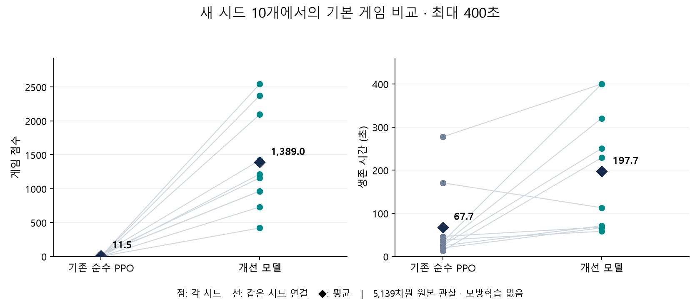

# 순수 PPO 점수 개선 결과

이 문서는 이전 006~014 단계의 기록이다. 현재 모델과 실행 방법은 [RESULTS_PHASE2.md](RESULTS_PHASE2.md)에 있다.

모방학습 없이 원본 5,139차원 관찰을 사용했다. 개체 인코더·지형 CNN과 조준 신경망을 PPO로 학습했다.
마지막 단계는 학습한 조준을 고정하고, 변경하지 않은 기본 게임에서 이동·성장 선택을 학습했다.
이전 005 순수 PPO 모델과 비교하며, 이전 혼합학습 모델은 비교 기준이나 초기 가중치로 쓰지 않았다.

## 모델 선택 후 새 시드 10개에서 비교

기본 GameConfig의 벽·발사하는 적 9기·체력·점수 규칙을 그대로 사용했다.
두 모델 모두 결정적 실행, frame_skip=4, 최대 6,000 환경 step=400초 조건이다.
시드 7001·7102·7203·7304·7405·7506·7607·7708·7809·7910은 학습·모델 선택에 사용하지 않았다.

| 지표 | 기존 순수 PPO | 개선 모델 |
|---|---:|---:|
| 평균 최종 점수 | 11.5 | **1,389.0** |
| 점수 중앙값 | 0 | **1,187.5** |
| 200초 시점 평균 점수¹ | 9.5 | **1,185.0** |
| 평균 생존 | 67.7초 | **197.7초** |
| 평균 적 처치 | 0 | **3.7기** |
| 400초 도달 | 0/10 | **2/10** |

¹ 200초 전에 사망한 판은 사망 시점 점수다. 더 오래 플레이한 차이만으로 개선된 것은 아니다.

점수는 10/10, 생존은 9/10 시드에서 개선됐다. 개선 모델의 점수 범위는 420~2,545점이다.
7809 시드는 점수가 35→965점으로 늘었지만 생존은 170.7→113.0초로 줄었다.
8/10 판은 400초 전에 사망했다. 모든 맵이나 더 긴 플레이에서의 생존·고득점을 보장하지 않는다.



- [원시 평가 JSON](heldout_400_seconds.json), [시드별 CSV](heldout_comparison.csv), [집계 JSON](results_summary.json).
- [선택 시점·모델 해시](candidate_selection.json). 선택 후 모델·설정을 바꾸지 않았다.
- 선택 기록의 PowerShell 배열 처리로 경로·해시 필드가 비었던 문제를 수정했다.
  불완전한 원본도 보존했으며, 테스트 전 해시 기록 및 실제 평가 명령의 체크포인트와 일치함을 다시 검사했다.

## 실험과 검증 기록

9개 개선 실험에서 총 2,193,408 step을 실행했다. 선택 모델 자체는 1,339,392 step이다.
반복 사용한 검증 6시드에서는 200초 1,459.2점, 400초 1,565.0점이었다.
이는 위의 독립 10시드 결과와 구분한다. 실험별 실행 시간에는 해당 실험 안의 평가 시간도 포함된다.

- [RESEARCH.md](RESEARCH.md): 각 가설·수정 이유·실패·수치·다음 판단.
- [experiment_summary.csv](experiment_summary.csv): 실험별 설정과 성과 비교.
- 각 실행의 `experiment.json`: 목표·전체 설정·부모 모델·소스 사본 해시.
- `episodes.jsonl`: 실제 점수·처치·생존·보상 항목별 누적값.
- `evaluations.jsonl`: 고정 조건 평가와 정확한 평가 체크포인트 해시.
- `tensorboard/`: PPO·게임·보상·검증 곡선과 목표/가설 텍스트. 014의 `final_comparison`에 독립 테스트도 기록했다.
- [검사 결과](final_model_checks.json): 원본 관찰, 순수 PPO 경로, PPO 업데이트, 보상 합, 저장/재로드 검사 통과.
  실제 최종 모델에서도 조준 가중치 보존과 지형 CNN 변경을 확인했다.
- [실제 게임 화면](visual_final_validation/frames.json): 검증 시드 101의 점수·행동·강화 상태와 PNG.
  200초에 1,835점·5처치였으며 223.5초에 1,935점으로 사망했다.

## 재생과 TensorBoard

프로젝트 루트 PowerShell에서 실행한다. 기본 모델 `pure_ppo_model.zip`은 선택 체크포인트와 해시가 같다.

```powershell
$env:PYTHONPATH = "$PWD/src"
$env:PYTHONDONTWRITEBYTECODE = "1"
$py = "src/space_z/rl/gpt_training/.venv/Scripts/python.exe"
& $py -B -m space_z.rl.gpt_training.play --seed 101 --max-steps 6000 --zoom 0.35
```

```powershell
& src/space_z/rl/gpt_training/.venv/Scripts/tensorboard.exe --logdir src/space_z/rl/gpt_training/experiments
```

학습 환경 worker는 최대 6개, Windows 실행기·조정 프로세스를 포함해 최대 8개였다.
TensorBoard 서버는 자동 실행하지 않았다. 코드·결과·의존성·캐시는 모두 gpt_training 안에 두었다.
공유 소스·맵 47개는 시작 시점 해시와 같으며 개인 폴더는 수정하지 않았다.
