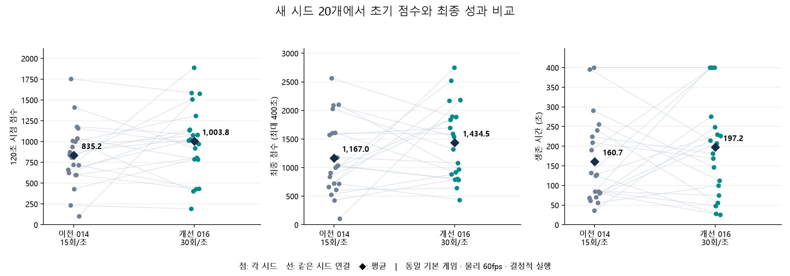

# 초기 점수와 하위 성적 개선 결과

이전 공개 모델 **014**와 비교했다. 첫 개선 이전의 005와 비교한 수치는 [이전 결과](RESULTS.md)에 보존했다.
이번에는 추가 학습 3건과 행동 주기 조정을 시험하고, 후보를 고정한 뒤 새 시드 20개에서 확인했다.

## 독립 20시드 · 기본 게임 · 최대 400초

두 모델 모두 원본 5,139차원 관찰, 동일 기본 GameConfig, 물리 60fps, 결정적 실행이다.
이전 모델은 4프레임마다, 개선 모델은 2프레임마다 행동을 선택한다.
각 모델의 스텝 수를 달리 계산해 **게임 시간 400초**를 동일하게 맞췄다.

| 지표 | 이전 014 | 개선 모델 |
|---|---:|---:|
| 60초 평균 점수 | 636.75 | **687.25** |
| 120초 평균 점수 | 835.25 | **1,003.75** (+20.2%) |
| 120초 점수 p25 | 618.75 | **788.75** (+27.5%) |
| 120초 점수 중앙값 | 825.00 | **1,020.00** |
| 120초 내 1,000점 도달 | 7/20 | **11/20** |
| 최종 평균 점수 | 1,167.00 | **1,434.50** (+22.9%) |
| 최종 점수 중앙값 | 1,012.50 | **1,432.50** |
| 최종 최저 점수 | 105 | **435** |
| 평균 생존 | 160.69초 | **197.18초** (+22.7%) |
| 평균 적 처치 | 3.55 | **4.70** |
| 400초 도달 | 1/20 | **4/20** |

p25는 점수를 작은 순서로 정렬했을 때의 25백분위 경계다. 해당 시점 전에 사망하면 마지막 점수를 사용한다.
평균·중앙값·하위 성적이 올랐지만 **개별 시드의 최종 점수는 10판 상승, 10판 하락**이었다.
16/20은 400초 전에 사망했다. 모든 맵이나 더 긴 플레이의 생존을 보장하지 않는다.



- [원시 평가](phase2_heldout_400_seconds.json), [시드별 CSV](phase2_heldout_comparison.csv), [집계 JSON](phase2_results_summary.json).
- [후보 선택 시간·해시·새 시드 목록](phase2_candidate_selection.json).
  17001~17910, 18001~18910으로 지정한 20개 시드는 후보 선택 후 처음 사용했으며 테스트 중 변경하지 않았다.
- 평가 4개를 병렬 실행했다. Windows 실행기까지 합해 최대 8개 Python 프로세스를 사용했다.

## 실제로 바꾼 것

- **016 추가 학습:** 실제 점수 배율은 유지하고 부분 피해·정렬된 발사의 보조 보상을 줄였다.
  피격·사망 비용을 높인 score_v6로 이동·성장·지형 인코더를 추가 학습했다. 조준 가중치는 보존했다.
- **018 재생 주기 조정:** 그 가중치를 다시 학습하지 않고 행동 주기를 4→2프레임으로 조정했다.
  모델의 `decision_frame_skip=2`로 보존해 재생·평가·화면 저장이 같은 주기를 사용한다.
- 원래 검증 6시드만으로 판단하지 않고 이미 관측했던 총 16시드에서 비교한 뒤 후보를 골랐다.
  [개발 비교 CSV](phase2_development_comparison.csv)에 각 가중치와 주기 조합의 결과가 있다.
- 단순 추가 학습 015, 조준만 추가 학습한 017, 샘플링 실행, 1·3프레임 주기는 최종 후보로 채택하지 않았다.
  실패와 판단 과정은 [RESEARCH_PHASE2.md](RESEARCH_PHASE2.md)에 남겼다.
- 이번 추가 학습량은 총 **530,432 step**이다. 선택된 분기는 이전 모델에서 **135,168 step**을 더 학습했다.
  선택 모델 자체의 누적 timesteps는 **1,474,560**이다. 018의 주기 조정에는 추가 PPO 학습이 없었다.
- 이동·조준·발사·강화·진화는 모두 PPO로 학습한 정책이 선택한다. 시연·모방학습·자동 성장 규칙은 사용하지 않았다.

## 재생

프로젝트 루트 PowerShell에서 실행한다. 기본 `pure_ppo_model.zip`을 새 후보로 갱신했다.

```powershell
$env:PYTHONPATH = "$PWD/src"
$env:PYTHONDONTWRITEBYTECODE = "1"
& src/space_z/rl/gpt_training/.venv/Scripts/python.exe -B -m space_z.rl.gpt_training.play --seed 505 --max-seconds 400 --zoom 0.35
```

이전 명령의 `--max-steps 6000`은 현재 2프레임 주기에서 200초다. 게임 시간을 지정하려면 `--max-seconds`를 사용한다.
모델에 저장된 주기를 기본으로 읽으며 `--frame-skip`으로 덮어쓰면 다른 조건의 재생이다.

실패를 확인했던 검증 시드 505도 화면으로 확인했다. 이전은 26.3초·220점에 사망했고,
새 후보는 [24초](visual_phase2_selected_seed505/step_000720.png)에 465점,
[200초](visual_phase2_selected_seed505/step_006000.png)에 2,320점·8처치·체력 200·twin 선체로 생존했다.
이 사례는 위 독립 20시드 집계와 구분한다.

## 로그·검사·복원

```powershell
& src/space_z/rl/gpt_training/.venv/Scripts/tensorboard.exe --logdir src/space_z/rl/gpt_training/experiments
```

- 015~017에는 목표·가설·설정·보상 항목·에피소드·주기 평가·가중치·소스 사본을 보존했다.
- 018의 `tensorboard/final_comparison`에 독립 테스트 평균·p25·그림과 프로토콜을 기록했다.
- [실제 모델 검사](phase2_model_checks.json): 입력·행동 공간, 고정한 조준/이동 가중치, 원본 대비 학습된 CNN,
  보존된 재생 주기, 후보/공개 파일 해시, 평가 시드·400초 조건을 확인했다.
- 실제 렌더링 코드의 SDL dummy 검사에서 워밍업 후 2게임초에 약 2.13실제초가 걸렸다.
  물리 FPS 목표는 그대로이며 추론·화면 갱신 빈도는 15→30회/초다. CPU 비용은 늘고 표시 성능은 실행 환경에 따라 달라질 수 있다.
- 이전 014 체크포인트는 그대로다. 이전 공개 메타데이터는 `pure_ppo_model_before_phase2.json`에 보존했다.
  현재 출처·해시는 `pure_ppo_model.json`에서 확인한다.
- 코드·결과·캐시·의존성은 gpt_training 안에만 두었으며 공유 소스·맵과 개인 폴더는 수정하지 않았다.
