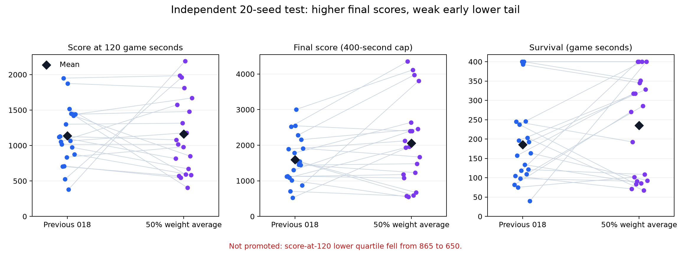

# 추가 학습 결과: 고득점 후보 보존, 기본 모델 유지

**기본 `pure_ppo_model.zip`은 기존 018로 유지했다.**
추가 실험에서 평균 점수와 생존이 높은 후보를 얻었지만, 새 시드에서 초반 하위 점수가 나빠져 사전 교체 기준을 통과하지 못했다.

## 고득점 실험 후보의 새 20시드 비교

두 모델 모두 기본 게임·원본 5,139차원 관찰·동일 이산 행동·물리 60fps·2프레임마다 결정적 행동 선택·최대 400초다.
후보와 해시를 고정한 뒤 31001~32910의 20개 새 시드를 처음 사용했다.
이전 보고서와 시드가 다르므로 아래 표 안의 두 모델을 서로 비교한다.

| 지표 | 기존 018 | 실험 후보: 50% 가중치 평균 |
|---|---:|---:|
| 120초 평균 점수 | 1,139.00 | 1,163.50 (+2.2%) |
| 120초 점수 p25 | **865.00** | **650.00 (-24.9%)** |
| 최종 평균 점수 | 1,591.25 | **2,057.75 (+29.3%)** |
| 최종 점수 중앙값 | 1,495.00 | **1,947.50** |
| 최종 점수 p25 | 1,112.50 | 1,151.25 |
| 평균 생존 | 185.72초 | **235.43초 (+26.8%)** |
| 생존 중앙값 | 160.45초 | 277.98초 |
| 생존 p25 | 107.88초 | 92.27초 |
| 120초 내 1,000점 도달 | 13/20 | 11/20 |
| 400초 생존 | 2/20 | 4/20 |

p25는 25백분위 경계다. 시점 전에 사망하면 마지막 점수를 사용한다. 생존은 400초에서 관측을 종료한다.
최종 점수는 12판 상승·8판 하락했다. 모든 판이나 모든 시작 상황의 안정성이 좋아진 것은 아니다.



- [원시 결과](phase3_blend_heldout_400_seconds.json), [집계·paired bootstrap 구간](phase3_blend_results_summary.json), [시드별 CSV](phase3_blend_heldout_comparison.csv).
- [테스트 전 후보·시각·해시 고정 기록](phase3_blend_candidate_selection.json).
- 최종 평균 점수 차이의 paired bootstrap 95% 구간은 +49.75~+909.50점이다.
  생존 차이는 -7.23~+110.68초로 0을 포함한다. 표본 20개와 400초 범위를 넘어선 개선을 보장하지 않는다.

평균 점수·초반 평균·평균 생존은 올랐지만 **초반 p25가 사전 기준에 미달했다.**
따라서 기본 모델을 교체하지 않고, 이 체크포인트를 실험 후보로만 보존했다.

## 실제로 진행한 것

| 실험 | 실제 추가 PPO 스텝 | 내용 |
|---|---:|---|
| 019 | 202,752 | 재생과 같은 2프레임에서 이동·성장·CNN 이어 학습, 조준 고정 |
| 020 | 131,072 | 019에서 이어 학습, gamma를 sqrt(0.995)로 조정 |
| 021 | 131,072 | 019에서 몸체 가중치를 고정하고 조준·발사만 추가 학습 |
| 022 | 0 | 기존 018과 추가 학습 020의 가중치 25%·50%·75% 평균 비교 |

- 이번 PPO 실행량은 **464,896 step**이다. 020 부모 분기는 018에서 +333,824, 누적 **1,808,384 step**이다.
- 가중치 평균은 학습 업데이트가 아니다. 평균 과정의 추가 PPO 스텝은 0이다.
  두 부모는 모두 순수 PPO로 학습했고, 이번 작업 전체에 시연·모방학습은 사용하지 않았다.
- 첫 독립 테스트에서는 직접 추가 학습 후보 020의 최종 평균이 1,561.25→1,764.75로 올랐지만
  생존은 240.23→195.09초로 떨어졌다. [실패한 첫 테스트](phase3_results_summary.json)도 그대로 남겼다.
- 그 뒤 기존 018과 020 가중치를 평균했다. 개발 8시드로 비율을 고르고, 개발 40시드에서 확인한 후
  또 다른 새 20시드를 테스트했다. 첫 테스트의 시드는 두 번째 단계에서는 개발용으로 명시했다.
- 50% 후보는 개발 40시드에서 120초 평균/p25, 200초 평균, 제한 생존 네 기준을 모두 넘었지만
  새 테스트에서는 초반 p25가 회귀했다. 새 테스트에 맞춰 다른 비율을 다시 고르지 않았다.
- 020은 gamma 외에도 이어 학습·seed·병렬 환경 수가 달라졌다. 성능 차이를 gamma 단독 효과로 해석하지 않는다.
- 전체 과정·실패·판단은 [RESEARCH_PHASE3.md](RESEARCH_PHASE3.md), 최종 파일 선택은 [결정 JSON](phase3_final_decision.json)에 있다.

## 직접 재생

프로젝트 루트 PowerShell에서 실험 후보를 명시한다. 기본 재생 명령은 계속 기존 018을 사용한다.

```powershell
$env:PYTHONPATH = "$PWD/src"
$env:PYTHONDONTWRITEBYTECODE = "1"
$py = "src/space_z/rl/gpt_training/.venv/Scripts/python.exe"
$checkpoint = "src/space_z/rl/gpt_training/experiments/022_checkpoint_blend/checkpoints/blend_050.zip"
& $py -B -m space_z.rl.gpt_training.play $checkpoint --seed 31001 --max-seconds 400 --no-stochastic --zoom 0.35
```

같은 시드의 기존 모델은 다음 명령으로 비교한다.

```powershell
& $py -B -m space_z.rl.gpt_training.play --seed 31001 --max-seconds 400 --no-stochastic --zoom 0.35
```

실험 후보 SHA256은 `71665f9ad32efb8467d150f29213944691f74dde143af2b96107c6a2f6f32cef`다.
실험 폴더의 `best.zip`은 중간 검증 시드의 선택 결과이며, 보고서의 최종 실험 후보와 다를 수 있다.

개발 시드 505의 실제 화면도 확인했다. 평균 후보는 [134.92초·1,985점·9처치에서 사망](visual_phase3_blend050_seed505/step_004048.png)했다.
기존 018이 같은 시드의 200초에 2,320점으로 생존한 것과 비교하면 이 사례는 회귀다.
이 화면 사례를 새 20시드의 평균 개선으로 대체해 설명하지 않는다.

## 기록과 검증

```powershell
& src/space_z/rl/gpt_training/.venv/Scripts/tensorboard.exe --logdir src/space_z/rl/gpt_training/experiments
```

- 019~021: 가설·전체 설정·부모/소스 해시·정확한 평가 ZIP·에피소드 JSONL·평가 JSONL·TensorBoard.
- 020의 `tensorboard/phase3_independent_round1`: 실패한 첫 독립 테스트.
- 022의 `tensorboard/development`, `tensorboard/phase3_final_comparison`: 평균 비율 비교·40시드 검증·두 번째 독립 테스트.
- [평균 후보 생성 코드](experiments/022_checkpoint_blend/create_candidates.py)와 소스 사본을 보존했다.
  동일 텐서는 정확히 복사하고, 변경된 가중치의 Adam 모멘트는 비웠다. 저장·로드 후 가중치와 예측을 확인했다.
- 선별 8시드를 40시드 평가에서 반복했을 때 모든 에피소드 평가값이 일치했다.
- [직접 학습 모델 검사](phase3_model_checks.json), [평균 모델 검사](phase3_blend_model_checks.json), [최종 범위 검사](phase3_scope_check.json).
- 변경·결과·캐시는 `gpt_training/` 안에만 두었다. Python 프로세스 최대 8개를 지켰고 공유 소스·맵 47개의 해시를 확인했다.
- 모든 맵·400초 이후 생존·다른 PC나 라이브러리 버전의 동일 결과는 확인하지 않았다.
